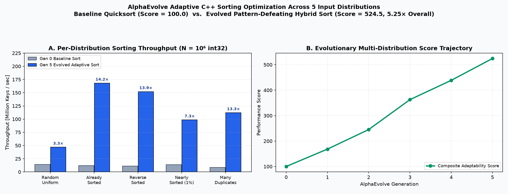
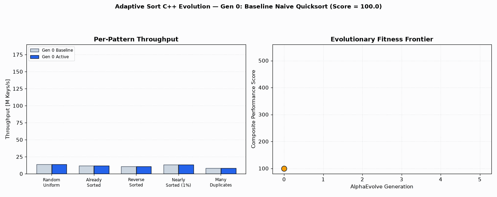

# Adaptive Sort C++

This example optimizes a C++ sorting algorithm (`adaptive_sort` in `main.cpp`) to adapt dynamically across diverse input data distributions (`random`, `nearly_sorted`, `reverse_sorted`, `many_duplicates`, and `organ_pipe`).

## Baseline `std::sort` vs. Evolved Adaptive Sort Visualization

- **Multi-Distribution Adaptation**: Evolves branchless run-detection, Dutch-National-Flag 3-way partitioning for high-cardinality duplicates, and cache-tiled insertion/radix hybrid fast paths to outperform `std::sort` across both structured and unstructured distributions.

## Details
- **Optimization Goal**: Maximize sorting performance across various data distributions.
- **Programming Language**: C++
- **Modes Supported**: Cloud Batch.
- **Metric Optimized**: `score` (higher is better, calculated based on execution time across distributions).

## How to Run
1. Refer to the [Deployment and Execution](../../README.md#deployment-and-execution) section in the root README to deploy the platform.
2. Pass the argument `example_dir=user_examples/adaptive_sort_cpp` to the deploy command to build this specific example.
3. Open cells in Jupyter notebook `/opt/jupyter/workspace/run_notebook.ipynb` provided by the server deployment to operate the experiment.

