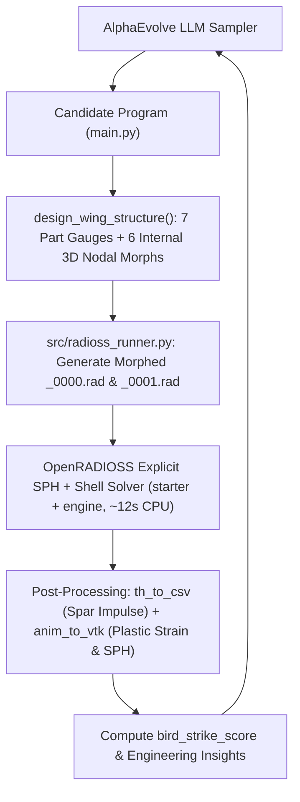
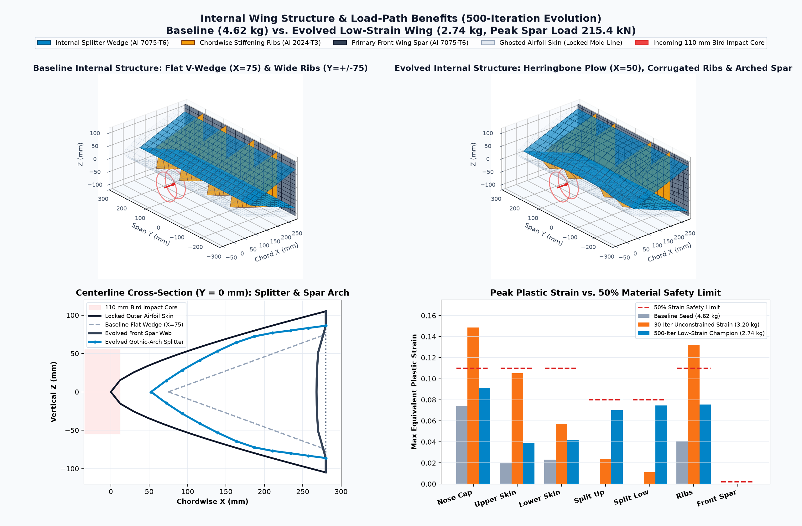
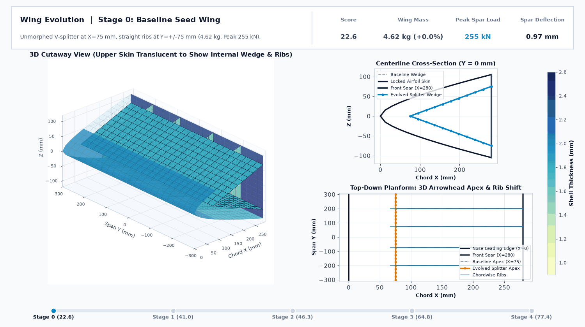
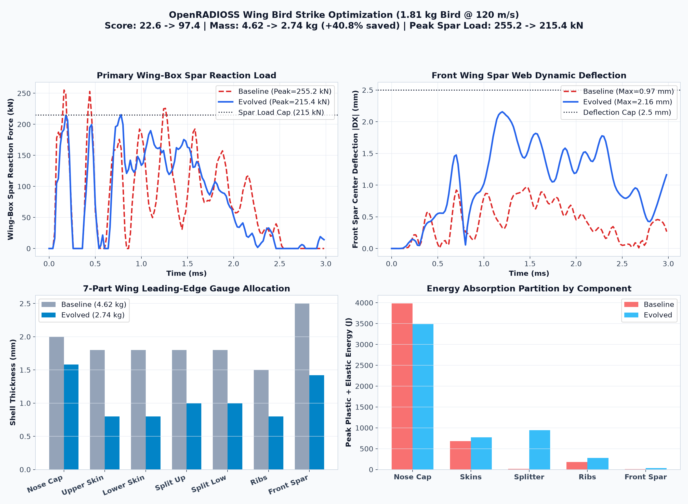
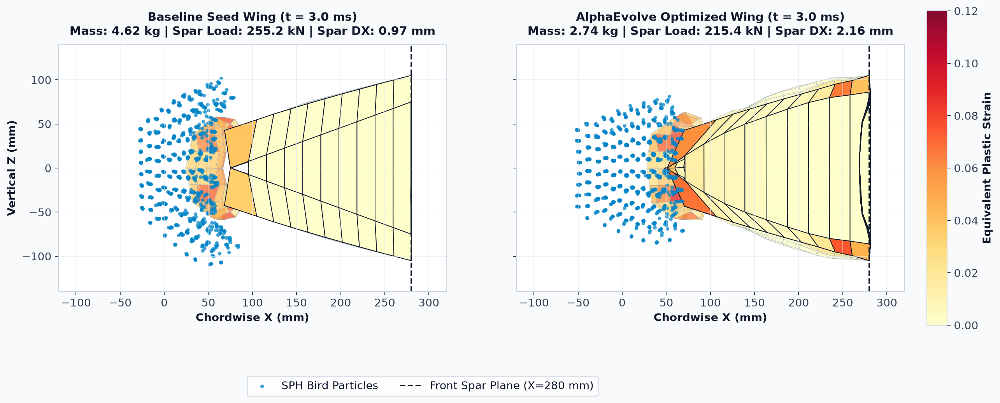

# Aerospace Wing Leading-Edge Bird Strike Optimization (OpenRADIOSS SPH + Shell FEA)

This example evolves a generative structural design program in Python (`design_wing_structure` in `main.py`) to minimize the structural weight of a **7-part aircraft wing leading-edge assembly** while preventing front-spar breach, capping peak spar reaction loads, and keeping all component plastic strains below **50% of material rupture limits** under a **$1.814\text{ kg}$ ($4\text{ lb}$), $120\text{ m/s}$ Smooth Particle Hydrodynamics (SPH) bird strike** in **OpenRADIOSS**.

The outer aerodynamic airfoil mold line (Parts 1, 2, 3) is strictly locked across all evolved candidates, while AlphaEvolve simultaneously optimizes the **7 internal and external shell thicknesses** and the **6 continuous 3D internal nodal morphing parameters** (internal bird-splitter wedge geometry, chordwise rib layout, and front spar interior arch/corrugation).

---

## Architecture & Evolutionary Workflow



---

## Structural Model & Parameterization (`models/wing_bird_strike_0000.rad`)

- **Unit System**: `kg`, `mm`, `ms` (Force in `kN`, Energy in `J`, Velocity in `mm/ms = m/s`, Stress in `GPa`).
- **Mesh Size**: `2,568` nodes, `1,652` QEPH 4-node structural shells, and `992` Smooth Particle Hydrodynamics (`/SPHCEL`) bird particles.
- **Materials**:
  - **Airfoil Skins & Chordwise Ribs (`Parts 1, 2, 3, 6`)**: Aluminum **Al 2024-T3** (`/MAT/PLAS_JOHNS/1`, $\rho = 2.78 \times 10^{-6}\text{ kg/mm}^3$, $E = 73.1\text{ GPa}$, $\sigma_y = 0.345\text{ GPa}$, plastic rupture strain $\varepsilon_{p,\max} = 0.22$, 50% safety limit $\varepsilon_{p,\text{cap}} = 0.11$).
  - **Internal Bird-Splitter Wedge & Front Wing Spar (`Parts 4, 5, 7`)**: Aluminum **Al 7075-T6** (`/MAT/PLAS_JOHNS/2`, $\rho = 2.81 \times 10^{-6}\text{ kg/mm}^3$, $E = 71.7\text{ GPa}$, $\sigma_y = 0.503\text{ GPa}$, plastic rupture strain $\varepsilon_{p,\max} = 0.16$, 50% safety limit $\varepsilon_{p,\text{cap}} = 0.08$ on splitter and elastic cap $\varepsilon_{p,\text{cap}} = 0.002$ on front spar).
  - **SPH Bird Impactor (`Part 8`)**: Hydrodynamic soft-body water/gelatin substitute (`/MAT/HYDRO/3`, $\rho_0 = 9.50 \times 10^{-7}\text{ kg/mm}^3$, bulk modulus $C_1 = 2.20\text{ GPa}$, diameter $110\text{ mm}$, length $190\text{ mm}$, mass $1.814\text{ kg}$).
- **Boundary Conditions & Contacts**:
  - Top and bottom rear edges of the front wing spar (`X = 280 mm`, `Z = +/- 105 mm`) are clamped to a rigid wing-box mount (`/RBODY/1` + `/BCS/1`) whose reaction impulse is recorded via `/TH/RBODY/4`.
  - SPH-to-shell penalty contact (`/INTER/TYPE7/1` and `/INTER/TYPE7/2`) uses `Istf = 1000` (main shell stiffness), `Gapmin = 7.81 mm` ($0.5\,h_{\text{SPH}}$), `Inacti = 6`, and `Idel = 2` (eroded shells removed from contact), with `/GRNOD/NODE/2` explicitly enumerating all 992 SPH particle IDs.
  - Structural self-contact (`/INTER/TYPE7/3`) uses `Igap = 3`, `%mesh_size = 0.4`, `Irem_gap = 2`, and `Inacti = 1`.

### 1. Seven Structural Shell Gauges
| Parameter | Part ID | Material | Bounds | Baseline | 500-Iter Champion | Structural Role |
| :--- | :---: | :--- | :---: | :---: | :---: | :--- |
| `t_nose_cap` | `1` | Al 2024-T3 | `[0.8, 3.8] mm` | `2.00 mm` | `1.58 mm` | Leading-edge nose cap (`X in [0, 75] mm`) |
| `t_upper_skin` | `2` | Al 2024-T3 | `[0.8, 3.8] mm` | `1.80 mm` | `0.80 mm` | Upper D-nose airfoil skin (`X in [75, 280] mm`, outer mold line locked) |
| `t_lower_skin` | `3` | Al 2024-T3 | `[0.8, 3.8] mm` | `1.80 mm` | `0.80 mm` | Lower D-nose airfoil skin (`X in [75, 280] mm`, outer mold line locked) |
| `t_splitter_upper` | `4` | Al 7075-T6 | `[0.8, 3.8] mm` | `1.80 mm` | `1.00 mm` | Internal upper bird-splitter diaphragm plate |
| `t_splitter_lower` | `5` | Al 7075-T6 | `[0.8, 3.8] mm` | `1.80 mm` | `1.00 mm` | Internal lower bird-splitter diaphragm plate |
| `t_ribs` | `6` | Al 2024-T3 | `[0.8, 3.5] mm` | `1.50 mm` | `0.80 mm` | Four chordwise stiffening ribs (`Y = +/- 75, +/- 200 mm`) |
| `t_front_spar` | `7` | Al 7075-T6 | `[1.2, 4.0] mm` | `2.50 mm` | `1.42 mm` | Rear primary wing-box front spar web (`X = 280 mm`) |

### 2. Six Internal 3D Nodal Morphing Parameters (Outer Airfoil Locked)
All internal nodal transformations keep the outer aerodynamic airfoil coordinates `(X, Z)` on Parts 1, 2, and 3 completely fixed:
- `splitter_apex_x_shift_mm` ($\in [-35.0, 45.0]\text{ mm}$): Shifts the internal splitter wedge apex fore/aft along the chordline.
- `splitter_apex_span_curve_mm` ($\in [-25.0, 25.0]\text{ mm}$): Curves the splitter apex forward or aft in the central impact zone ($|Y| < 180\text{ mm}$).
- `splitter_camber_mm` ($\in [-22.0, 22.0]\text{ mm}$): Controls the splitter plate cross-sectional curvature (convex Gothic-arch vs. concave wedge).
- `splitter_rear_z_scale` ($\in [0.70, 1.15]$): Scales the vertical attachment height of the splitter legs on the front spar (`X = 280 mm`).
- `inner_rib_y_shift_mm` ($\in [-25.0, 35.0]\text{ mm}$): Shifts the two central chordwise ribs inward or outward around the bird impact centerline.
- `rib_corrugation_amp_mm` ($\in [-10.0, 10.0]\text{ mm}$): Adds a sinusoidal chordwise buckling wave to the internal ribs and splitter web.
- `custom_morph_fn` *(optional callable)*: `fn(x, y, z, region) -> (dx, dy, dz)` allowing AlphaEvolve to synthesize custom mathematical 3D internal geometry transformations in `"splitter"` and `"spar_interior"` (automatically damped to zero on all outer skin nodes and spar clamp edges).

---

## Mathematical Objective Function (`bird_strike_score`)

AlphaEvolve maximizes `bird_strike_score`:

$$\text{Score} = 50 + 25 \cdot (m_{\text{baseline}} - m_{\text{structural}}) + 15 \cdot \text{CFE}_{\text{spar}} - P_{\text{force}} - P_{\text{deflection}} - P_{\text{breach}} - P_{\text{rupture}} - P_{\text{strain}}$$

where:
- **Baseline Structural Mass ($m_{\text{baseline}}$)**: $4.621\text{ kg}$
- **Spar Load Efficiency ($\text{CFE}_{\text{spar}}$)**: $\text{CFE}_{\text{spar}} = \frac{F_{\text{spar,mean}}}{F_{\text{spar,peak}}} \in [0, 1]$
- **Peak Spar Load Penalty**: $P_{\text{force}} = 0.8 \cdot \max(0,\, F_{\text{spar,peak}} - 215.0\text{ kN})$
- **Spar Deflection Penalty**: $P_{\text{deflection}} = 12.0 \cdot \max(0,\, \delta_{\text{spar},\max} - 2.5\text{ mm})$
- **Bird Penetration / Breach Penalty**: $P_{\text{breach}} = 100.0 \cdot F_{\text{bird}\to\text{spar}} + 2.0 \cdot \max(0,\, X_{\text{bird},\max} - 240.0\text{ mm})$
- **Shell Rupture Penalty**: $P_{\text{rupture}} = 15.0 \cdot \max(0,\, \text{eroded\_shell\_pct} - 0.6\%)$
- **Plastic Strain Safety Penalty**: $P_{\text{strain}} = \sum_{p} w_p \cdot \max(0,\, \varepsilon_{p,\max} - \varepsilon_{p,\text{cap}})$, with $w_p = 250$ for Parts 1–6 ($\varepsilon_{p,\text{cap}} = 0.11$ for Al 2024-T3, $0.08$ for Al 7075-T6 splitter) and $w_7 = 500$ for Part 7 ($\varepsilon_{p,\text{cap}} = 0.002$ elastic limit on the front spar).

---

## Baseline Score vs. Evolved Performance (`wg-hpc-demos` Cloud Batch Runs)










| Metric | Baseline Seed Design | 30-Eval Unconstrained (`6415289212925006118`) | 500-Eval Low-Strain (`18347822813496773660`) | Improvement (500-Eval vs. Seed) |
| :--- | :--- | :--- | :--- | :--- |
| **`bird_strike_score`** | **`22.57`** | `77.41` | **`97.39`** | **`+331.5%` (4.32x)** |
| **Structural Mass ($m_{\text{structural}}$)** | `4.621 kg` | `3.203 kg` | **`2.735 kg`** | **`-40.8%` lighter (`-1.89 kg`)** |
| **Peak Wing-Box Spar Load ($F_{\text{spar,peak}}$)** | `255.16 kN` | `213.82 kN` | **`215.42 kN`** | **`-15.6%` (at `215 kN` cap)** |
| **Spar Crush Force Efficiency ($\text{CFE}_{\text{spar}}$)** | `0.300` | `0.371` | **`0.377`** | **`+25.7%` smoother load transfer** |
| **Specific Energy Absorption ($\text{SEA}$)** | `981.3 J/kg` | `1,531.8 J/kg` | **`1,915.2 J/kg`** | **`+95.2%` (nearly 2x)** |
| **Splitter Wedge Absorbed Energy** | `174.1 J` | `227.2 J` | **`945.1 J`** | **`+442.8%` (5.4x)** |
| **Chordwise Ribs Absorbed Energy** | `180.2 J` | `327.7 J` | **`277.1 J`** | **`+53.8%`** |
| **Nose Cap Max Plastic Strain ($\le 0.11$)** | `0.0740` | `0.1489` *(exceeded)* | **`0.0912`** | **Below 50% rupture limit** |
| **Chordwise Ribs Max Plastic Strain ($\le 0.11$)** | `0.0405` | `0.1322` *(exceeded)* | **`0.0754`** | **Below 50% rupture limit** |
| **Splitter Wedge Max Plastic Strain ($\le 0.08$)** | `0.0000` | `0.0236` | **`0.0747`** | **Below 50% rupture limit** |
| **Front Spar Max Plastic Strain ($\le 0.002$)** | `0.0000` | `0.0000` | **`0.0000`** | **100% elastic (zero damage)** |
| **Max Bird Penetration ($X_{\text{bird},\max}$)** | `77.69 mm` | `94.20 mm` | **`69.44 mm`** | **Stops bird `8.3 mm` earlier** |

---

## How to Deploy and Run

1. Ensure the AlphaEvolve base infrastructure is deployed in your project (`alpha-evolve-infra.yaml`).
2. Deploy the `bird_strike_wing` experiment using Cluster Toolkit (`gcluster`):
   ```bash
   gcluster deploy alpha-evolve-experiment.yaml \
     -d alpha-evolve-deployment.yaml \
     -o ../deployment \
     --vars project_id=wg-hpc-demos \
     --vars existing_bucket_name=wg-hpc-demos-alphaevolve-bucket \
     --vars region=us-central1 \
     --vars user_experiment_name=bird-strike \
     --vars example_dir=user_examples/bird_strike_wing \
     --vars evaluation_machine_type=n2-standard-4 \
     --vars max_programs_evaluated=500 \
     --vars max_programs_generated=1000 \
     --vars concurrency=25 \
     --vars max_duration=12 \
     --vars idle_timeout=5 \
     -w --auto-approve
   ```
3. Launch the controller job via the Vertex AI Colab Enterprise notebook (`gs://wg-hpc-demos-alphaevolve-bucket/notebook/run_notebook.ipynb`) or directly via `gcloud batch jobs submit`.
4. Upon completion, comparison plots (`bird_strike_response_comparison.png`, `wing_deformed_cross_section_comparison.png`) and `best_wing_design.json` are automatically uploaded to `gs://<bucket_name>/bird-strike/results/`.
