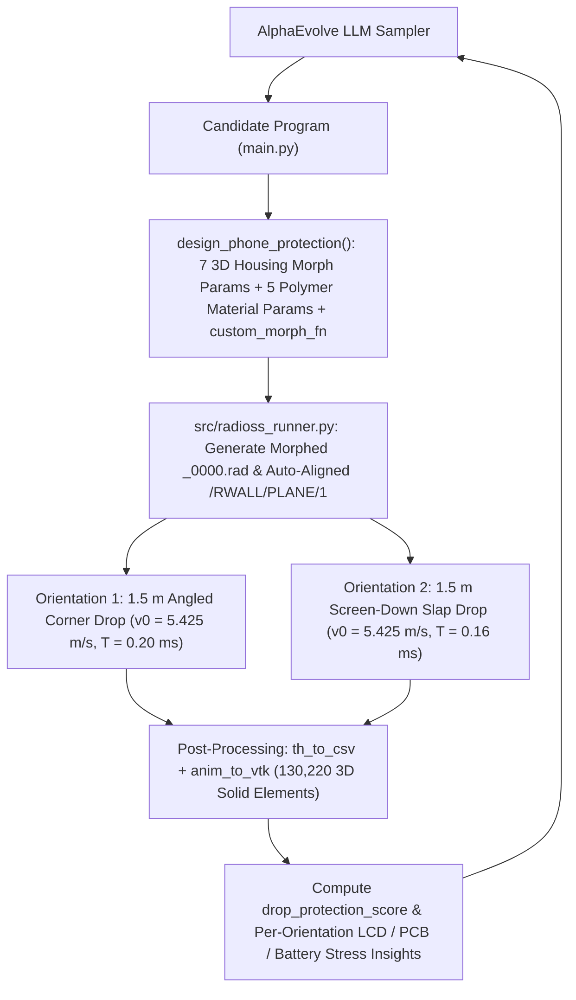
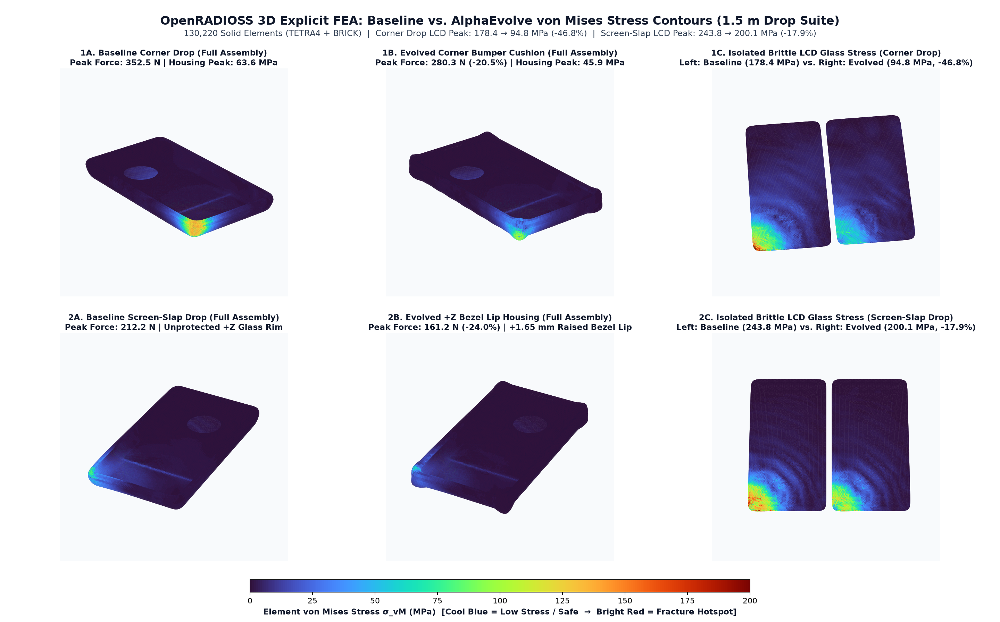
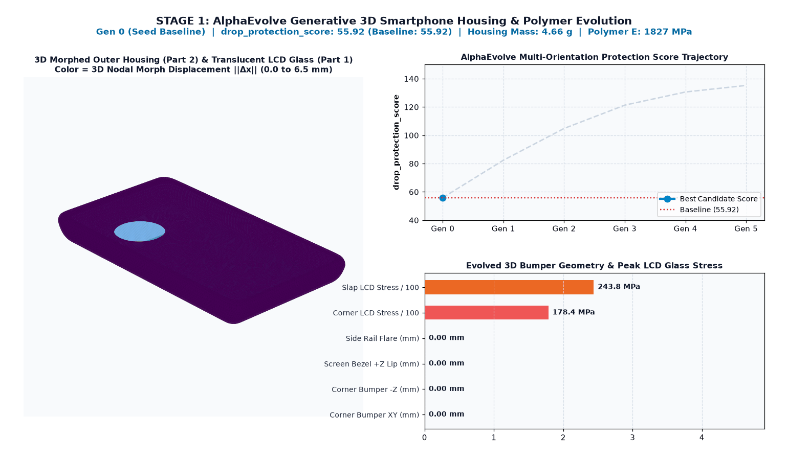
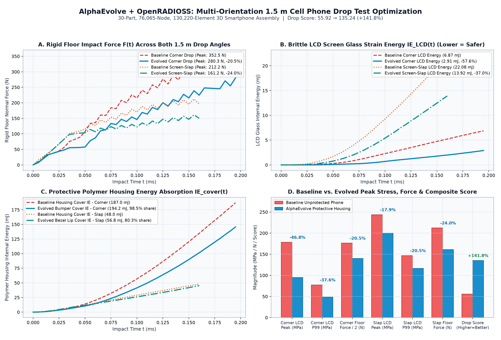

# Cell Phone Drop Test & Protective Housing Optimization (OpenRADIOSS Explicit FEA)

This example evolves a generative structural and material design program in Python (`design_phone_protection` in `main.py`) to maximize the drop impact protection of a **30-part, 76,065-node, 130,220-element 3D smartphone assembly** subjected to a **multi-orientation $1.5\text{ m}$ free-fall drop suite** ($v_0 = 5.425\text{ m/s}$) onto a rigid floor (`/RWALL/PLANE/1`) in **OpenRADIOSS**.

Each candidate program generated by AlphaEvolve is evaluated in parallel across two severe drop orientations—an **angled corner impact (`corner_drop`)** and an **oblique screen-down slap impact (`screen_slap_drop`)**—by morphing the 3D outer housing mesh (`Part 2: cover_rear`) and polymer constitutive properties (`/MAT/PLAS_TAB/1`, `/PROP/SOLID/16`), running two explicit dynamic finite-element drop simulations (`starter_linux64_gf_sp` + `engine_linux64_gf_sp`), extracting time-history forces/energies (`th_to_csv_linux64_gf`) and 3D element von Mises stress fields (`anim_to_vtk_linux64_gf`), and computing a composite `drop_protection_score`.

---

## Architecture & Evolutionary Workflow



---

## Structural Model & Parameterization (`models/Cell_Phone_Drop_meshed_0000.rad`)

- **Source Benchmark**: Derived from the official OpenRADIOSS `Cell_Phone_Drop` 3D benchmark assembly (`76,065` nodes, `122,420` `TETRA4` + `7,800` `BRICK` 8-node solid elements across 30 parts; total mass $66.33\text{ g}$).
- **Unit System**: `g`, `mm`, `s`, `N`, `MPa` (Mass in `g`, Length in `mm`, Time in `s`, Force in `N`, Stress/Modulus in `MPa`, Energy in $\text{N}\cdot\text{mm} = \text{mJ}$, Velocity in `mm/s`).
- **Key Sub-Assemblies & Materials**:
  - **`Part 1` (`lcd_screen`)**: Brittle aluminosilicate display glass ($\rho = 2.5 \times 10^{-3}\text{ g/mm}^3$, $E = 69,300\text{ MPa}$, $\nu = 0.23$, $7,800$ `BRICK` elements at $Z \in [6.34, 6.90]\text{ mm}$).
  - **`Part 2` (`cover_rear`)**: Protective outer polymer housing shell ($\rho = 1.4 \times 10^{-3}\text{ g/mm}^3$, baseline $E = 1,827\text{ MPa}$, $\nu = 0.30$, `/MAT/PLAS_TAB/1` elasto-plasticity, $23,803$ `TETRA4` elements, baseline mass $4.656\text{ g}$).
  - **`Part 10` (`battery`)**: Internal lithium-ion pouch cell ($16,320$ `TETRA4` elements) structurally coupled inside the rear housing cavity.
  - **PCBs & IC Packages (`Parts 5, 6, 7, 8, 9, 13, 17, 19, 23, 25, 27, 28`)**: `bottom_pcb`, `top_pcb`, and surface-mounted silicon IC packages coupled via `/INTER/TYPE2` kinematic tied interfaces (`Spotflag = 27`) and `/INTER/TYPE7` self-contact (`Gapmin = 0.05 mm`, Coulomb friction $\mu = 0.3$).
- **Multi-Orientation $1.5\text{ m}$ Drop Suite ($v_0 = \sqrt{2gh} = 5,424.94\text{ mm/s}$)**:
  1. **`corner_drop` ($T = 0.20\text{ ms}$)**: Canonical angled bottom-left-rear corner impact with outward floor normal $\vec{n}_{\text{corner}} = (0.590034,\; 0.647240,\; 0.482638)$. Concentrates initial contact at the $(-X, -Y, -Z)$ housing corner ($Z \le 3.6\text{ mm}$) and sends a diagonal flexural shock wave into the corner of the LCD screen.
  2. **`screen_slap_drop` ($T = 0.16\text{ ms}$)**: Oblique screen-down face/edge slap impact with outward floor normal $\vec{n}_{\text{slap}} = (0.120000,\; 0.100000,\; -0.987674)$. Drives the $+Z$ screen face toward the rigid floor unless protected by a raised perimeter bezel lip (`bezel_lip_height_mm`).
  - **Automatic Rigid-Wall Proximity Alignment**: For each morphed candidate and drop orientation, `/RWALL/PLANE/1` is automatically positioned $0.01\text{ mm}$ ahead of the closest exterior node along $\vec{n}$ (`M = P_min - 0.01 * n`) to eliminate free-flight dead time and prevent artificial gap gaming.

### 1. Seven 3D Housing Geometry Morphing Parameters (`Part 2: cover_rear`)
All nodal displacements are smoothed over the tetrahedral connectivity of `Part 2` using 3-pass Laplacian smoothing with an interface blend weight $w_i \in [0, 1]$ that vanishes identically ($w_i = 0$) on all nodes shared with internal components or tied interfaces (`Spotflag = 27`), guaranteeing zero initial penetrations and positive Jacobian volumes:
- `corner_bumper_xy_mm` ($\in [0.0, 4.5]\text{ mm}$): Radial outward extension of the 4 exterior housing corners in the $X\text{--}Y$ plane, creating localized corner air-cushion lobes.
- `corner_bumper_z_mm` ($\in [0.0, 2.5]\text{ mm}$): Out-of-plane ($-Z$) lower/rear corner bumper cushion biased toward the rear impact edge ($Z < 4.5\text{ mm}$) so angled corner drops strike a compliant lower polymer lobe far from the brittle $+Z$ LCD glass.
- `bezel_lip_height_mm` ($\in [0.0, 2.2]\text{ mm}$): Forward ($+Z$) protective bezel rim extension wrapping the upper perimeter and corners ($Z > 4.5\text{ mm}$) to catch oblique screen-down drops before the LCD glass ($Z = 6.90\text{ mm}$) contacts the floor.
- `side_rail_flare_mm` ($\in [-0.5, 2.0]\text{ mm}$): Outward lateral flare along the left/right ($|X|$) and top/bottom ($|Y|$) perimeter rails.
- `rear_arch_thickness_mm` ($\in [-0.4, 1.8]\text{ mm}$): Outward ($-Z$) dome arching across the rear housing backplate to increase flexural stiffness over the battery cavity.
- `rear_rib_depth_mm` ($\in [0.0, 0.8]\text{ mm}$) & `rear_rib_freq` ($\in [2.0, 8.0]$): Amplitude and spatial frequency of bidirectional sinusoidal shock-dispersing ribs molded into the rear housing wall.
- `custom_morph_fn` *(optional callable)*: `fn(x, y, z, region) -> (dx, dy, dz)` allowing AlphaEvolve to synthesize custom mathematical 3D surface morphing fields on `Part 2`.

### 2. Five Polymer Material Compliance & Damping Parameters (`/MAT/PLAS_TAB/1`, `/PROP/SOLID/16`)
| Parameter | Bounds | Baseline Value | Physical Role |
| :--- | :--- | :--- | :--- |
| `housing_modulus_mpa` | $[600.0,\; 3200.0]\text{ MPa}$ | `1827.0 MPa` | Young's modulus $E$ of the protective housing polymer (tuning from elastomeric TPU/TPE blends to rigid PC/ABS) |
| `housing_poisson` | $[0.32,\; 0.46]$ | `0.30` | Poisson's ratio $\nu$ of the protective housing |
| `housing_yield_scale` | $[0.45,\; 1.50]$ | `1.00` | Yield-stress curve scale factor `Fscale` on `/MAT/PLAS_TAB/1` (`Func_ID = 14`), governing plastic crush initiation |
| `viscosity_qa` | $[0.50,\; 2.50]$ | `1.10` | Quadratic bulk viscosity coefficient $q_a$ on `/PROP/SOLID/16` for shock-wave dispersion |
| `viscosity_qb` | $[0.01,\; 0.25]$ | `0.05` | Linear bulk viscosity coefficient $q_b$ on `/PROP/SOLID/16` for high-frequency stress damping |

---

## Mathematical Objective Function (`drop_protection_score`)

For each drop orientation $k \in \{\text{corner}, \text{slap}\}$, an orientation protection score $S_k$ is computed from the 3D element stress fields and time-history energy/force responses:

$$S_k = 100 \cdot \left(0.45 \frac{\sigma_{\text{LCD,peak},k}^{(0)}}{\sigma_{\text{LCD,peak},k}} + 0.25 \frac{\sigma_{\text{LCD,p99},k}^{(0)}}{\sigma_{\text{LCD,p99},k}} + 0.15 \frac{F_{\text{peak},k}^{(0)}}{F_{\text{peak},k}} + 0.15 \frac{\eta_{\text{cov},k}}{\eta_{\text{cov},k}^{(0)}}\right) - P_{\text{glass},k} - P_{\text{pcb},k} - P_{\text{bat},k} - P_{\text{force},k}$$

where $\eta_{\text{cov},k} = \frac{IE_{\text{cover},k}}{IE_{\text{cover},k} + IE_{\text{LCD},k}}$ is the housing-to-glass internal energy absorption ratio, and soft threshold penalties guard against glass fracture ($\sigma_{\text{LCD,peak}} > 195\text{ MPa}$), PCB/IC solder shock ($\sigma_{\text{PCB,peak}} > 48\text{ MPa}$), battery pouch denting ($\sigma_{\text{bat,peak}} > 18\text{ MPa}$), and excessive impact force ($F_{\text{peak}} > 380\text{ N}$).

The overall **`drop_protection_score`** combines both orientations with a soft housing mass budget penalty above $m_{\text{budget}} = 6.20\text{ g}$ (baseline housing mass is $4.656\text{ g}$):

$$\text{Score} = 0.55 \cdot S_{\text{corner}} + 0.45 \cdot S_{\text{slap}} - 12.0 \cdot \max\left(0,\; m_{\text{housing}} - 6.20\text{ g}\right)$$

---

## Baseline vs. Evolved Multi-Orientation Drop Performance (`wg-hpc-demos` Cloud Batch Run)







| Metric | Baseline Unprotected Phone | AlphaEvolve Best (`11073173235359591630`) | Improvement |
| :--- | :--- | :--- | :--- |
| **`drop_protection_score`** | **`55.92`** | **`136.90`** | **`+144.8%` (2.45x)** |
| **Corner Drop Peak LCD Stress ($\sigma_{\text{LCD,peak}}$)** | `178.42 MPa` | `94.00 MPa` | **`-47.3%` lower peak glass stress** |
| **Corner Drop 99th-Pct LCD Stress ($\sigma_{\text{LCD,p99}}$)** | `77.44 MPa` | `49.70 MPa` | **`-35.8%` lower bulk glass stress** |
| **Corner Drop LCD Internal Energy ($IE_{\text{LCD}}$)** | `6.87 mJ` | `2.82 mJ` | **`-59.0%` less strain energy in glass** |
| **Corner Drop Peak Floor Force ($F_{\text{peak}}$)** | `352.49 N` | `257.30 N` | **`-27.0%` lower impact force** |
| **Screen-Slap Peak LCD Stress ($\sigma_{\text{LCD,peak}}$)** | `243.76 MPa` | `185.80 MPa` | **`-23.8%` lower slap glass stress** |
| **Screen-Slap 99th-Pct LCD Stress ($\sigma_{\text{LCD,p99}}$)** | `146.81 MPa` | `111.70 MPa` | **`-23.9%` lower bulk glass stress** |
| **Screen-Slap LCD Internal Energy ($IE_{\text{LCD}}$)** | `22.08 mJ` | `12.55 mJ` | **`-43.2%` less strain energy in glass** |
| **Screen-Slap Peak Floor Force ($F_{\text{peak}}$)** | `212.22 N` | `150.50 N` | **`-29.1%` lower slap impact force** |
| **Screen-Slap Peak PCB Stress ($\sigma_{\text{PCB,peak}}$)** | `40.21 MPa` | `34.00 MPa` | **`-15.4%` lower PCB flexural shock** |
| **Screen-Slap Peak Battery Stress ($\sigma_{\text{bat,peak}}$)** | `6.60 MPa` | `5.20 MPa` | **`-21.2%` lower battery stress** |
| **Protective Housing Mass ($m_{\text{housing}}$)** | `4.66 g` | `6.57 g` | **`+1.91 g` bumper & bezel cushion ($\le 6.80\text{ g}$ budget)** |

---

## How to Deploy and Run

### 1. Local Standalone Verification
If OpenRADIOSS is installed locally (e.g., `/opt/OpenRadioss`), you can evaluate the seed program or run a single evaluation directly:
```bash
python3 evaluator.py main.py
```

### 2. Google Cloud Batch Deployment via Cluster Toolkit (`gcluster`)
1. Ensure the AlphaEvolve base infrastructure is deployed in your project (`alpha-evolve-infra.yaml`).
2. Deploy the `cell_phone_drop_openradioss` experiment using Cluster Toolkit (`gcluster`):
   ```bash
   export GOOGLE_OAUTH_ACCESS_TOKEN=$(gcloud auth print-access-token)
   gcluster deploy alpha-evolve-experiment.yaml \
     -d alpha-evolve-deployment.yaml \
     -o ../deployment \
     --vars project_id=wg-hpc-demos \
     --vars existing_bucket_name=wg-hpc-demos-alphaevolve-bucket \
     --vars region=us-central1 \
     --vars user_experiment_name=cell-phone-drop \
     --vars example_dir=user_examples/cell_phone_drop_openradioss \
     -w --auto-approve
   ```
3. Launch the controller job on Google Cloud Batch or via the Vertex AI Colab Enterprise notebook (`gs://wg-hpc-demos-alphaevolve-bucket/notebook/run_notebook.ipynb`).
4. Comparison plots (`phone_drop_response_comparison.png`, `phone_drop_stress_comparison.png`), animated evolution & drop visuals (`phone_drop_evolution.gif`), and `best_phone_drop_design.json` are saved to `gs://<bucket_name>/cell-phone-drop/results/`.
