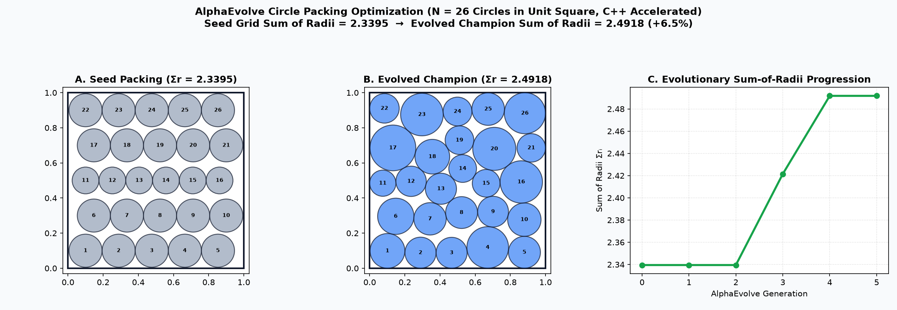
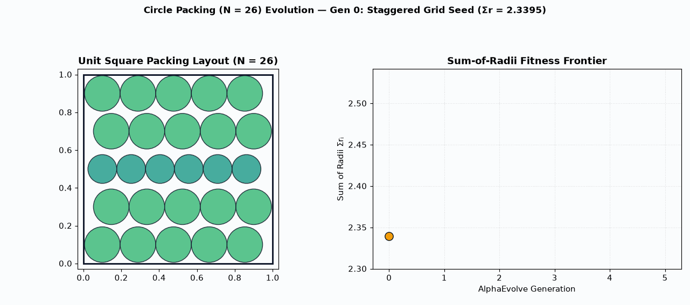

# Circle Packing (Cloud Batch)

This example evolves a constructor-based algorithm to pack $N = 26$ non-overlapping circles into a unit square $[0, 1]^2$, maximizing the sum of their radii ($\sum_{i=1}^{26} r_i$). It uses a compiled C++ geometric relaxation helper library for computationally intensive evaluations on Google Cloud Batch.

## Baseline Grid vs. Evolved $N = 26$ Packing Visualization

- **Geometric Packing Progression**: Evolves from a uniform lattice seed (`sum_of_radii = 2.3395`) into a dense multi-scale hexagonal/boundary-wedged configuration (`sum_of_radii = 2.4918`, **+6.5%**), strictly satisfying zero pairwise overlap ($d_{ij} \ge r_i + r_j$) and unit-square containment ($r_i \le x_i, y_i \le 1 - r_i$).

## Details
- **Optimization Goal**: Evolve a search algorithm to find the best circle packing, accelerated with C++.
- **Programming Language**: Python (with C++ helper).
- **Modes Supported**: Cloud Batch.
- **Metric Optimized**: `sum_of_radii` (higher is better).

## How to Run
1. Refer to the [Deployment and Execution](../../README.md#deployment-and-execution) section in the root README to deploy the platform.
2. Pass the argument `example_dir=user_examples/circle_packing_cloud_batch` to the deploy command to build this specific example.
3. Open cells in Jupyter notebook `/opt/jupyter/workspace/run_notebook.ipynb` provided by the server deployment to operate the experiment.

