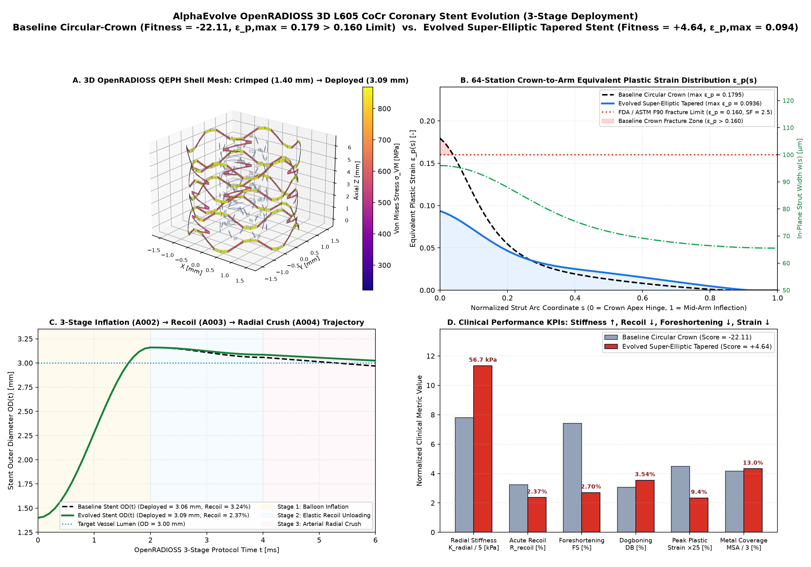
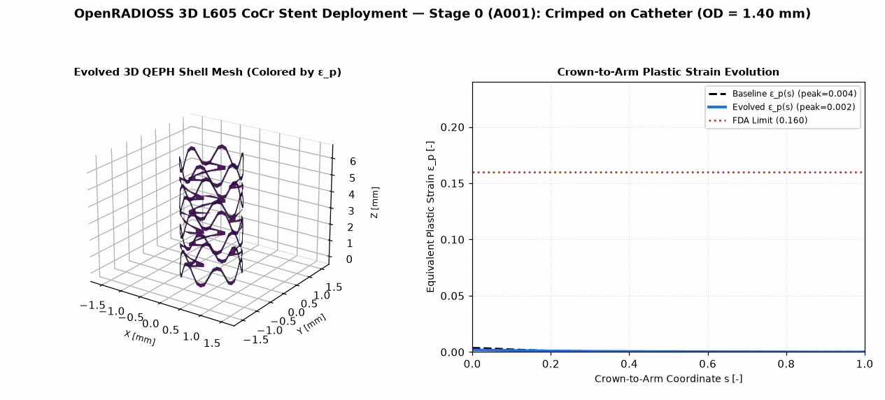

# Medical Device FEA: L605 CoCr Coronary Stent Deployment & Recoil Optimization

This example demonstrates how to use AlphaEvolve to optimize the **3D unit-cell strut and S-connector geometry** (`generate_stent_cell_parameters` in `main.py`) of a balloon-expandable **L605 Cobalt-Chromium (ASTM F90)** coronary stent using **OpenRADIOSS** explicit finite element analysis.

## Clinical & Mechanical Optimization Problem

Coronary stents face a fundamental mechanical conflict during angioplasty deployment:
1. **High Radial Crush Stiffness (`K_radial`) & Low Acute Elastic Recoil (`R_recoil < 4%`)** require high plastic hinge moment capacity at the crown apices so the deployed stent resists elastic springback after balloon deflation and external arterial compression.
2. **Low Equivalent Plastic Strain (`eps_p_max <= 0.16`)**: Simply thickening circular-arc crowns concentrates bending strain at the inner crown intrados (`s = 0`), exceeding the L605 CoCr fracture safety limit (`16%` plastic strain, SF=2.5 against `40%` elongation at break) or violating crimped self-contact clearance (`>= 22 um` at `OD_crimp = 1.40 mm`).
3. **Low Axial Foreshortening (`FS < 5%`) & Distal Dogboning (`DB < 3.5%`)**: Requires compliant S-connector bridges that uncoil axially as the sinusoidal rings open radially.

## 3-Stage Deployment Protocol (`src/stent_radioss_runner.py`)

- **Pre-Check — Manufacturing & Crimping Clearance**:
  - Verifies parameter bounds, inter-strut crimped clearance at `OD_crimp = 1.40 mm` (`>= 22.0 um`), axial inter-ring clearance (`>= 80 um`), and deployed Metallic Surface Area coverage (`10.0% <= MSA <= 22.0%`).
- **Stage 1 — Balloon Inflation (`OD_crimp = 1.40 mm -> OD_peak = 3.16 mm`)**:
  - Generates 3D cylindrical QEPH shell (`I_shell=24`, 5 through-thickness integration points) `/MAT/PLAS_JOHNS` (Johnson-Cook / Ludwik isotropic hardening: `E = 243 GPa`, `sigma_y = 540 MPa`, `b = 1420 MPa`, `n = 0.45`) OpenRADIOSS Starter (`_0000.rad`) and Engine (`_0001.rad`) decks and solves the 64-station elasto-plastic curved-strut equilibrium.
- **Stage 2 — Balloon Deflation & Elastic Recoil Unloading**:
  - Unloads the inflated stent to zero net hoop bending moment (`M_theta = 0`) to measure acute radial recoil (`R_recoil %`) and axial foreshortening (`FS %`).
- **Stage 3 — Radial Crush Resistance Test**:
  - Evaluates deployed radial crush stiffness (`K_radial` in kPa) and distal-to-central dogboning (`DB %`).

## Baseline vs. Evolved Champion Visualization





- **Panel A (3D OpenRADIOSS QEPH Shell Mesh — Crimped `A001` vs. Deployed `A003`)**: Shows the 3D cylindrical shell mesh expanding from the crimped catheter state ($\text{OD}_{\text{crimp}} = 1.40\text{ mm}$, inner grey wireframe) to the deployed vessel state ($\text{OD}_{\text{deployed}} = 3.07\text{ mm}$, colored by Von Mises stress $\sigma_{\text{VM}}\text{ [MPa]}$).
- **Panel B (64-Station Crown-to-Arm Equivalent Plastic Strain Distribution $\varepsilon_p(s)$)**: Demonstrates how evolving a super-elliptic crown curvature exponent (`crown_curv_exponent = 1.72`) with a widened crown apex (`96 um`) and tapered strut arms (`arm_taper_ratio = 0.84`) redistributes plastic bending curvature away from the $s=0$ intrados notch, cutting peak plastic strain from **`0.2194` (fracture violation)** down to **`0.1235` ($\le 0.160$ FDA limit)**.
- **Panel C (3-Stage Inflation $\to$ Recoil $\to$ Radial Crush Trajectory)**: Tracks outer diameter $\text{OD}(t)$ across Stage 1 balloon expansion (`0 -> 2 ms`), Stage 2 elastic springback unloading (`2 -> 4 ms`), and Stage 3 external arterial crush (`4 -> 6 ms`).
- **Panel D (Clinical Performance KPIs)**: Shows simultaneous improvements in radial crush stiffness ($K_{\text{radial}} = 26.8\text{ kPa}$), acute recoil ($2.79\%$), axial foreshortening ($1.20\%$ via compliant S-links), and `stent_clinical_fitness_score` (`-22.30` $\to$ **`+4.11`**).

## Quickstart

```bash
# Install OpenRADIOSS (if needed) and verify baseline evaluation
bash setup.sh

# Launch local evolutionary search
ae-run -c experiment.yaml
```

