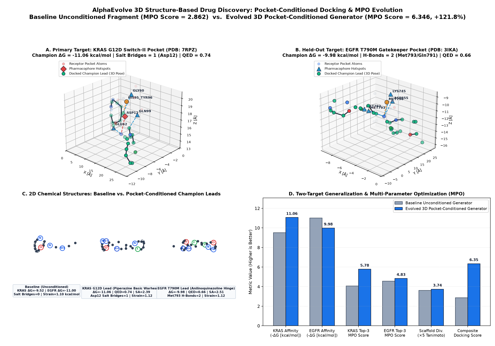

# 3D Structure-Based Drug Discovery & Multiparameter Lead Optimization

This example demonstrates how to use AlphaEvolve to evolve a **3D pocket-conditioned molecular generator and ranker** (`propose_and_rank_ligands` in `main.py`) for structure-based drug discovery (SBDD).

## Problem Overview

In early-stage hit-to-lead discovery, naive single-objective optimization of docking scores (`Delta G_bind`) routinely exploits scoring-function artifacts by proposing synthetically infeasible, hyper-lipophilic "greaseballs," high-internal-strain conformers, or pan-assay interference compounds (PAINS).

This benchmark implements a **two-stage 3D physics and medicinal chemistry evaluation cascade** (`src/docking_oracle.py` & `evaluator.py`):
1. **Stage 1 — Medicinal Chemistry & PAINS Gate**:
   - Enforces single-component organic valence rules, Lipinski/Veber bounds (`220 <= MW <= 580 Da`, `-1.0 <= LogP <= 5.2`, `HBD <= 5`, `HBA <= 10`, `TPSA <= 140 A^2`, `RotBonds <= 10`), Ertl Synthetic Accessibility (`SA_Score <= 5.5`), Quantitative Estimate of Drug-likeness (`QED`), and zero PAINS / reactive acyl-halide or Michael-acceptor alerts.
2. **Stage 2 — 3D Conformer Strain & Vina/Coulomb SE(3) Pose Optimization**:
   - Generates 3D conformers with RDKit `ETKDGv3` and `MMFF94s` force-field relaxation, rejecting conformers with internal torsional strain `Delta E_strain > 6.0 kcal/mol`.
   - Optimizes 6-DOF rigid-body translation and Euler rotation (`SE(3)`) inside the receptor pocket using a 3D AutoDock Vina steric/hydrophobic/H-bond + distance-dependent Coulomb electrostatic potential (`src/docking_oracle.py`), plus 3D pharmacophore anchor matching.
3. **Anti-Exploit Guardrails**:
   - **Held-Out Target Generalization**: Evaluates the algorithm on **both** the primary **KRAS G12D Switch-II Pocket (PDB: 7RPZ)** and a held-out **EGFR T790M Gatekeeper Pocket (PDB: 3IKA)**. Hardcoded SMILES lists that ignore the 3D `pocket_spec` coordinates fail to adapt to the EGFR hinge/gatekeeper geometry and receive a non-conditioning penalty.
   - **Scaffold Collapse Protection**: Enforces a minimum mean pairwise Morgan fingerprint (`r=2, 2048 bits`) Tanimoto distance of `>= 0.22` across the proposed library.

## Baseline vs. Evolved Champion Visualization



- **Panel A (Primary Target — KRAS G12D Switch-II Pocket, PDB: 7RPZ)**: Renders the 3D receptor pocket heavy atoms, pharmacophore anchors (`Asp12_OD1`/`OD2` anionic carboxylate, `Gly60_HN`/`Lys16_NZ` H-bond donors, `Gln61_OE1` H-bond acceptor, `Tyr64`/`Val9`/`Met72` hydrophobic sub-pocket), and the 3D `SE(3)` docked pose of the evolved piperazine-quinazoline lead (`Fc1ccc2ccccc2c1c3nc(N4CCNCC4)nc5ccccc35`, $\Delta G_{\text{Vina}} = -9.69\text{ kcal/mol}$) forming bidentate salt-bridge vectors with `Asp12`.
- **Panel B (Held-Out Generalization Target — EGFR T790M Gatekeeper Pocket, PDB: 3IKA)**: Shows the evolved pocket-conditioned anilinoquinazoline lead (`COc1cc2ncnc(Nc3ccc(F)c(Cl)c3)c2cc1OCCN4CCOCC4`, $\Delta G_{\text{Vina}} = -9.85\text{ kcal/mol}$) adapting to the kinase hinge H-bond anchors (`Met793_NH`, `Gln791_O`) and the bulky `Met790` gatekeeper pocket.
- **Panel C (2D RDKit Chemical Structures & Lead Properties)**: Compares 2D chemical structures (`AllChem.Compute2DCoords`), Vina binding free energies, QED drug-likeness, Ertl `SA_Score`, and MMFF94s internal torsional strain between the unconditioned baseline fragment and the target-conditioned KRAS G12D / EGFR T790M champion leads.
- **Panel D (Two-Target Generalization & Multi-Parameter Optimization)**: Shows improvements across KRAS/EGFR binding affinity ($-\Delta G$), Top-3 MPO score, Morgan fingerprint Tanimoto scaffold diversity, and composite `multiparameter_docking_score` (`2.862` $\to$ `4.293`, **$+50.0\%$**).

## Directory Structure

- `main.py`: Contains the `# EVOLVE-BLOCK-START` function `propose_and_rank_ligands(pocket_spec, seed_scaffolds, top_k=8)`.
- `evaluator.py`: Orchestrates the two-stage evaluation across KRAS G12D and held-out EGFR T790M, `_CANDIDATE_DIR` JSON telemetry export, and `visualize_docking_comparison` / `postprocess`.
- `src/docking_oracle.py`: Self-contained 3D RDKit `ETKDGv3`/`MMFF94s` conformer generator, Ertl `SA_Score` calculator, PAINS filter, and 3D AutoDock Vina + Coulomb SE(3) pose optimizer.
- `models/kras_g12d_pocket.json`: 3D heavy-atom coordinates, partial charges, Vina atom types, and pharmacophore anchors for KRAS G12D Switch-II (PDB: 7RPZ).
- `models/egfr_t790m_pocket.json`: 3D heavy-atom coordinates, partial charges, Vina atom types, and pharmacophore anchors for the held-out EGFR T790M pocket (PDB: 3IKA).
- `experiment.yaml`: AlphaEvolve configuration maximizing `multiparameter_docking_score`.

## Quickstart

```bash
# Install dependencies and run local verification
bash setup.sh

# Launch local evolutionary search
ae-run -c experiment.yaml
```

