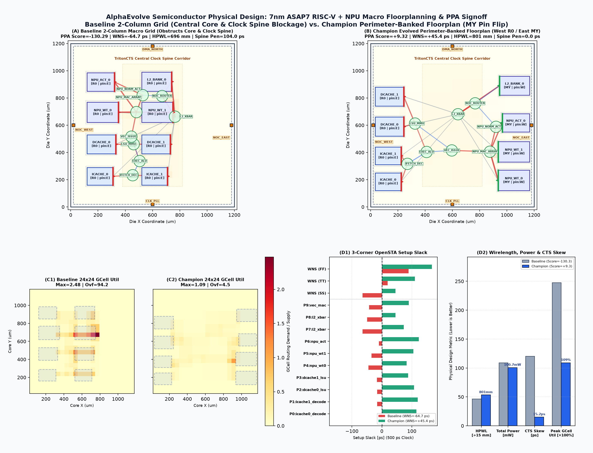

# Semiconductor Physical Design: OpenROAD 7nm ASAP7 Macro Floorplanning & PPA Optimization

This example demonstrates how to use AlphaEvolve to evolve a **dataflow-aware macro floorplanning and pin-orientation algorithm** (`compute_macro_floorplan` in `main.py`) for a 7nm ASAP7 RISC-V Vector + NPU Accelerator SoC tile (`asap7_riscv_npu_tile`).

## Problem Overview

In hierarchical ASIC physical design, hard SRAM macro placement (`(x_um, y_um, orientation, halo_um)`) dictates the achievable **Power, Performance, and Area (PPA)** of the entire block:
- Placing SRAM macros near the center of the die fragments the standard-cell core, blocks the central clock spine (`TritonCTS` from `IO_CLK_PLL`), and forces long wire detours across M2–M5 routing tracks.
- Placing SRAM macros near the die perimeter with the wrong orientation (`R0` on the East boundary) points active signal pins into the die edge (`PIN_BLOCKED_BY_BOUNDARY`), causing severe local GCell routing congestion (`FastRoute`).

## Two-Stage OpenROAD PPA Evaluation Cascade (`src/openroad_runner.py`)

1. **Stage 1 — Floorplan DRC Legality & Global Routing Congestion Gate**:
   - Verifies core boundary containment (`[20, 20, 1180, 1180] um`), zero macro-macro overlaps, minimum channel spacing (`>= 18.0 um`), zero sliver notches, and active pin-edge clearance (`>= 42.0 um`).
   - Generates OpenROAD `macro_placement.tcl` commands and solves the 2D `RePlAce` electrostatic density-spreading global placement for the 8 standard-cell functional clusters (45,000 gates) and 24x24 GCell `FastRoute` RUDY congestion map.
2. **Stage 2 — `TritonCTS` Clock Skew & 3-Corner `OpenSTA` Signoff**:
   - Evaluates Worst Negative Slack (`WNS`), Total Negative Slack (`TNS`), and clock-tree skew across all three 7nm ASAP7 PVT corners (`ss_0p63v_100c`, `tt_0p70v_25c`, `ff_0p77v_m40c`) at a `500 ps` (`2.0 GHz`) clock target, along with dynamic switching + repeater + CTS + leakage power (`mW`).

## Baseline vs. Evolved Champion Floorplan & Multi-Corner PPA Comparison



- **Panel (A) — Baseline 2-Column Macro Grid (`ppa_composite_score = -130.29`)**: Places `SRAM_ICACHE_1`, `SRAM_DCACHE_1`, `SRAM_NPU_WT_1`, and `SRAM_L2_BANK_0` at `x = 520 um` directly across the central `TritonCTS` clock spine (`x in [380, 820] um`) overlaid on the 24x24 `FastRoute` GCell congestion heatmap, fragmenting the standard-cell core, adding `+104.0 ps` of clock-spine blockage skew, and causing severe setup violations (`Worst WNS = -64.7 ps`, `Total TNS = -647.6 ps`).
- **Panel (B) — Champion Evolved Perimeter-Banked Floorplan (`ppa_composite_score = +9.32`)**: Banks the CPU instruction/data cache SRAMs along the West perimeter (`x = 34 um`, `R0` with East-facing M4 pins) and the NPU weight/activation/L2 SRAMs along the East perimeter (`x = 936..966 um`, flipped to `MY` so active M4 signal pins face West into the interior core channel) overlaid on the 24x24 GCell congestion heatmap, clearing the central standard-cell sea and eliminating clock-spine blockage (`0.0 ps` penalty).
- **Panel (C) — 24x24 GCell `FastRoute` RUDY Congestion Maps**: Shows routing demand/supply utilization across the `[20, 20, 1180, 1180] um` core, where the perimeter-banked champion eliminates central M2–M5 macro routing detours (`Max GCell Util = 2.48 -> 1.09`, `Overflow = 94.2 -> 4.5`).
- **Panel (D) — 3-Corner `OpenSTA` Setup Timing (`D1`) & Wirelength/Switching Power/Clock Skew (`D2`)**: Demonstrates positive setup timing closure across all critical paths (`P0..P9`) and all 3 PVT corners (`Worst WNS = +45.4 ps`, `Total TNS = 0.0 ps`) alongside simultaneous reductions in switching/total power (`109.1 -> 100.7 mW`) and `TritonCTS` clock skew (`120.8 -> 15.2 ps`).

## Quickstart

```bash
# Run local baseline verification and generate comparison visualization
python3 run_experiment.py

# Launch evolutionary search (automatically invokes postprocess)
ae-run -c experiment.yaml
```
