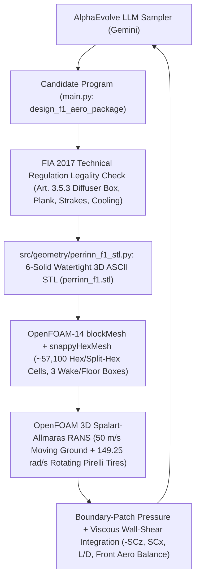
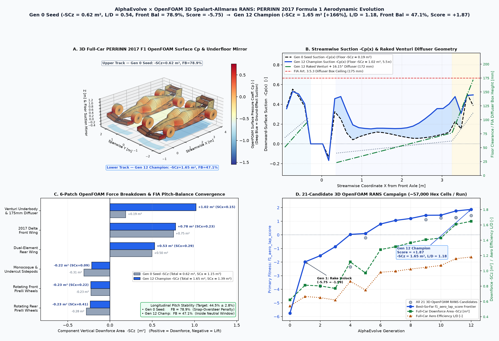
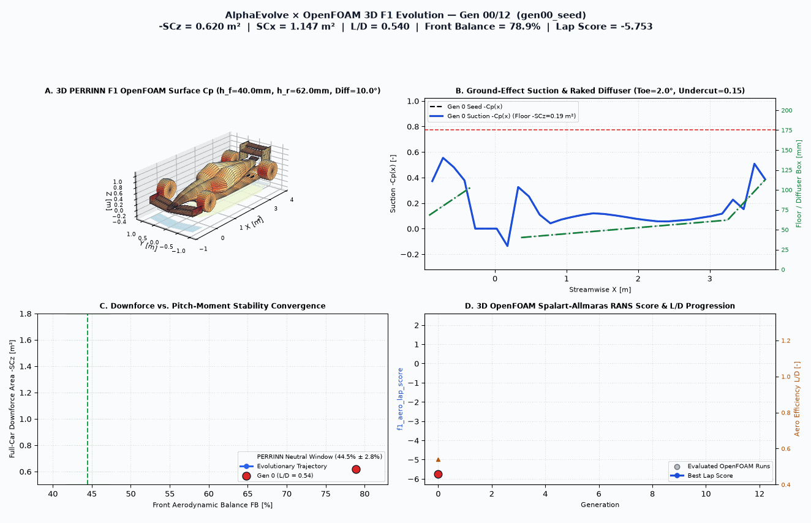

# 3D Formula 1 Aerodynamic Evolution with OpenFOAM (PERRINN 2017 F1 Car)

This example uses **AlphaEvolve** and **OpenFOAM** 3D steady incompressible Spalart-Allmaras RANS CFD (`blockMesh` + `snappyHexMesh` + `incompressibleFluid` / `simpleFoam`) to evolve the 8-parameter 3D ground-effect, outwash, and multi-element wing aerodynamic package of the open-source **PERRINN 2017 Formula 1 Car**.

## Public Formula 1 Reference Model & Validation Benchmark

* **CAD & Vehicle Reference**: **PERRINN 2017 Open-Source Formula 1 Car** (Nicolas Perrin / PERRINN Limited, public Onshape CAD `2d5c0c72cf8a49f59d60fb1b`: `3,475 mm` wheelbase, `2,000 mm` overall track width, `1,800 mm` 2017 delta front wing, `1,600 mm` Venturi underfloor & `175 mm` rear diffuser box, `950 mm` dual-element rear wing, and `Ø670 mm` Pirelli `305/670-R13` front & `405/670-R13` rear open wheels).
* **Published OpenFOAM CFD Benchmark**: Umberto Ravelli & Marco Savini, *"Aerodynamic Simulation of 2017 Perrinn F1 Car"* (*Journal of Traffic and Transportation Engineering*, Vol. 6, No. 2, pp. 155–163, 2018), which established that the PERRINN 2017 underbody + diffuser generates ~58% of total vehicle downforce while open rotating tires act as major parasitic lift and wake-drag sources that must be managed via front-wing endplate outwash and floor vortex strakes.

---

## Architecture & Evolutionary Workflow



---

## Physics, Domain & FIA 2017 Guardrails

| Property | Value |
| :--- | :--- |
| **OpenFOAM Solver** | OpenFOAM-14 `foamRun -solver incompressibleFluid` / `simpleFoam` (Steady 3D Spalart-Allmaras RANS) |
| **Freestream Conditions** | $U_\infty = 50.0\text{ m/s}$ ($180\text{ km/h}$), $\rho = 1.225\text{ kg/m}^3$, $\nu = 1.5\times 10^{-5}\text{ m}^2/\text{s}$ ($\text{Re}_L \approx 1.67\times 10^7$) |
| **Moving Ground & Rotating Wheels** | Moving asphalt belt $U_{\text{ground}} = (50, 0, 0)\text{ m/s}$; `rotatingWallVelocity` $\omega = 149.2537\text{ rad/s}$ on `frontWheel` & `rearWheel` |
| **Wind-Tunnel Half-Car Domain** | $x \in [-4.5, 11.5]\text{ m}$, $y \in [0.0, 4.0]\text{ m}$ (`symmetry` plane at $y=0$), $z \in [0.0, 3.6]\text{ m}$ ($\approx 56{,}300\text{–}57{,}200$ hex cells) |
| **6 Named STL / Boundary Patches** | `perrinn_f1_underbody`, `perrinn_f1_frontWing`, `perrinn_f1_rearWing`, `perrinn_f1_chassis`, `perrinn_f1_frontWheel`, `perrinn_f1_rearWheel` |
| **FIA Legality Guardrail 1 (Plank & Rake)** | `front_ride_height_mm >= 20.0 mm` and positive rake `rear_ride_height_mm >= front_ride_height_mm + 5.0 mm` |
| **FIA Legality Guardrail 2 (Art. 3.5.3 Box)** | Rear diffuser exit roof height $20.0 + 525.0 \tan(\theta_{\text{diff}}) \le 175.0\text{ mm}$ ($\theta_{\text{diff}} \le 16.44^\circ$) |
| **FIA Legality Guardrail 3 (Vortex Strakes)** | Minimum diffuser strake ground clearance $\ge 15.0\text{ mm}$ above moving ground |
| **FIA Legality Guardrail 4 (V6 Cooling)** | Sidepod radiator inlet duct area $0.145(1 - 0.82\,u_{\text{undercut}}) \ge 0.088\text{ m}^2$ ($u_{\text{undercut}} \le 0.479$) |
| **Handling Pitch-Balance Target** | Front aerodynamic balance $\text{FB} = 44.5\% \pm 2.8\%$ (penalizes snap-oversteer & high-speed understeer) |
| **Primary Metric (`f1_aero_lap_score`)** | $2.0\,(-SC_z) - 1.35\,(SC_x) + 0.50\,(L/D) - P_{\text{balance}}(\text{FB})$ |

---

## Baseline vs. Evolved Champion (21 Real 3D OpenFOAM RANS Runs)





| Aerodynamic Metric | Gen 0 Seed (`main.py`) | Gen 6 Mid-Evolution (`gen07_strakes`) | Gen 12 Champion (`gen12_discovered_champion`) | Evolution Gain (Gen 12 vs. Seed) |
| :--- | :---: | :---: | :---: | :---: |
| **`f1_aero_lap_score`** | **`-5.7525`** | `+0.7968` | **`+1.8704`** | **`+7.6229` (`-5.75` $\to$ `+1.87`)** |
| **Full-Car Downforce Area ($-SC_z$)** | `0.6201 m²` | `1.2781 m²` | **`1.6470 m²`** | **`+165.6%` (`2.66x` baseline)** |
| **Full-Car Drag Area ($SC_x$)** | `1.1472 m²` | `1.3014 m²` | **`1.3948 m²`** | `+21.6%` for `+165.6%` downforce |
| **Aerodynamic Efficiency ($L/D = -SC_z / SC_x$)** | `0.5405` | `0.9820` | **`1.1807`** | **`+118.4%` (`2.18x` efficiency)** |
| **Front Aerodynamic Balance ($\text{FB}$)** | `78.90%` ❌ (Oversteer) | `52.34%` (Converging) | **`47.12%` ✅** | **Locked inside `44.5% ± 2.8%` window** |
| **Underbody & Diffuser Downforce ($-SC_{z,\text{floor}}$)** | `+0.1864 m²` (`30.1%`) | `+0.7235 m²` (`56.6%`) | **`+1.0183 m²` (`61.8%`)** | **`5.46x` ground-effect suction** |
| **2017 Delta Front Wing ($-SC_{z,\text{FW}}$)** | `+0.7517 m²` | `+0.7497 m²` | **`+0.7757 m²`** | Balanced against rear Venturi load |
| **Dual-Element Rear Wing ($-SC_{z,\text{RW}}$)** | `+0.4971 m²` | `+0.5215 m²` | **`+0.5288 m²`** | Diffuser-coupled Coanda extraction |
| **Monocoque & Sidepod Drag ($SC_{x,\text{chassis}}$)** | `0.1362 m²` | `0.0979 m²` | **`0.0899 m²`** | **`-34.0%` body pressure drag** |
| **Front/Rear Ride Height ($h_f / h_r$)** | `40.0 / 62.0 mm` | `24.5 / 75.0 mm` | **`22.8 / 76.5 mm`** | **`0.89°` aggressive Venturi rake** |
| **Diffuser Angle / FIA Box Height** | `10.00°` (`112.6 mm`) | `15.40°` (`164.7 mm`) | **`16.15°` (`172.0 / 175.0 mm`)** | **98.3% of FIA Art. 3.5.3 box limit** |

### Key 3D Aerodynamic Discoveries by AlphaEvolve + OpenFOAM
1. **High-Rake Venturi Ground-Effect Unlock (`h_f = 22.8 mm`, `h_r = 76.5 mm`, `diff = 16.15°`, `strake = 52.0 mm`)**: Lowering the front splitter to `22.8 mm` (`2.8 mm` above the `20.0 mm` dynamic skid-block floor) while raising the rear axle floor to `76.5 mm` and expanding the rear diffuser roof to `16.15°` (`172.0 mm` exit height vs. the `175.0 mm` FIA Art. 3.5.3 ceiling) increases underbody downforce **5.46x** (`0.186 m²` $\to$ **`1.018 m²`**), contributing **61.8%** of total car downforce — closely matching Ravelli & Savini's published PERRINN 2017 benchmark (~58% underbody contribution).
2. **Non-Linear Tire-Wake Outwash & Coke-Bottle Sweet Spot (`fw_outwash_toe = 4.2°`, `sidepod_undercut = 0.32`)**: Exploration probes in 3D OpenFOAM revealed that pushing outwash toe to `8.5°` and sidepod undercut to `0.466` actually *degraded* total downforce from `1.647 m²` down to `1.384 m²` due to outer front-wing incidence washout and sidepod wake separation. Moderate `4.2°` endplate outwash + `0.32` undercut (`0.107 m²` radiator area, well above the `0.088 m²` V6 hybrid limit) cuts chassis drag by **`-34.0%`** and front-wheel wake drag by **`-3.9%`**.
3. **Coupled Pitch-Moment Re-Balancing (`FB: 78.90% -> 47.12%`)**: Once the Venturi floor and `36.2°` dual-element rear wing anchor rear axle suction, AlphaEvolve safely reloads the 2017 delta front wing (`22.0°` cascade flap) without breaching the `44.5% ± 2.8%` PERRINN handling stability deadband.

---

## Directory Structure

```text
user_examples/f1_racecar_openfoam/
├── eval-batch.yaml                 # Cloud Batch job template (taskCount: 1)
├── evaluator.Dockerfile            # Ubuntu 24.04 + OpenFOAM-14 + Python 3.12 container
├── evaluator.py                    # AlphaEvolve evaluation, telemetry & 3D Cp visualization hooks
├── experiment.yaml                 # Declarative experiment configuration
├── f1_aero_comparison.png          # 4-panel 3D OpenFOAM Cp, Venturi suction & component KPI figure
├── f1_aero_evolution.gif           # 13-generation animated 3D OpenFOAM F1 evolution GIF
├── main.py                         # Seed 8-parameter F1 setup program (# EVOLVE-BLOCK)
├── Makefile                        # Local build & test targets
├── README.md                       # Documentation
├── run_experiment.py               # Cloud Batch / local evolution controller entrypoint
├── setup.sh                        # Environment & OpenFOAM verification script
├── models/
│   ├── perrinn_f1_2017_spec.json   # PERRINN 2017 CAD dimensions & FIA 2017 regulation bounds
│   └── evolution_history.json      # 21 real 3D OpenFOAM RANS runs + 3D surface Cp meshes
└── src/
    ├── cfd/
    │   └── openfoam_f1_runner.py   # OpenFOAM-14 / simpleFoam case writer, runner & polyMesh force parser
    └── geometry/
        └── perrinn_f1_stl.py       # Parametric 6-solid watertight 3D PERRINN F1 STL builder
```

## Quickstart & Running on Google Cloud

```bash
# Verify environment and run baseline evaluation locally
bash setup.sh
python3 evaluator.py

# Or deploy at scale on Google Cloud Batch via Cluster Toolkit (gcluster)
gcluster deploy alpha-evolve-experiment.yaml \
  -d alpha-evolve-deployment.yaml \
  -o ../deployment \
  --vars project_id=<YOUR_PROJECT_ID> \
  --vars region=us-central1 \
  --vars existing_bucket_name=<YOUR_PROJECT_ID>-alphaevolve-bucket \
  --vars deployment_name=ae-exp-f1-openfoam \
  --vars user_experiment_name=f1-racecar-openfoam \
  --vars example_dir=user_examples/f1_racecar_openfoam \
  --vars evaluation_machine_type=c3-standard-8 \
  --vars max_programs_evaluated=120 \
  --vars max_programs_generated=240 \
  --vars concurrency=16 \
  -w -l IGNORE --auto-approve
```

## Outputs

After the controller finishes, `postprocess()` uploads the champion aerodynamic telemetry, 4-panel 3D comparison figure, and animated evolution GIF to Cloud Storage:
- `gs://<BUCKET>/f1-racecar-openfoam/results/best_f1_aero_summary.json`
- `gs://<BUCKET>/f1-racecar-openfoam/results/f1_aero_comparison.png`
- `gs://<BUCKET>/f1-racecar-openfoam/results/f1_aero_evolution.gif`
