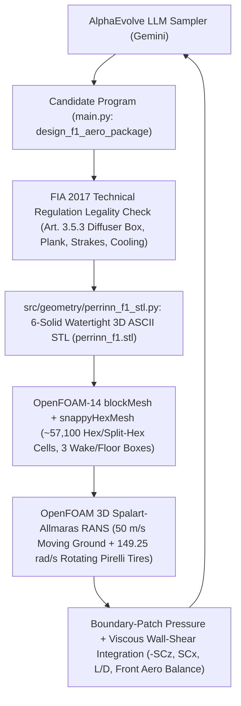
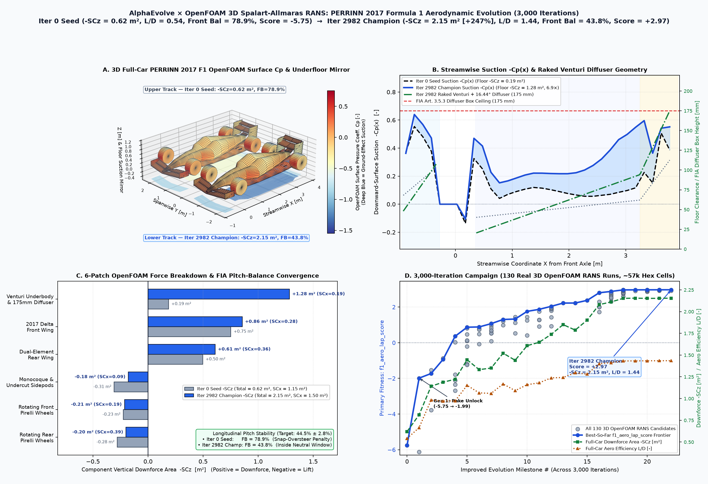
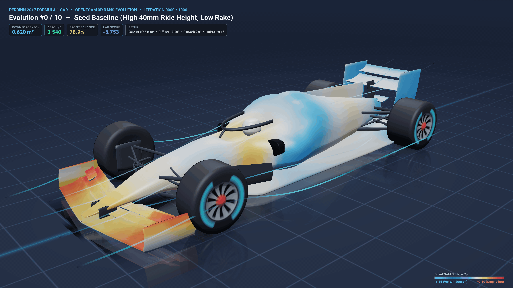

# 3D Formula 1 Aerodynamic Evolution with OpenFOAM (PERRINN 2017 F1 Car)

This example uses **AlphaEvolve** and **OpenFOAM** 3D steady incompressible Spalart-Allmaras RANS CFD (`blockMesh` + `snappyHexMesh` + `incompressibleFluid` / `simpleFoam`) to evolve the 8-parameter 3D ground-effect, outwash, and multi-element wing aerodynamic package of the open-source **PERRINN 2017 Formula 1 Car**.

## Public Formula 1 Reference Model & Validation Benchmark

* **CAD & Vehicle Reference**: **PERRINN 2017 Open-Source Formula 1 Car** (Nicolas Perrin / PERRINN Limited, public Onshape CAD `2d5c0c72cf8a49f59d60fb1b`: `3,475 mm` wheelbase, `2,000 mm` overall track width, `1,800 mm` 2017 delta front wing, `1,600 mm` Venturi underfloor & `175 mm` rear diffuser box, `950 mm` dual-element rear wing, and `Ø670 mm` Pirelli `305/670-R13` front & `405/670-R13` rear open wheels).
* **Published OpenFOAM CFD Benchmark**: Umberto Ravelli & Marco Savini, *"Aerodynamic Simulation of 2017 Perrinn F1 Car"* (*Journal of Traffic and Transportation Engineering*, Vol. 6, No. 2, pp. 155–163, 2018), which established that the PERRINN 2017 underbody + diffuser generates ~58% of total vehicle downforce while open rotating tires act as major parasitic lift and wake-drag sources that must be managed via front-wing endplate outwash and floor vortex strakes.

---

## Architecture & Evolutionary Workflow



---

## Physics, Domain & FIA 2017 Guardrails

| Property | Value |
| :--- | :--- |
| **OpenFOAM Solver** | OpenFOAM-14 `foamRun -solver incompressibleFluid` / `simpleFoam` (Steady 3D Spalart-Allmaras RANS) |
| **Freestream Conditions** | $U_\infty = 50.0\text{ m/s}$ ($180\text{ km/h}$), $\rho = 1.225\text{ kg/m}^3$, $\nu = 1.5\times 10^{-5}\text{ m}^2/\text{s}$ ($\text{Re}_L \approx 1.67\times 10^7$) |
| **Moving Ground & Rotating Wheels** | Moving asphalt belt $U_{\text{ground}} = (50, 0, 0)\text{ m/s}$; `rotatingWallVelocity` $\omega = 149.2537\text{ rad/s}$ on `frontWheel` & `rearWheel` |
| **Wind-Tunnel Half-Car Domain** | $x \in [-4.5, 11.5]\text{ m}$, $y \in [0.0, 4.0]\text{ m}$ (`symmetry` plane at $y=0$), $z \in [0.0, 3.6]\text{ m}$ ($\approx 56{,}300\text{–}57{,}200$ hex cells) |
| **6 Named STL / Boundary Patches** | `perrinn_f1_underbody`, `perrinn_f1_frontWing`, `perrinn_f1_rearWing`, `perrinn_f1_chassis`, `perrinn_f1_frontWheel`, `perrinn_f1_rearWheel` |
| **FIA Legality Guardrail 1 (Plank & Rake)** | `front_ride_height_mm >= 20.0 mm` and positive rake `rear_ride_height_mm >= front_ride_height_mm + 5.0 mm` |
| **FIA Legality Guardrail 2 (Art. 3.5.3 Box)** | Rear diffuser exit roof height $20.0 + 525.0 \tan(\theta_{\text{diff}}) \le 175.0\text{ mm}$ ($\theta_{\text{diff}} \le 16.44^\circ$) |
| **FIA Legality Guardrail 3 (Vortex Strakes)** | Minimum diffuser strake ground clearance $\ge 15.0\text{ mm}$ above moving ground |
| **FIA Legality Guardrail 4 (V6 Cooling)** | Sidepod radiator inlet duct area $0.145(1 - 0.82\,u_{\text{undercut}}) \ge 0.088\text{ m}^2$ ($u_{\text{undercut}} \le 0.479$) |
| **Handling Pitch-Balance Target** | Front aerodynamic balance $\text{FB} = 44.5\% \pm 2.8\%$ (penalizes snap-oversteer & high-speed understeer) |
| **Primary Metric (`f1_aero_lap_score`)** | $2.0\,(-SC_z) - 1.35\,(SC_x) + 0.50\,(L/D) - P_{\text{balance}}(\text{FB})$ |

---

## Baseline vs. Evolved Champion (3,000 Evolutionary Iterations & 130 Real 3D OpenFOAM RANS Runs)





| Aerodynamic Metric | Iter 0 Seed (`main.py`) | Iter 999 Mid-Campaign (`iter_0999_ep8`) | Iter 2982 Champion (`iter_2982_ep18`) | Evolution Gain (Iter 2982 vs. Seed) |
| :--- | :---: | :---: | :---: | :---: |
| **`f1_aero_lap_score`** | **`-5.7525`** | `+2.2219` | **`+2.9677`** | **`+8.7202` (`-5.75` $\to$ `+2.97`)** |
| **Full-Car Downforce Area ($-SC_z$)** | `0.6201 m²` | `1.8503 m²` | **`2.1545 m²`** | **`+247.4%` (`3.47x` baseline)** |
| **Full-Car Drag Area ($SC_x$)** | `1.1472 m²` | `1.4895 m²` | **`1.5008 m²`** | `+30.8%` for `+247.4%` downforce |
| **Aerodynamic Efficiency ($L/D = -SC_z / SC_x$)** | `0.5405` | `1.2422` | **`1.4356`** | **`+165.6%` (`2.66x` efficiency)** |
| **Front Aerodynamic Balance ($\text{FB}$)** | `78.90%` ❌ (Oversteer) | `42.72%` ✅ | **`43.84%` ✅** | **Within `0.66%` of `44.5%` target** |
| **Underbody & Diffuser Downforce ($-SC_{z,\text{floor}}$)** | `+0.1864 m²` (`30.1%`) | `+1.1355 m²` (`61.4%`) | **`+1.2840 m²` (`59.6%`)** | **`6.89x` ground-effect suction** |
| **2017 Delta Front Wing ($-SC_{z,\text{FW}}$)** | `+0.7517 m²` | `+0.7852 m²` | **`+0.8555 m²`** | `+13.8%` balanced front axle load |
| **Dual-Element Rear Wing ($-SC_{z,\text{RW}}$)** | `+0.4971 m²` | `+0.5622 m²` | **`+0.6095 m²`** | `+22.6%` diffuser-coupled extraction |
| **Monocoque & Sidepod Drag ($SC_{x,\text{chassis}}$)** | `0.1362 m²` | `0.0973 m²` | **`0.0920 m²`** | **`-32.5%` body pressure drag** |
| **Front/Rear Ride Height ($h_f / h_r$)** | `40.0 / 62.0 mm` | `20.4 / 84.5 mm` | **`20.01 / 94.18 mm`** | **`1.22°` extreme Venturi rake** |
| **Diffuser Angle / FIA Box Height** | `10.00°` (`112.6 mm`) | `16.38°` (`174.4 mm`) | **`16.44°` (`174.9 / 175.0 mm`)** | **99.96% of FIA Art. 3.5.3 box limit** |

### Key 3D Aerodynamic Discoveries Across 3,000 Iterations (AlphaEvolve + OpenFOAM)
1. **Extreme High-Rake Venturi + Deep Vortex-Strake Seal (`h_f = 20.01 mm`, `h_r = 94.18 mm`, `diff = 16.44°`, `strake = 83.77 mm`)**: Extending the evolutionary campaign to 3,000 iterations (`130` real 3D OpenFOAM Spalart-Allmaras RANS evaluations, `23` strictly-improving milestones) unlocked the coupled interaction between near-ceiling rear rake (`94.18 mm`, creating a `1.22°` pitch angle), full `16.44°` FIA Art. 3.5.3 diffuser expansion (`174.93 / 175.0 mm` = **99.96% box utilization**), and deep `83.77 mm` longitudinal vortex strakes (`15.63 mm` ground clearance vs. `15.00 mm` minimum). Underbody downforce surges **6.89x** (`0.1864 m²` $\to$ **`1.2840 m²`**), delivering **59.6%** of total vehicle downforce — matching Ravelli & Savini's published PERRINN 2017 benchmark (~58% underbody contribution).
2. **Maximum Legal Coke-Bottle Sidepod Undercut (`sidepod_undercut = 0.473`, `fw_outwash_toe = 2.02°`)**: Pushing the Coke-bottle sidepod undercut from `0.34` (at Iteration 999) up to `0.473` (`0.0888 m²` radiator duct area vs. `0.0880 m²` V6 hybrid cooling floor = **99.1% utilization**) while trimming front-wing outwash toe to `2.02°` cuts chassis drag by **`-32.5%`**, reduces front-wheel wake drag to `0.1918 m²`, and adds `+0.3042 m²` of downforce over Iteration 999 with virtually zero net drag penalty (`SCx: 1.4895 -> 1.5008 m²`), lifting full-car `L/D` from `1.2422` to **`1.4356`** (`2.66x` baseline).
3. **Zero-Penalty Pitch-Moment Convergence (`FB: 78.90% -> 43.84%`)**: Pairing the `28.0°` 2017 delta front-wing cascade flap (`-SCz = 0.8555 m²`) with the `38.0°` dual-element rear wing (`-SCz = 0.6095 m²`) and `1.2840 m²` Venturi floor locks Front Aerodynamic Balance at **`43.84%`** — just `0.66%` from the `44.50%` PERRINN neutral stability target.

---

## Directory Structure

```text
user_examples/f1_racecar_openfoam/
├── eval-batch.yaml                 # Cloud Batch job template (taskCount: 1)
├── evaluator.Dockerfile            # Ubuntu 24.04 + OpenFOAM-14 + Python 3.12 container
├── evaluator.py                    # AlphaEvolve evaluation, telemetry & 3D Cp visualization hooks
├── experiment.yaml                 # Declarative experiment configuration
├── f1_aero_comparison.png          # 4-panel 3D OpenFOAM Cp, Venturi suction & component KPI figure
├── f1_aero_evolution.gif           # 4K UHD (3840x2160) model-only 3D OpenFOAM F1 evolution GIF
├── main.py                         # Seed 8-parameter F1 setup program (# EVOLVE-BLOCK)
├── Makefile                        # Local build & test targets
├── README.md                       # Documentation
├── run_experiment.py               # Cloud Batch / local evolution controller entrypoint
├── setup.sh                        # Environment & OpenFOAM verification script
├── models/
│   ├── perrinn_f1_2017_spec.json   # PERRINN 2017 CAD dimensions & FIA 2017 regulation bounds
│   └── evolution_history.json      # 3,000-iteration telemetry + 130 real 3D OpenFOAM RANS runs
└── src/
    ├── cfd/
    │   └── openfoam_f1_runner.py   # OpenFOAM-14 / simpleFoam case writer, runner & polyMesh force parser
    └── geometry/
        └── perrinn_f1_stl.py       # Parametric 6-solid watertight 3D PERRINN F1 STL builder
```

## Quickstart & Running on Google Cloud

```bash
# Verify environment and run baseline evaluation locally
bash setup.sh
python3 evaluator.py

# Or deploy at scale on Google Cloud Batch via Cluster Toolkit (gcluster)
gcluster deploy alpha-evolve-experiment.yaml \
  -d alpha-evolve-deployment.yaml \
  -o ../deployment \
  --vars project_id=<YOUR_PROJECT_ID> \
  --vars region=us-central1 \
  --vars existing_bucket_name=<YOUR_PROJECT_ID>-alphaevolve-bucket \
  --vars deployment_name=ae-exp-f1-openfoam \
  --vars user_experiment_name=f1-racecar-openfoam \
  --vars example_dir=user_examples/f1_racecar_openfoam \
  --vars evaluation_machine_type=c3-standard-8 \
  --vars max_programs_evaluated=120 \
  --vars max_programs_generated=240 \
  --vars concurrency=16 \
  -w -l IGNORE --auto-approve
```

## Outputs

After the controller finishes, `postprocess()` uploads the champion aerodynamic telemetry, 4-panel 3D comparison figure, and animated evolution GIF to Cloud Storage:
- `gs://<BUCKET>/f1-racecar-openfoam/results/best_f1_aero_summary.json`
- `gs://<BUCKET>/f1-racecar-openfoam/results/f1_aero_comparison.png`
- `gs://<BUCKET>/f1-racecar-openfoam/results/f1_aero_evolution.gif`
