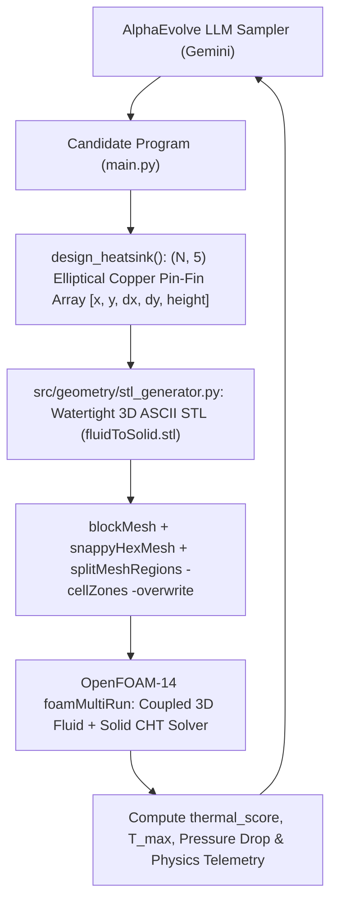
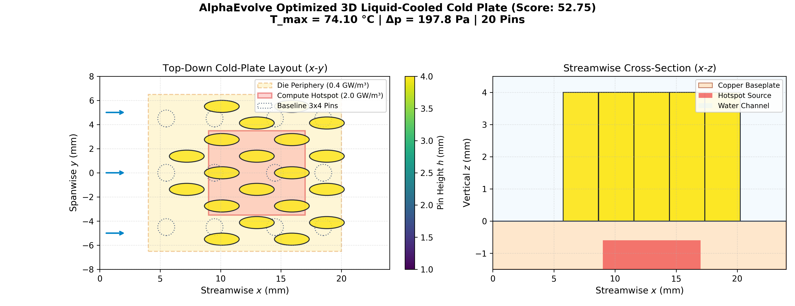
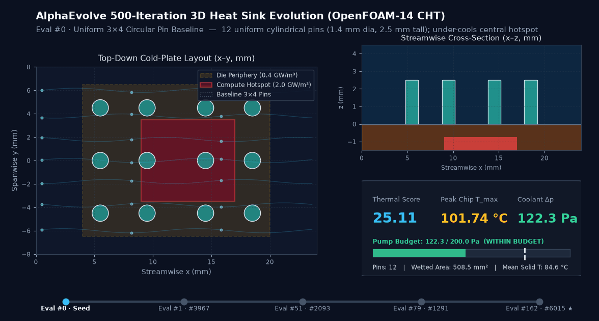

# 3D Liquid-Cooling Heat Sink Optimization with OpenFOAM-14

This example uses AlphaEvolve and OpenFOAM-14 Conjugate Heat Transfer (CHT) to design a 3D copper pin-fin liquid-cooling cold plate for an EDA semiconductor die with a non-uniform compute hotspot.

## Overview

Modern AI and HPC accelerators exhibit severe spatial power non-uniformity: dense compute core clusters generate intense localized heat fluxes while surrounding cache/IO periphery runs cooler. Uniform heat-sink pin arrays either under-cool the central hotspot or over-restrict coolant flow across the entire channel.

AlphaEvolve evolves a Python generator `design_heatsink(parameters)` that outputs an `(N, 5)` array of 3D elliptical copper pin-fins `[x, y, dx, dy, height]`. Each candidate design is converted into a watertight 3D STL surface (`fluidToSolid.stl`), meshed into coupled fluid and solid regions with `blockMesh`, `snappyHexMesh`, and `splitMeshRegions`, and solved to steady state with `foamMultiRun` (`fluid` = `incompressibleFluid`, `solid` = `solid`).

---

## Architecture & Evolutionary Workflow



---

## Physics & Domain Setup

| Property | Value |
| :--- | :--- |
| **OpenFOAM Version** | OpenFOAM-14 (`foamMultiRun` multi-region CHT) |
| **Channel Dimensions** | `24 mm` (L) $\times$ `16 mm` (W) $\times$ `4.5 mm` (H) water channel |
| **Copper Baseplate** | `1.5 mm` thick (`z in [-1.5, 0] mm`, $\kappa = 385\text{ W/m}\cdot\text{K}$) |
| **Central Compute Hotspot** | `8 mm` $\times$ `7 mm` (`x in [9, 17] mm`, `y in [-3.5, 3.5] mm`), $q = 2.0\text{ GW/m}^3$ ($\approx 101\text{ W}$) |
| **Surrounding Die Periphery** | `16 mm` $\times$ `13 mm` (`x in [4, 20] mm`, `y in [-6.5, 6.5] mm`), $q = 0.4\text{ GW/m}^3$ ($\approx 55\text{ W}$) |
| **Coolant Inlet** | Water at $U_{\text{in}} = 0.50\text{ m/s}$, $T_{\text{in}} = 300.0\text{ K}$ ($26.85\,^\circ\text{C}$) |
| **Pressure-Drop Budget** | $\Delta p \le 200.0\text{ Pa}$ |
| **Primary Metric** | `thermal_score = 400.0 - (T_max_K + dp_penalty_K)` (higher is better) |
| **Baseline (`3x4` uniform pins)** | $T_{\max} = 374.89\text{ K}$ ($101.74\,^\circ\text{C}$), $\Delta p = 122.3\text{ Pa}$, `thermal_score = 25.11` |
| **500-Eval Champion (`00049_00488`)** | $T_{\max} = 347.82\text{ K}$ ($74.67\,^\circ\text{C}$, **$-27.07\,^\circ\text{C}$**), $\Delta p = 147.8\text{ Pa}$, **`thermal_score = 52.18`** (**`+107.8%`**) |

---

## Baseline vs. Evolved Performance (`wg-hpc-demos` Cloud Batch Runs)





| Metric | Baseline Seed (`00001_00001`) | 30-Eval Champion (`00003_00019`) | 500-Eval Champion (`00049_00488`) | Improvement (500-Eval vs. Seed) |
| :--- | :--- | :--- | :--- | :--- |
| **`thermal_score`** | **`25.11`** | `44.97` | **`52.18`** | **`+27.07` (`+107.8%`, 2.08x)** |
| **Peak Chip Temperature ($T_{\max}$)** | `374.89 K` (`101.74 °C`) | `355.03 K` (`81.88 °C`) | **`347.82 K` (`74.67 °C`)** | **`-27.07 K` (`-27.07 °C`) cooler** |
| **Temperature Rise Above Coolant ($\Delta T_{\max}$)** | `74.89 K` | `55.03 K` | **`47.82 K`** | **`-36.1%` peak thermal resistance** |
| **Mean Solid Baseplate Temp ($T_{\text{mean}}$)** | `348.20 K` | `337.90 K` | **`334.60 K`** | **`-13.60 K` cooler** |
| **Coolant Pressure Drop ($\Delta p \le 200\text{ Pa}$)** | `122.3 Pa` | `140.4 Pa` | **`147.8 Pa`** | **`0.00 K` penalty (`52.2 Pa` margin)** |
| **Pin Count ($N$) & Layout** | `12` (`3x4` uniform grid) | `12` (`1-2-3-2-3-1` diamond) | **`12` (`5`-row hydrodynamically tapered core)** | **Zero extra copper pin count** |
| **Pin Height ($H$) & Aspect Ratio ($dx/dy$)** | `2.5 mm`, `1.00` (circular) | `3.95 mm`, `1.19–1.25` | **`4.00 mm`, `1.39–1.56` (streamlined)** | **Full `4.0 mm` core height + low form drag** |

### Key Physical Discoveries by AlphaEvolve (`00049_00488`)
1. **Upstream Flow-Focusing Splitter Pair (`x = 5.6 mm`, `y = +/- 2.0 mm`)**: Two streamlined elliptical guide pins ($dx = 2.5\text{ mm}$, $dy = 1.6\text{ mm}$) split and accelerate the incoming $300\text{ K}$ coolant jet directly toward the central compute core hotspot while pre-cooling the upstream die periphery.
2. **Dense `3x3` Staggered Hotspot Core (`x = 9.2, 12.6, 16.0 mm`)**: Nine full-height ($H = 4.0\text{ mm}$) elliptical copper pins ($dx = 2.6\text{–}2.8\text{ mm}$, $dy = 1.9\text{–}2.0\text{ mm}$) sit directly atop the $2.0\text{ GW/m}^3$ hotspot (`x in [9, 17] mm`, `y in [-3.5, 3.5] mm`). Alternate rows shift spanwise (`y = {-2.9, 0, +2.9} mm` $\rightarrow$ `y = {-2.6, 0, +2.6} mm` $\rightarrow$ `y = {-3.1, 0, +3.1} mm`) to continuously strip thermal boundary layers.
3. **Downstream Wake-Recovery Pin (`x = 19.4 mm`, `y = 0.0 mm`)**: A single centerline pin ($dx = 2.5\text{ mm}$, $dy = 1.8\text{ mm}$) extracts residual heat in the thermal plume downstream of the hotspot without blocking the outer exit channels, keeping total pressure drop at $\Delta p = 147.8\text{ Pa}$ (well below the $200\text{ Pa}$ pump budget).

---

## Directory Structure

```text
user_examples/heatsink_openfoam/
├── evaluator.Dockerfile      # Ubuntu 24.04 + OpenFOAM-14 + Python 3.12 container
├── evaluator.py              # AlphaEvolve evaluation & visualization hooks
├── experiment.yaml           # Declarative experiment configuration
├── heatsink_evolution.gif    # Animated 500-iteration evolutionary progression
├── main.py                   # Seed candidate generator (# EVOLVE-BLOCK)
├── Makefile                  # Local build & test targets
├── optimized_heatsink.png    # 4-panel comparison of baseline vs. 500-eval champion
├── README.md                 # Documentation
├── run_experiment.py         # End-to-end Cloud Batch / local evolution driver
└── src/
    ├── geometry/
    │   └── stl_generator.py  # Watertight 3D elliptical pin-fin STL generator
    └── optimization/
        └── optimization.py   # OpenFOAM-14 multi-region CHT case writer & runner
```

## Design Space & Constraints

Each row `[x, y, dx, dy, height]` of the returned `(N, 5)` NumPy array (`4 <= N <= 20`) specifies one 3D copper pin-fin in meters:
- `x in [0.0030, 0.0210]`: Streamwise center along the 24 mm plate.
- `y in [-0.0065, 0.0065]`: Spanwise center across the 16 mm channel.
- `dx in [0.0008, 0.0030]`: Streamwise elliptical diameter.
- `dy in [0.0008, 0.0024]`: Spanwise elliptical diameter.
- `height in [0.0010, 0.0040]`: Pin height extending into the 4.5 mm water channel.
- **Clearance**: Every pair of pins must maintain at least `0.5 mm` (`0.0005 m`) surface-to-surface clearance so `snappyHexMesh` produces clean hex-dominant fluid passages.
- **Single Simulation Rule**: `evaluate(parameters)` runs strictly **1** OpenFOAM simulation per candidate evaluation.

## Running on Google Cloud

Deploy the experiment infrastructure using Cluster Toolkit (`gcluster`) from the `alphaevolve-hpc` root directory:

```bash
gcluster deploy alpha-evolve-experiment.yaml \
  -d alpha-evolve-deployment.yaml \
  -o ../deployment \
  --vars project_id=<YOUR_PROJECT_ID> \
  --vars region=us-central1 \
  --vars existing_bucket_name=<YOUR_PROJECT_ID>-alphaevolve-bucket \
  --vars deployment_name=ae-exp-heatsink-foam \
  --vars user_experiment_name=heatsink-foam \
  --vars example_dir=user_examples/heatsink_openfoam \
  --vars evaluation_machine_type=n2-standard-4 \
  --vars max_programs_evaluated=500 \
  --vars max_programs_generated=1000 \
  --vars concurrency=20 \
  -w -l IGNORE --auto-approve
```

## Outputs

After the controller finishes, post-processing uploads the best design summary and layout plot to Cloud Storage:
- `gs://<BUCKET>/heatsink-foam/results/best_heatsink_summary.json`
- `gs://<BUCKET>/heatsink-foam/results/optimized_heatsink.png`
