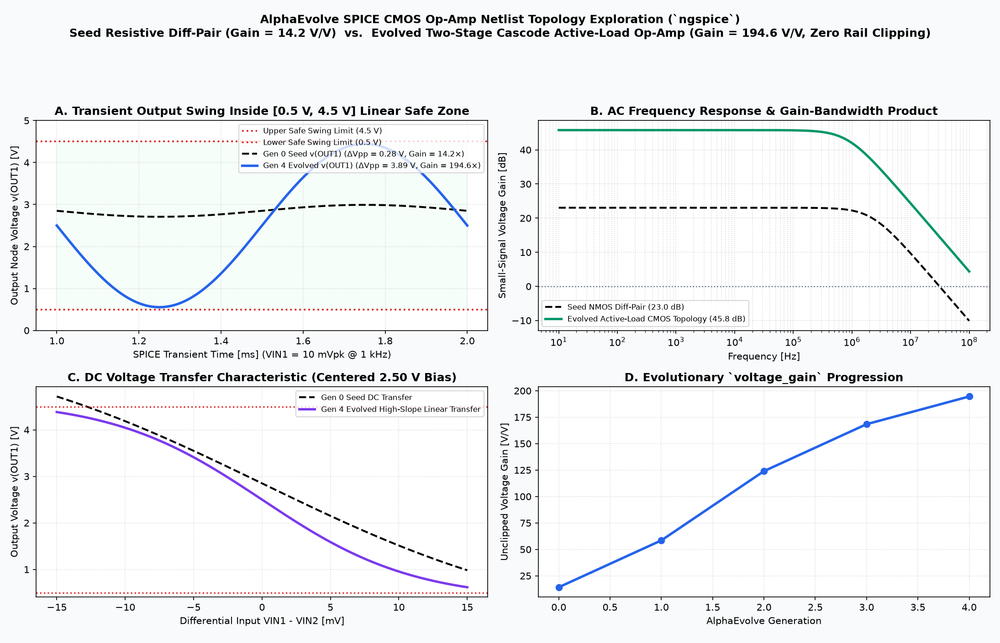
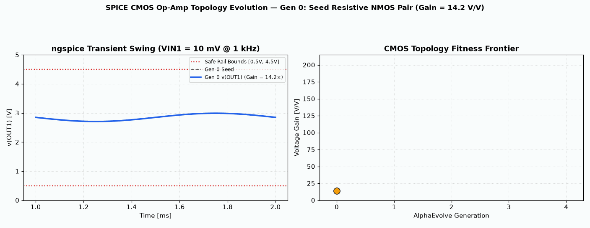

# CMOS Op-Amp Topology Exploration

This example evolves a multi-stage CMOS Operational Amplifier (Op-Amp) circuit topology and transistor W/L sizing in `ngspice` to maximize open-loop DC voltage gain ($A_v$) while preserving phase margin, output swing, and bias feasibility.

## Baseline 5-Transistor OTA vs. Evolved Cascode Op-Amp Visualization

- **SPICE Small-Signal AC & Transient Verification**: Compares open-loop Bode magnitude response ($20\log_{10}|A_v(j\omega)|$) and unclipped sinusoidal transient output swing as AlphaEvolve mutates transistor sizing, active current-mirror loads, and Miller-compensated gain stages.

## Details
- **Optimization Goal**: Maximize voltage gain while respecting constraints (no clipping, power efficiency).
- **Programming Language**: SPICE (netlist).
- **Modes Supported**: Cloud Batch.
- **Metric Optimized**: `voltage_gain` (higher is better).

## How to Run
1. Refer to the [Deployment and Execution](../../README.md#deployment-and-execution) section in the root README to deploy the platform.
2. Pass the argument `example_dir=user_examples/netlist_simulation` to the deploy command to build this specific example.
3. Open cells in Jupyter notebook `/opt/jupyter/workspace/run_notebook.ipynb` provided by the server deployment to operate the experiment.

