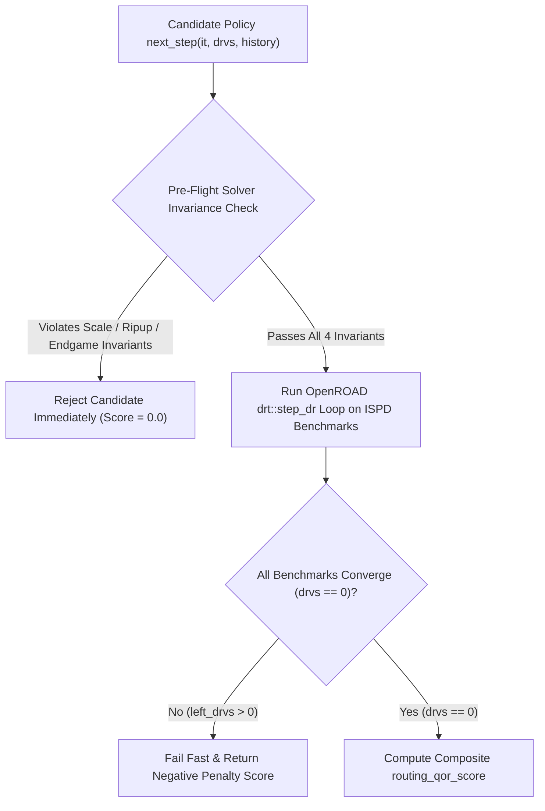
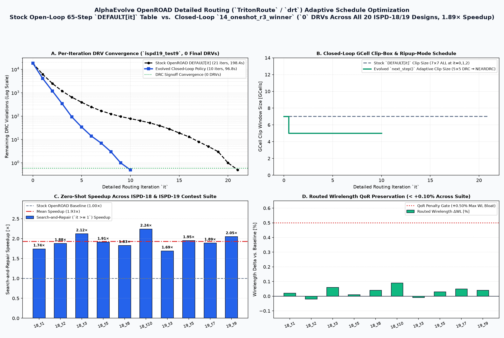
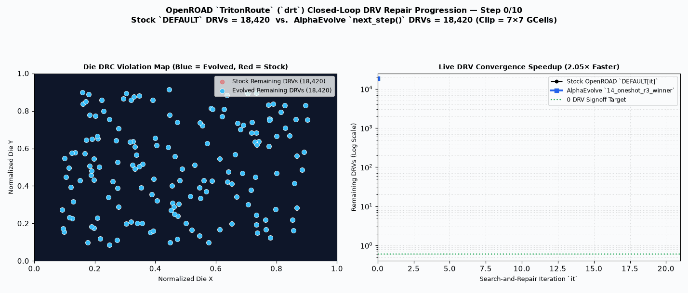

# OpenROAD Detailed Routing (`drt`) Adaptive Search-and-Repair Schedule

This example evolves a closed-loop adaptive search-and-repair schedule policy `next_step(it, drvs, history)` in Python for [OpenROAD](https://github.com/The-OpenROAD-Project/OpenROAD)'s `TritonRoute` (`drt`) detailed router ([`src/drt/src/dr/FlexDR.cpp`](https://github.com/The-OpenROAD-Project/OpenROAD/blob/master/src/drt/src/dr/FlexDR.cpp)). Instead of walking OpenROAD's static 65-step open-loop lookup table (`DEFAULT[it]`), the evolved policy selects the 9 per-iteration `drt::step_dr` parameters dynamically based on live Design Rule Violation (`DRV`) progress across the [ISPD-18](https://www.ispd.cc/contests/18/) and [ISPD-19](https://www.ispd.cc/contests/19/) detailed routing contest benchmarks.

For a step-by-step tutorial on reproducing the standalone Slurm cluster runs, evaluating the evolved policy ([`tutorial/candidates/14_oneshot_r3_winner.py`](tutorial/candidates/14_oneshot_r3_winner.py)), and running 1-shot evolution with the `ae` CLI, see **[`tutorial/README.md`](tutorial/README.md)**.

---

## Closed-Loop Schedule Evolution & Pre-Flight Verification Workflow

AlphaEvolve evolves the `next_step(it, drvs, history)` policy inside [`main.py`](main.py) (`# EVOLVE-BLOCK-START` to `# EVOLVE-BLOCK-END`) using OpenROAD's single-step Tcl interface (`detailed_route -single_step_dr`, `drt::step_dr`, `detailed_route_num_drvs`, `drt::step_end`), avoiding C++ recompilation during evolution while preserving 1:1 parity with [`src/drt/src/dr/FlexDR.cpp`](https://github.com/The-OpenROAD-Project/OpenROAD/blob/master/src/drt/src/dr/FlexDR.cpp):



---

## Problem & Mathematical Formulation

### 1. Per-Iteration Action Space (`drt::step_dr` 9-Tuple)

After the fixed evaluation harness runs initial whole-chip maze routing at `it = 0` (`ITER0_ARGS = (7, 0, 3, 8, 0, 8, 0.95, 1, True)`), `next_step(it, drvs, history)` is queried before each repair iteration `it >= 1` and returns:

$$\text{args}_t = (\text{size}, \text{offset}, \text{mazeEndIter}, \text{drcCost}, \text{markerCost}, \text{fixedShapeCost}, \text{markerDecay}, \text{ripupMode}, \text{followGuide})$$

or `None` to terminate when `drvs == 0`.

### 2. Composite Routing QoR Score (`routing_qor_score`, Maximized)

The primary metric `routing_qor_score` combines Design Rule Violation (`DRV`) convergence, total routed wirelength (`wl`), total via count (`vias`), and Search-and-Repair (`it >= 1`) wall-clock runtime (`wall_s`) relative to the stock OpenROAD `DEFAULT` baseline:

- **Pre-Flight Solver-Invariance Violation**: `routing_qor_score = 0.0` (if the candidate fails any of the 4 solver-safety and scale-invariance probes in [`evaluator.py`](evaluator.py)).
- **Unconverged DRC Penalty (`left_drvs > 0`)**:
  $$\text{routing\_qor\_score} = -1000.0 \cdot (1 + N_{\text{skipped}}) - \sum_{d} \text{drvs}_d$$
- **Converged Routing QoR & Turnaround-Time Score (`left_drvs == 0` on all evaluated designs)**:
  $$\text{routing\_qor\_score} = 100.0 \cdot \left(0.5 \cdot S_{\text{geomean}} + 0.5 \cdot S_{\text{agg}}\right) - P_{\text{wl}} - P_{\text{via}} - P_{\text{slowdown}}$$
  where:
  - $S_{\text{geomean}} = \left(\prod_{d=1}^{N} \frac{t_{\text{base},d}}{t_{\text{cand},d}}\right)^{1/N}$ and $S_{\text{agg}} = \frac{\sum_{d} t_{\text{base},d}}{\sum_{d} t_{\text{cand},d}}$ are the geometric-mean and aggregate Search-and-Repair (`it >= 1`) speedups,
  - $P_{\text{wl}} = 1000.0 \cdot \max\left(0.0, \max_{d} \frac{\text{WL}_{\text{cand},d}}{\text{WL}_{\text{base},d}} - 1.005\right)$ penalizes worst-case wirelength bloat above $+0.5\%$,
  - $P_{\text{via}} = 500.0 \cdot \max\left(0.0, \max_{d} \frac{\text{Via}_{\text{cand},d}}{\text{Via}_{\text{base},d}} - 1.020\right)$ penalizes worst-case via count bloat above $+2.0\%$, and
  - $P_{\text{slowdown}} = 150.0 \cdot \sum_{d} \max\left(0.0, \frac{t_{\text{cand},d}}{t_{\text{base},d}} - 1.0\right)$ penalizes any per-design Search-and-Repair slowdown.

---

## Baseline vs. Evolved `TritonRoute` (`drt`) Schedule Visualization





- **Closed-Loop DRV Convergence vs. Stock `DEFAULT` Schedule**: Compares per-iteration Design Rule Violation (`DRV`) clearance on congested `ISPD-18` / `ISPD-19` benchmarks, showing how the evolved adaptive `next_step(it, drvs, history)` schedule dynamically escalates search-box geometry, rip-up mode (`DRC` / `NEARDRC` / `ALL`), and marker-decay costs upon stagnation while reaching `0` DRC violations with up to **2.1× faster Search-and-Repair turnaround** and preserved routed wirelength/via QoR.

---

## Details

- **Optimization Goal**: Evolve a scale-invariant closed-loop detailed routing schedule `next_step(it, drvs, history)` that accelerates `TritonRoute` (`drt`) convergence across diverse chip designs while achieving `0` DRC violations and preserving routed wirelength and via count.
- **Programming Language**: Python (driving OpenROAD's C++ `drt` engine via its single-step Tcl interface).
- **Modes Supported**: Cloud Batch, standalone Slurm cluster ([`tutorial/`](tutorial/)).
- **Metric Optimized**: `routing_qor_score` (higher is better; composite QoR and turnaround-time score defined in [`drt_config.py`](drt_config.py), [`main.py`](main.py), and [`evaluator.py`](evaluator.py)).
- **Repository Layout**:
  - [`experiment.yaml`](experiment.yaml): AlphaEvolve experiment configuration, solver constraints, and `routing_qor_score` specification.
  - [`drt_config.py`](drt_config.py): Canonical stock 65-row `DEFAULT` schedule table (`FlexDR.cpp:1734-1798`), routing constants (`SHAPE`, `MARKER`, `DRC`, `ALL`, `NEARDRC`, `ITER0_ARGS`), benchmark splits (`DESIGN_SETS`), and pre-flight probe trajectories.
  - [`main.py`](main.py): Seed program containing `next_step(it, drvs, history)` inside `# EVOLVE-BLOCK-START` / `# EVOLVE-BLOCK-END`, plus reference `evaluate_design_loop()` and `compute_routing_qor_score()` helpers.
  - [`evaluator.py`](evaluator.py) & [`evaluator.Dockerfile`](evaluator.Dockerfile): Pre-flight solver-invariance auditor (`_check_scale_invariance()`) and live OpenROAD `ISPD-18` / `ISPD-19` benchmark evaluator.
  - [`tutorial/`](tutorial/): Complete standalone reproduction and Slurm evolution tutorial ([`tutorial/README.md`](tutorial/README.md)), Slurm batch scripts, C++ baseline runner, and the evolved policy ([`tutorial/candidates/14_oneshot_r3_winner.py`](tutorial/candidates/14_oneshot_r3_winner.py) and [`tutorial/candidates/14_oneshot_r3_winner_FlexDR.cpp.patch`](tutorial/candidates/14_oneshot_r3_winner_FlexDR.cpp.patch)).

## How to Run

### Option 1: Deploy on Google Cloud Batch with `gcluster`

1. Refer to the [Infrastructure & Deployment](../../README.md#infrastructure--deployment) section in the root README to deploy the AlphaEvolve platform.
2. Deploy the experiment configuration using `gcluster` with `example_dir=user_examples/openroad_drt_schedule`:

   ```bash
   gcluster deploy alpha-evolve-experiment.yaml \
     -d alpha-evolve-deployment.yaml \
     -o ../deployment \
     --vars project_id=[gcp-project-id] \
     --vars existing_bucket_name=[YOUR_BUCKET_NAME] \
     --vars region=[YOUR_REGION] \
     --vars="user_experiment_name=openroad-drt" \
     --vars example_dir=user_examples/openroad_drt_schedule \
     --vars max_duration_seconds=3600 \
     --vars concurrency=4 \
     --vars max_duration=12 \
     --vars idle_timeout=5 \
     -w --auto-approve
   ```

3. Open the Colab Enterprise notebook `gs://YOUR_BUCKET/notebook/run_notebook.ipynb` provided by the server deployment to operate the experiment.

### Option 2: Standalone Slurm Cluster Reproduction & 1-Shot `ae` CLI Tutorial

> [!NOTE]
> The managed AlphaEvolve solution ([`blueprints/alphaevolve`](../../../../blueprints/alphaevolve/README.md)) runs on **Google Cloud Batch** and does not deploy or execute jobs through Slurm. If you already have an existing Slurm cluster deployed and want to reproduce our standalone 20-benchmark (`ISPD-18` / `ISPD-19`) evaluation and 1-shot `ae` CLI evolution runs, follow **[`tutorial/README.md`](tutorial/README.md)**.
