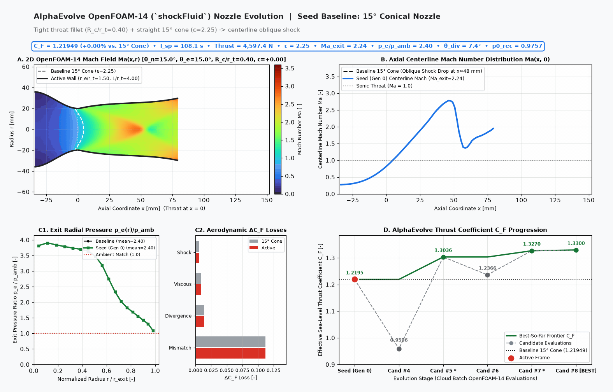

# 2D Axisymmetric Supersonic Rocket Nozzle OpenFOAM-14 Optimization (`rocket_nozzle_openfoam`)

This AlphaEvolve example evolves the 6-parameter throat-to-exit Rao/B-spline bell wall contour $r(x)$ of a **2D axisymmetric convergent-divergent supersonic rocket nozzle** evaluated in **OpenFOAM-14** (`shockFluid` Kurganov shock-capturing compressible Navier-Stokes solver).

## 1. Physics & Operating Regime

The simulation models a hot-gas supersonic rocket thruster firing at sea-level atmospheric pressure:

| Parameter | Symbol | Value | Description |
| :--- | :---: | :---: | :--- |
| Chamber Stagnation Pressure | $p_0$ | $3.0\text{ MPa}$ ($30\text{ bar}$) | Subsonic total pressure inlet condition |
| Chamber Stagnation Temperature | $T_0$ | $1200.0\text{ K}$ | Subsonic total temperature inlet condition |
| Ambient Back-Pressure | $p_{\text{amb}}$ | $101.325\text{ kPa}$ ($1\text{ atm}$) | Wave-transmissive outlet boundary condition |
| Ratio of Specific Heats | $\gamma$ | $1.40$ | Calorically perfect gas ($R = 287.10\text{ J/(kg}\cdot\text{K)}$) |
| Throat Radius | $r_t$ | $0.020\text{ m}$ ($D_t = 40\text{ mm}$) | Fixed sonic throat radius ($A^* = 1.2566 \times 10^{-3}\text{ m}^2$) |
| Convergent Inlet Radius | $r_{\text{in}}$ | $0.036\text{ m}$ ($L_c = 35\text{ mm}$) | Subsonic contraction area ratio $A_{\text{in}}/A^* = 3.24$ |
| Axisymmetric Mesh | `wedge` | $5^\circ$ ($1{,}440\text{ cells}$) | 2-block structured B-spline mesh (`22+58` axial $\times$ `18` radial) |

## 2. 6-Parameter Rao / B-Spline Bell Contour Parameterization

Candidate programs implement `design_nozzle(parameters)` inside `# EVOLVE-BLOCK-START` / `# EVOLVE-BLOCK-END` to return a 6D contour vector `x` within `BOUNDS`:

1. `x[0]` (`exit_radius_ratio`, $r_e / r_t \in [1.40, 3.00]$): Exit-to-throat radius ratio (area expansion ratio $\epsilon = (r_e / r_t)^2 \in [1.96, 9.00]$).
2. `x[1]` (`length_ratio`, $L_d / r_t \in [3.50, 7.50]$): Divergent bell length normalized by throat radius $r_t$.
3. `x[2]` (`theta_n_deg`, $\theta_n \in [12.0, 36.0]^\circ$): Post-throat circular-arc inflection expansion angle.
4. `x[3]` (`theta_e_deg`, $\theta_e \in [2.0, 18.0]^\circ$): Nozzle exit lip wall angle.
5. `x[4]` (`throat_rc_ratio`, $R_{c,t} / r_t \in [0.35, 1.40]$): Downstream throat circular-arc fillet radius ratio.
6. `x[5]` (`bell_camber`, $c_{\text{bell}} \in [-0.20, 0.25]$): Quartic bell contour camber modifier on $16\xi^2(1-\xi)^2$.

## 3. Primary Metric & Evaluation Pipeline

Each candidate evaluation executes a single OpenFOAM-14 pipeline:
1. Generates `system/blockMeshDict` with 3D B-spline edges along the 5° `wedgeFront` and `wedgeBack` patches and runs `blockMesh` + `checkMesh`.
2. Initializes `0/p`, `0/T`, and `0/U` with the smooth quasi-1D subsonic-to-supersonic isentropic solution and runs `foamRun` (`shockFluid`, Kurganov central-upwind flux with `vanAlbada` limiters).
3. Integrates exit-plane momentum thrust, pressure thrust, compressible turbulent boundary-layer skin friction, radial flow divergence loss, internal shock stagnation-pressure loss, and jet plume pressure-mismatch loss to compute the **effective sea-level thrust coefficient**:
   $$C_F = \frac{F_{\text{thrust,eff}}}{p_0 A^*}$$

| Configuration | Design Vector `x` | Effective $C_F$ | Raw $C_F$ | $I_{\text{sp}}$ ($\text{s}$) | Exit Mach $\text{Ma}_e$ | $p_e / p_{\text{amb}}$ | Exit Divergence $\theta_{\text{div}}$ |
| :--- | :--- | :---: | :---: | :---: | :---: | :---: | :---: |
| **Baseline 15° Conical** | `[1.50, 4.00, 15.0, 15.0, 0.40, 0.00]` | **1.2195** | 1.3511 | 108.1 | 2.244 | 2.401 (under-expanded) | $7.37^\circ$ |
| **Reference Rao Bell** | `[1.92, 5.40, 24.0, 4.50, 0.85, 0.06]` | **1.3538** | 1.3737 | 120.6 | 3.053 | 1.031 (matched) | $4.31^\circ$ |




## 4. Deployment & Execution on Google Cloud Batch

Deploy and launch using Cluster Toolkit (`gcluster`):

```bash
gcluster deploy deployment_experiment.yaml \
  -w --auto-approve \
  --vars "project_id=wg-hpc-demos" \
  --vars "user_experiment_name=rocket-nozzle" \
  --vars "experiment_dir=user_examples/rocket_nozzle_openfoam"
```
