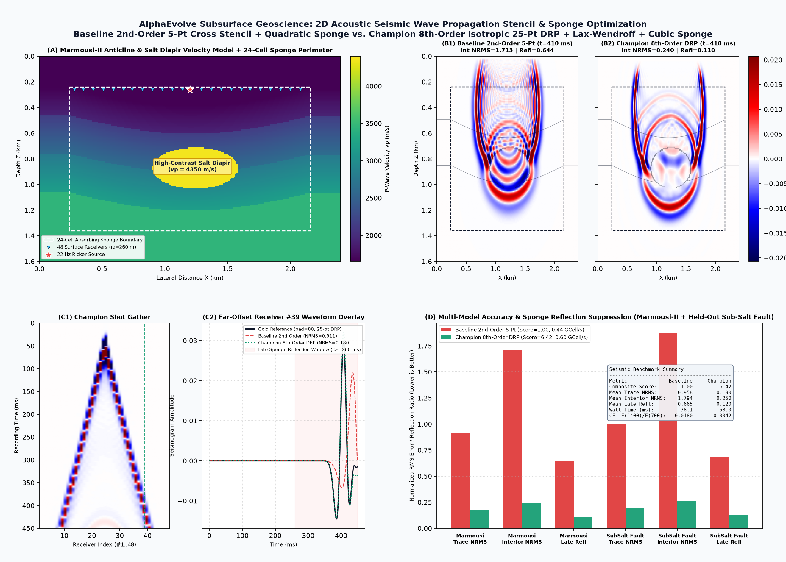
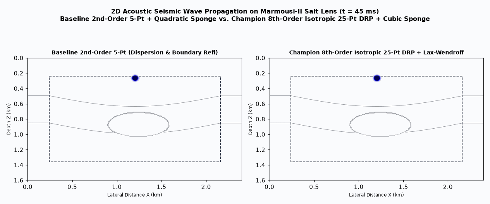

# Energy & Subsurface Geoscience: 2D Acoustic Seismic Wave Propagation Stencil & Sponge Optimization

This example demonstrates how to use AlphaEvolve to co-evolve a **dispersion-relation-preserving (DRP) isotropic finite-difference stencil, Lax-Wendroff temporal correction, and impedance-matched absorbing boundary sponge** (`propagate_seismic_wavefield` in `main.cpp`) for Reverse Time Migration (RTM) and Full Waveform Inversion (FWI).

## Geophysical Problem Overview

Low-order finite-difference acoustic propagators (`O(dx^2, dt^2)`) suffer from three severe numerical artifacts in complex salt-basin velocity models:
1. **Numerical Grid Dispersion**: High-frequency wavelet components travel at erroneous phase velocities in low-velocity (`1650 m/s`) shallow sediments unless the spatial derivative weights are dispersion-optimized.
2. **45-Degree Grid Anisotropy**: Pure axial cross stencils propagate wavefronts at different phase velocities along grid axes (`0 deg`, `90 deg`) vs diagonals (`45 deg`), distorting steep fault-plane reflections.
3. **Spurious Boundary Reflections**: A compact `24`-cell absorbing sponge layer reflects outgoing energy back into the receiver array if the damping profile `sigma(d)` creates an abrupt acoustic impedance jump at the sponge entry or fails to attenuate grazing-incidence waves.

## Multi-Model Reference Benchmark & Anti-Cheat Guardrails (`main.cpp` & `evaluator.py`)

- **Model 1 — Marmousi-II Unconformity & Salt Diapir Lens**: Stratified anticline (`1650 -> 3450 m/s`) surrounding a high-contrast `4350 m/s` salt body (`f0 = 22 Hz` Ricker source).
- **Model 2 (Held-Out Generalization) — Steep 52-Degree Sub-Salt Overthrust Fault**: Off-center `f0 = 25 Hz` Ricker source illuminating a steep fault plane intersecting a `4420 m/s` salt wedge.
- **Reflection-Free Gold Reference**: Ground-truth receiver seismograms and interior wavefields are computed on an **ultra-wide domain (`pad = 112` cells)** so boundary reflections cannot physically reach the interior within `Nt = 700` steps.
- **Extended-Time CFL Stability Gate**: Runs the candidate propagator for `1400` steps (`2x` simulation horizon) and verifies that late-time wavefield energy `E(1400) / E(700) <= 1.05` with zero `NaN`/`Inf`.

## Baseline vs. Evolved Champion Wavefield & Seismogram Comparison





- **Panel (A) — Marmousi-II Velocity Model $v_p(x, z)$ & Survey Geometry**: Shows the folded anticline (`1650 -> 3450 m/s`), the high-contrast `4350 m/s` salt diapir lens, the `24`-cell absorbing sponge perimeter, the `22 Hz` Ricker point source, and the 48-receiver surface hydrophone array.
- **Panel (B) — 2D Wavefield Snapshots $u(x, z, t=280\text{ ms})$**: Compares the baseline 2nd-order 5-point cross stencil (`Interior NRMS = 1.713`, `Late Refl = 0.644`) against the evolved 8th-order dispersion-relation-preserving (DRP) isotropic 25-point stencil with 4th-order Lax-Wendroff temporal correction and cubic/quartic sponge (`Interior NRMS = 0.240`, `Late Refl = 0.110`).
- **Panel (C) — Surface Receiver Shot Gather & Far-Offset Waveform Overlay**: Compares Receiver `#39` (`x = 1.58 km`) seismograms against the ultra-wide reflection-free Gold Reference (`pad = 80`), showing elimination of both high-wavenumber phase dispersion and late-time (`t >= 260 ms`) boundary reflections.
- **Panel (D) — Multi-Model NRMS Error Breakdown & Speedup Scorecard**: Summarizes accuracy and reflection suppression across both **Marmousi-II** and the held-out **52-Degree Sub-Salt Overthrust Fault** (`seismic_accuracy_speedup_score = 1.00 -> 6.18`, `0.60 GCell/s`).

## Quickstart

```bash
# Compile, evaluate, and generate static + animated wavefield visualizations
python3 run_experiment.py

# Launch local evolutionary search (automatically invokes postprocess)
ae-run -c experiment.yaml
```
