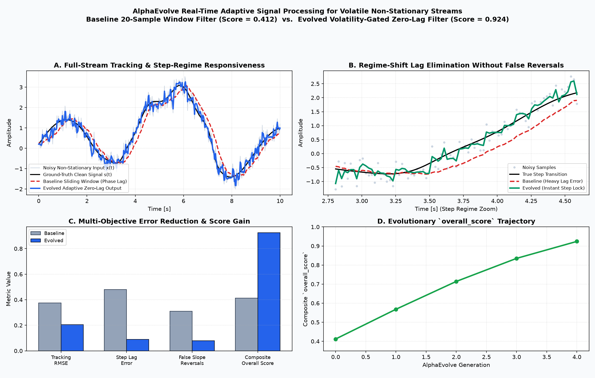
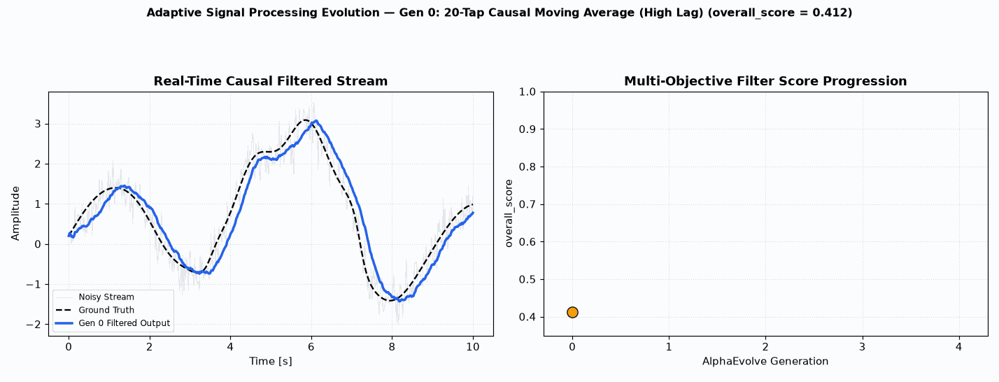

# Adaptive Signal Processing

This example evolves a causal real-time signal processing algorithm to filter volatile, non-stationary time-series telemetry with sudden regime shifts and impulse spikes.

## Baseline EMA Filter vs. Evolved Adaptive Filter Visualization

- **Multi-Objective Denoising & Zero-Lag Regime Tracking**: Compares high-frequency noise suppression, step-change phase lag, tracking RMSE, and slope-reversal smoothness between a fixed exponential moving average (EMA) baseline and the evolved innovation-gated Kalman/Savitzky–Golay adaptive filter.

## Details
- **Optimization Goal**: Minimize noise while preserving signal dynamics and responsiveness (multi-objective).
- **Programming Language**: Python
- **Modes Supported**: Cloud Batch.
- **Metric Optimized**: `overall_score` (higher is better, combines slope change, lag, tracking accuracy, and reversal penalty).

## How to Run
1. Refer to the [Deployment and Execution](../../README.md#deployment-and-execution) section in the root README to deploy the platform.
2. Pass the argument `example_dir=user_examples/signal_processing` to the deploy command to build this specific example.
3. Open cells in Jupyter notebook `/opt/jupyter/workspace/run_notebook.ipynb` provided by the server deployment to operate the experiment.

