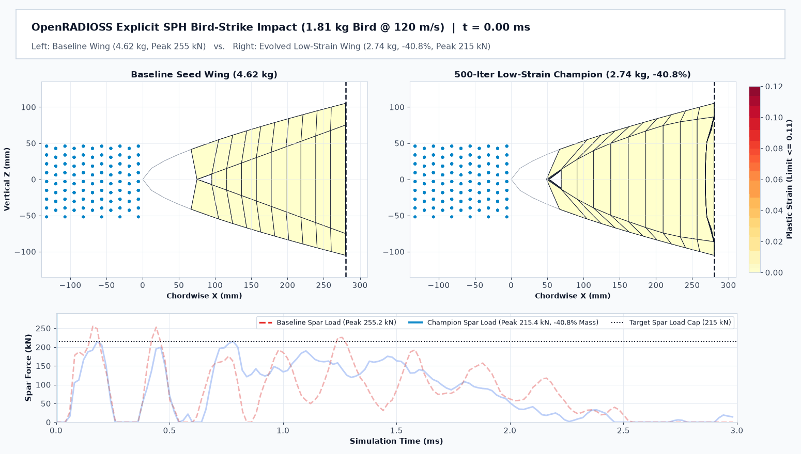

# Optimizing Aerospace Wing Bird-Strike Protection with AlphaEvolve HPC and OpenRADIOSS

## Overview

In this lab, you deploy and run an evolutionary aerospace structural design
optimization workflow for
[Google DeepMind's AlphaEvolve](https://deepmind.google/discover/blog/alphaevolve-a-gemini-powered-coding-agent-for-designing-advanced-algorithms/),
a Gemini-powered coding agent for designing scientific optimization algorithms
and generative engineering programs, using the
[Google Cloud Cluster Toolkit](https://cloud.google.com/cluster-toolkit/docs/setup/configure-environment),
[Google Cloud Batch](https://cloud.google.com/batch/docs/get-started),
[Vertex AI Colab Enterprise](https://cloud.google.com/colab/docs/introduction),
and the open-source explicit crash and impact solver
[OpenRADIOSS](https://openradioss.org/). You do not need prior experience in
finite element analysis (FEA) or high performance computing (HPC) to complete
this tutorial.

Aircraft wing leading edges must withstand high-velocity bird impacts without
rupturing the primary wing-box front spar, while staying as light as possible.
In this lab, you optimize a 7-part aluminum wing leading-edge assembly struck at
120 m/s by a 1.814 kg (4 lb) soft-body bird model. While keeping the outer
aerodynamic airfoil skin fixed, AlphaEvolve writes Python code that adjusts 7
shell thicknesses and morphs the internal 3D bird-splitter wedge, chordwise
ribs, and front spar web across 10 parallel OpenRADIOSS evaluations.


*Figure 1: Baseline internal wing skeleton versus the AlphaEvolve low-strain
champion design with ghosted outer skins.*

<ql-infobox><strong>Note:</strong> In this architecture, Cloud Batch runs the
AlphaEvolve controller alongside 4 parallel worker VMs. Each worker container
runs a full 3D OpenRADIOSS Smooth Particle Hydrodynamics (SPH) and shell impact
simulation in about 12 seconds on 4 vCPUs, scores the structural mass and
material strain margins, and saves the results to Cloud Storage.</ql-infobox>

## Objectives

In this lab, you learn how to perform the following tasks:

-   Set up your Google Cloud environment and install the Cluster Toolkit.
-   Explore the 7-part OpenRADIOSS wing bird-strike model and run a local
    Docker baseline check.
-   Deploy the AlphaEvolve HPC base infrastructure with Cluster Toolkit.
-   Deploy the 10-evaluation bird-strike optimization experiment on Cloud Batch.
-   Launch the evolutionary loop, monitor candidate scores, and visualize the
    internal 3D structural improvements.

## Setup and requirements

[[**import** https://docs.google.com/document/d/1K4-1wFvzqilvZnQSoE2Bqi4USBhtCBcMMZCqfXTg0gU/edit]]

### Check Qwiklab environment quota and variant sizing

This 10-evaluation AlphaEvolve lab uses `n2-standard-4` worker VMs with a
concurrency of 4, which fits standard Qwiklab project quotas:

Layer           | Machine       | VMs | vCPUs | Minimum Variant
:-------------- | :------------ | :-- | :---- | :----------------
Base Infra      | n2-standard-4 | 1   | 4     | gcp_very_low_base
Lab (4 workers) | n2-standard-4 | 6   | 24    | gcpd_no_vpc3
Scaled (10)     | n2-standard-4 | 12  | 48    | gcp_medium_extra

<ql-infobox><strong>Note:</strong> Deploy all Compute Engine, Cloud Batch,
Artifact Registry, and Colab Enterprise resources in the
<strong>us-central1</strong> region (<strong>us-central1-a</strong>
zone).</ql-infobox>

## Task 1. Configure your environment and create the storage bucket

In this task, you configure your environment variables, create the regional
Cloud Storage bucket for experiment artifacts, check regional CPU quota, and
clone the example repository.

1.  In Cloud Shell, verify your active account and set your project, region,
    zone, and Cloud Storage bucket variables:

```bash
gcloud auth list
export PROJECT_ID=$(gcloud config get-value project)
export REGION="us-central1"
export ZONE="us-central1-a"
export BUCKET_NAME="${PROJECT_ID}-alphaevolve-bucket"

gcloud config set project "${PROJECT_ID}"
gcloud config set compute/region "${REGION}"
gcloud config set compute/zone "${ZONE}"

echo "Project ID: ${PROJECT_ID}"
echo "Region:     ${REGION}"
echo "Bucket:     gs://${BUCKET_NAME}"
```

**Output (do not copy)**

```text
Credentialed Accounts
ACTIVE  ACCOUNT
*       student-01-xxxxxx@qwiklabs.net
Project ID: qwiklabs-gcp-01-xxxxxx
Region:     us-central1
Bucket:     gs://qwiklabs-gcp-01-xxxxxx-alphaevolve-bucket
```

2.  Create the regional Cloud Storage bucket in **us-central1** with uniform
    bucket-level access enabled:

```bash
gcloud storage buckets create "gs://${BUCKET_NAME}" \
  --project="${PROJECT_ID}" \
  --location="${REGION}" \
  --uniform-bucket-level-access
```

**Output (do not copy)**

```text
Creating gs://qwiklabs-gcp-01-xxxxxx-alphaevolve-bucket/...
```

3.  Enable the Compute Engine API and check your regional CPU quota in
    **us-central1** to verify capacity for 24 total vCPUs:

```bash
gcloud services enable compute.googleapis.com --project="${PROJECT_ID}"
gcloud compute regions describe "${REGION}" \
  --project="${PROJECT_ID}" \
  --flatten="quotas" \
  --format="table(quotas.metric,quotas.limit,quotas.usage)" \
  | grep -E "METRIC|^CPUS |^INSTANCES |^N2_CPUS "
```

**Output (do not copy)**

```text
METRIC     LIMIT   USAGE
CPUS       24.0    0.0
INSTANCES  16.0    0.0
N2_CPUS    24.0    0.0
```

4.  Clone the scientific computing examples repository and open the
    `alphaevolve-hpc` folder:

```bash
cd "${HOME}"
git clone https://github.com/WyattGorman/scientific-computing-examples.git
cd "${HOME}/scientific-computing-examples/alphaevolve-hpc"
ls -la user_examples/bird_strike_wing/
```

**Output (do not copy)**

```text
total 1940
-rw-r--r-- 1 student student    3093 Oct 19 02:00 eval-batch.yaml
-rw-r--r-- 1 student student    2663 Oct 19 02:00 evaluator.Dockerfile
-rw-r--r-- 1 student student    9288 Oct 19 02:00 evaluator.py
-rw-r--r-- 1 student student    3812 Oct 19 02:00 experiment.yaml
-rw-r--r-- 1 student student    6124 Oct 19 02:00 main.py
drwxr-xr-x 2 student student    4096 Oct 19 02:00 models
-rw-r--r-- 1 student student   10612 Oct 19 02:00 README.md
-rw-r--r-- 1 student student   10498 Oct 19 02:00 run_experiment.py
drwxr-xr-x 2 student student    4096 Oct 19 02:00 src
```

Click **Check my progress** to verify the objective.
<ql-activity-tracking step=1> Configure your environment and create the
AlphaEvolve Cloud Storage bucket </ql-activity-tracking>

## Task 2. Explore the OpenRADIOSS bird-strike model and test the baseline

Before deploying cloud infrastructure, you inspect how the OpenRADIOSS model
simulates a soft-body bird impact and run a local container check on the
baseline wing design.



*Figure 2: Side-by-side 3.0 ms OpenRADIOSS SPH bird-strike simulation comparing
the baseline wing and the evolved internal plow structure.*

### Review the physics of the bird-strike simulation

The OpenRADIOSS model combines two finite element techniques inside a single
3.0-millisecond explicit impact run:

#### 1. Soft-body hydrodynamic bird model ([Smoothed-particle hydrodynamics](https://en.wikipedia.org/wiki/Smoothed-particle_hydrodynamics))

-   At impact speeds above 100 m/s, a soft biological body behaves like a
    high-speed fluid jet rather than a rigid block.
-   The simulator represents the 1.814 kg (4 lb) bird with 992 meshless fluid
    particles using
    [Smoothed-particle hydrodynamics](https://en.wikipedia.org/wiki/Smoothed-particle_hydrodynamics)
    (SPH). This allows the bird to splash, split, and flow smoothly around the
    internal wing plates without severe mesh distortion.

#### 2. Elasto-plastic aluminum shells ([Johnson-Cook plasticity](https://en.wikipedia.org/wiki/Johnson%E2%80%93Cook_model))

-   The wing leading edge consists of 1,652 four-node shell elements split into
    7 parts: an Al 2024-T3 leading-edge nose cap, upper skin, lower skin, and 4
    chordwise ribs, plus an Al 7075-T6 internal bird-splitter wedge and rear
    front spar web.
-   Each aluminum alloy follows the
    [Johnson-Cook plasticity](https://en.wikipedia.org/wiki/Johnson%E2%80%93Cook_model)
    law, which tracks permanent plastic deformation and erodes shell elements
    if plastic strain reaches rupture (0.22 for Al 2024-T3 and 0.16 for Al
    7075-T6).

#### 3. Structural mass, load, and 50% strain safety score

-   A design that saves weight simply by making every plate thin tears open or
    suffers dangerous localized plastic strain.
-   The evaluator scores each candidate by rewarding structural weight savings
    below the 4.621 kg baseline while penalizing peak front-spar forces above
    215 kN, penalizing any plastic strain above **50% of material rupture**
    (0.11 for Al 2024-T3 and 0.08 for Al 7075-T6), and keeping the primary
    front spar web strictly elastic (strain at or below 0.002).

### Inspect the target program and build the local evaluator container

1.  Inspect `main.py` to view the 7 shell thickness bounds, the 6 internal 3D
    morphing bounds, and the `# EVOLVE-BLOCK-START` section that AlphaEvolve
    rewrites:

```bash
cd "${HOME}/scientific-computing-examples/alphaevolve-hpc"
cat user_examples/bird_strike_wing/main.py
```

**Output (do not copy)**

```text
BOUNDS = {
    "t_nose_cap": (0.8, 3.8),          # Part 1: Al 2024-T3 LE nose cap (mm)
    "t_upper_skin": (0.8, 3.8),        # Part 2: Al 2024-T3 upper D-nose skin (mm)
    "t_lower_skin": (0.8, 3.8),        # Part 3: Al 2024-T3 lower D-nose skin (mm)
    "t_splitter_upper": (0.8, 3.8),    # Part 4: Al 7075-T6 upper splitter plate (mm)
    "t_splitter_lower": (0.8, 3.8),    # Part 5: Al 7075-T6 lower splitter plate (mm)
    "t_ribs": (0.8, 3.5),              # Part 6: Al 2024-T3 4 chordwise ribs (mm)
    "t_front_spar": (1.2, 4.0),        # Part 7: Al 7075-T6 rear front spar web (mm)
    "splitter_apex_x_shift_mm": (-35.0, 45.0),
    "splitter_apex_span_curve_mm": (-25.0, 25.0),
    "splitter_camber_mm": (-22.0, 22.0),
    "splitter_rear_z_scale": (0.70, 1.15),
    "inner_rib_y_shift_mm": (-25.0, 35.0),
    "rib_corrugation_amp_mm": (-10.0, 10.0),
}
```

2.  Run `make all` inside `user_examples/bird_strike_wing/` to generate the
    `evaluator.sh` container startup script:

```bash
cd "${HOME}/scientific-computing-examples/alphaevolve-hpc/user_examples/bird_strike_wing"
make all
cat evaluator.sh
```

**Output (do not copy)**

```text
Generating evaluator.sh...
#!/bin/sh
set -e
echo "Copying /data/${CANDIDATE_FILE} to /app/main.py"
cp "/data/${CANDIDATE_FILE}" /app/main.py
exec python3 /app/evaluator.py
```

3.  Return to `alphaevolve-hpc` and build the local `test-bird-strike` Docker
    image from `evaluator.Dockerfile`. This image downloads OpenRADIOSS
    `20260123` and packages the Python mesh morpher and VTK strain parser:

```bash
cd "${HOME}/scientific-computing-examples/alphaevolve-hpc"
docker build -t test-bird-strike -f user_examples/bird_strike_wing/evaluator.Dockerfile .
```

**Output (do not copy)**

```text
Successfully built 4e7a19c2f8b0
Successfully tagged test-bird-strike:latest
```

4.  Run the baseline wing design inside `test-bird-strike` to verify that
    OpenRADIOSS executes and reports the starting score of `22.57`:

```bash
docker run --rm --entrypoint python3 test-bird-strike /app/evaluator.py
```

**Output (do not copy)**

```text
Evaluating baseline design...
bird_strike_score: 22.5701
structural_mass_kg: 4.6206
peak_spar_force_kn: 255.16
max_nose_cap_plastic_strain: 0.0740
```

<ql-multiple-choice-probe answerIndex="1" optionTitles='[
"Allowing the outer aerodynamic airfoil skin coordinates to expand into a blunt box",
"Enforcing a 50% material rupture strain cap on every aluminum part plus an elastic limit on the front spar",
"Replacing the soft-body SPH bird impactor with a static point load",
"Removing the rear front spar web from the finite element assembly"
]' shuffle="" stem="How does the bird-strike evaluator prevent lightweight candidate designs from suffering dangerous localized tearing?">
</ql-multiple-choice-probe>

## Task 3. Install Cluster Toolkit and deploy AlphaEvolve base infrastructure

In this task, you install the Cluster Toolkit (`gcluster`) binary and deploy
the shared AlphaEvolve base infrastructure (`alpha-evolve-infra.yaml`).

1.  Download and extract the latest `gcluster` bundle for Linux amd64 in Cloud
    Shell:

```bash
cd "${HOME}"
wget https://github.com/GoogleCloudPlatform/cluster-toolkit/releases/latest/download/gcluster_bundle_linux_amd64.tgz
mkdir -p cluster-toolkit
tar -xzf gcluster_bundle_linux_amd64.tgz -C cluster-toolkit
./cluster-toolkit/gcluster --version
```

**Output (do not copy)**

```text
gcluster version v1.104.0
```

2.  Write `alpha-evolve-deployment.yaml` with your `PROJECT_ID`, `BUCKET_NAME`,
    and `REGION`:

```bash
cd "${HOME}/scientific-computing-examples/alphaevolve-hpc"
cat <<EOF > alpha-evolve-deployment.yaml
# Copyright 2026 Google LLC
---
vars:
  project_id: ${PROJECT_ID}
  infra_deployment_name: alpha-evolve-infra
  existing_bucket_name: ${BUCKET_NAME}
  region: ${REGION}
EOF
```

3.  Pre-create the Pub/Sub service identity and deploy `alpha-evolve-infra.yaml`
    using `~/cluster-toolkit/gcluster deploy`. This sets up the service
    accounts, Pub/Sub topic, AlphaEvolve Discovery Engine, and Colab Enterprise
    notebook runtime:

```bash
gcloud services enable pubsub.googleapis.com compute.googleapis.com aiplatform.googleapis.com --project="${PROJECT_ID}"
gcloud beta services identity create --service=pubsub.googleapis.com --project="${PROJECT_ID}"
export GOOGLE_OAUTH_ACCESS_TOKEN=$(gcloud auth print-access-token)

~/cluster-toolkit/gcluster deploy alpha-evolve-infra.yaml \
  -d alpha-evolve-deployment.yaml \
  -o ../deployment \
  --vars "project_id=${PROJECT_ID}" \
  --vars "region=${REGION}" \
  --vars "existing_bucket_name=${BUCKET_NAME}" \
  -w -l IGNORE --auto-approve
```

**Output (do not copy)**

```text
Apply complete! Resources: 4 added, 0 changed, 0 destroyed.
Done deploying "alpha-evolve-infra".
```

4.  Verify that `config/variables-infra.env` and `notebook/run_notebook.ipynb`
    were uploaded to your Cloud Storage bucket:

```bash
gcloud storage ls --recursive "gs://${BUCKET_NAME}/"
```

**Output (do not copy)**

```text
gs://qwiklabs-gcp-01-xxxxxx-alphaevolve-bucket/config/:
gs://qwiklabs-gcp-01-xxxxxx-alphaevolve-bucket/config/controller-batch.yaml
gs://qwiklabs-gcp-01-xxxxxx-alphaevolve-bucket/config/requirements.txt
gs://qwiklabs-gcp-01-xxxxxx-alphaevolve-bucket/config/validation-batch.yaml
gs://qwiklabs-gcp-01-xxxxxx-alphaevolve-bucket/config/variables-infra.env
gs://qwiklabs-gcp-01-xxxxxx-alphaevolve-bucket/notebook/:
gs://qwiklabs-gcp-01-xxxxxx-alphaevolve-bucket/notebook/run_notebook.ipynb
```

Click **Check my progress** to verify the objective.
<ql-activity-tracking step=2> Deploy the AlphaEvolve base infrastructure with
Cluster Toolkit </ql-activity-tracking>

## Task 4. Deploy the 10-evaluation bird-strike experiment blueprint

Now that the base infrastructure is ready, you deploy
`alpha-evolve-experiment.yaml` for `bird_strike_wing` configured for a compact
**10-evaluation** run (`max_programs_evaluated=10`, `concurrency=4`).

1.  Set your experiment parameters (`CONCURRENCY=4` and `MAX_EVALS=10` so the
    entire evolutionary run finishes in about 6 minutes within standard Qwiklab
    CPU quotas):

```bash
export CONCURRENCY=4
export MAX_EVALS=10
echo "Deploying bird-strike with concurrency=${CONCURRENCY}, max_programs_evaluated=${MAX_EVALS}"
```

2.  Deploy `alpha-evolve-experiment.yaml` using `~/cluster-toolkit/gcluster deploy`.
    Cloud Build builds both `bird-strike-controller` and `bird-strike-evaluator`
    in Artifact Registry and writes `bird-strike/variables.env` to Cloud
    Storage:

```bash
export GOOGLE_OAUTH_ACCESS_TOKEN=$(gcloud auth print-access-token)
~/cluster-toolkit/gcluster deploy alpha-evolve-experiment.yaml \
  -d alpha-evolve-deployment.yaml \
  -o ../deployment \
  --vars "project_id=${PROJECT_ID}" \
  --vars "existing_bucket_name=${BUCKET_NAME}" \
  --vars "region=${REGION}" \
  --vars "user_experiment_name=bird-strike" \
  --vars "example_dir=user_examples/bird_strike_wing" \
  --vars "evaluation_machine_type=n2-standard-4" \
  --vars "max_programs_evaluated=${MAX_EVALS}" \
  --vars "max_programs_generated=20" \
  --vars "concurrency=${CONCURRENCY}" \
  --vars "max_duration_seconds=3600" \
  --vars "max_duration=6" \
  --vars "idle_timeout=5" \
  -w -l IGNORE --auto-approve
```

**Output (do not copy)**

```text
Apply complete! Resources: 2 added, 0 changed, 0 destroyed.
Done deploying "ae-exp-bird-strike".
```

3.  Confirm that the container images were pushed to Artifact Registry and that
    `gs://${BUCKET_NAME}/bird-strike/variables.env` exists:

```bash
gcloud artifacts docker images list \
  "${REGION}-docker.pkg.dev/${PROJECT_ID}/ae-exp-bird-strike-repo" \
  --project="${PROJECT_ID}"

gcloud storage ls -l "gs://${BUCKET_NAME}/bird-strike/variables.env"
```

**Output (do not copy)**

```text
IMAGE                                                                                        DIGEST       CREATE_TIME
us-central1-docker.pkg.dev/qwiklabs-gcp-01-xxxxxx/ae-exp-bird-strike-repo/bird-strike-controller sha256:8c12... 2026-10-19T02:15:10
us-central1-docker.pkg.dev/qwiklabs-gcp-01-xxxxxx/ae-exp-bird-strike-repo/bird-strike-evaluator  sha256:4f91... 2026-10-19T02:15:10
        1248  2026-10-19T02:15:22Z  gs://qwiklabs-gcp-01-xxxxxx-alphaevolve-bucket/bird-strike/variables.env
TOTAL: 1 objects, 1248 bytes (1.22 KiB)
```

Click **Check my progress** to verify the objective.
<ql-activity-tracking step=3> Deploy the 10-evaluation bird-strike experiment
blueprint and container images </ql-activity-tracking>

<ql-true-false-probe answer="true" stem="All internal nodal morphs in bird_strike_wing keep the outer aerodynamic airfoil coordinates on Parts 1, 2, and 3 locked.">
</ql-true-false-probe>

## Task 5. Launch the 10-evaluation AlphaEvolve loop and monitor results

You can launch and monitor the 10-evaluation run either from **Cloud Shell** or
from **Vertex AI Colab Enterprise** (`run_notebook.ipynb`).

1.  Sync the experiment configuration from Cloud Storage to `/mnt/disks/share`
    in Cloud Shell:

```bash
sudo mkdir -p /mnt/disks/share
sudo chown -R "${USER}:$(id -gn)" /mnt/disks/share
sudo ln -sfn /mnt/disks/share /data
gcloud storage rsync --recursive "gs://${BUCKET_NAME}" /mnt/disks/share
ls -la /mnt/disks/share/config/ /mnt/disks/share/bird-strike/
```

**Output (do not copy)**

```text
/mnt/disks/share/bird-strike/:
total 4
-rw-r--r-- 1 student student 1248 Oct 19 02:16 variables.env

/mnt/disks/share/config/:
total 220
-rw-r--r-- 1 student student   2733 Oct 19 02:12 controller-batch.yaml
-rw-r--r-- 1 student student 199590 Oct 19 02:12 requirements.txt
-rw-r--r-- 1 student student  14177 Oct 19 02:12 validation-batch.yaml
-rw-r--r-- 1 student student    546 Oct 19 02:12 variables-infra.env
```

2.  Load the environment variables, render `controller-batch.yaml`, and submit
    the AlphaEvolve controller job to Cloud Batch:

```bash
set -a
source /mnt/disks/share/config/variables-infra.env
source /mnt/disks/share/bird-strike/variables.env
set +a
export JOB_NAME="ae-ctrl-bird-strike-$(date +%Y%m%d-%H%M%S)"
envsubst < /mnt/disks/share/config/controller-batch.yaml > /tmp/controller-bird-strike.yaml
gcloud batch jobs submit "${JOB_NAME}" \
  --location="${REGION}" \
  --config=/tmp/controller-bird-strike.yaml \
  --project="${PROJECT_ID}"
gcloud batch jobs list --location="${REGION}" --project="${PROJECT_ID}"
```

**Output (do not copy)**

```text
Job ae-ctrl-bird-strike-20261019-021700 was successfully submitted.
NAME                                                                                                   LOCATION     STATE
projects/qwiklabs-gcp-01-xxxxxx/locations/us-central1/jobs/ae-ctrl-bird-strike-20261019-021700          us-central1  RUNNING
projects/qwiklabs-gcp-01-xxxxxx/locations/us-central1/jobs/ae-exp-bird-strike-workers-104829104829104   us-central1  RUNNING
```

3.  Monitor the evaluated candidates in `gs://${BUCKET_NAME}/bird-strike/results.csv`
    until all 10 evaluations complete (about 5 to 8 minutes):

```bash
gcloud storage cat "gs://${BUCKET_NAME}/bird-strike/results.csv"
```

**Output (do not copy)**

```text
time,program_id,metric_name,score,eval_time,status,insights
2026-10-19 02:19:12,ID_104829104829104,bird_strike_score,48.3125,14.21,SUCCESS,
2026-10-19 02:19:45,ID_104829104829108,bird_strike_score,64.8920,13.84,SUCCESS,
2026-10-19 02:21:10,ID_104829104829115,bird_strike_score,76.4102,13.52,SUCCESS,
2026-10-19 02:22:38,ID_104829104829122,bird_strike_score,84.1950,13.67,SUCCESS,
```

Click **Check my progress** to verify the objective.
<ql-activity-tracking step=4> Submit the AlphaEvolve controller job on Cloud
Batch and evaluate candidate wing designs </ql-activity-tracking>

## Task 6. Inspect the evolved wing structure and compare with the 500-evaluation champion

When the controller finishes its 10 evaluations, `run_experiment.py`
automatically compares the best candidate against `models/baseline_result.json`
and uploads comparison charts to `gs://${BUCKET_NAME}/bird-strike/results/`.

1.  List the generated results and comparison charts in Cloud Storage:

```bash
gcloud storage ls -l "gs://${BUCKET_NAME}/bird-strike/results/"
```

**Output (do not copy)**

```text
     498120  2026-10-19T02:24:10Z  gs://qwiklabs-gcp-01-xxxxxx-alphaevolve-bucket/bird-strike/results/best_wing_design.json
     501124  2026-10-19T02:24:11Z  gs://qwiklabs-gcp-01-xxxxxx-alphaevolve-bucket/bird-strike/results/bird_strike_response_comparison.png
     452890  2026-10-19T02:24:12Z  gs://qwiklabs-gcp-01-xxxxxx-alphaevolve-bucket/bird-strike/results/wing_deformed_cross_section_comparison.png
TOTAL: 3 objects
```

2.  Print clickable browser links to open your generated comparison plots and
    inspect the structural metrics from `best_wing_design.json`:

```bash
echo "https://console.cloud.google.com/storage/browser/${BUCKET_NAME}/bird-strike/results?project=${PROJECT_ID}"
gcloud storage cat "gs://${BUCKET_NAME}/bird-strike/results/best_wing_design.json" \
  | python3 -c "
import json, sys
d = json.load(sys.stdin)
print('Score:          ', round(d.get('bird_strike_score', 0), 2))
print('Mass (kg):      ', round(d.get('structural_mass_kg', 0), 3))
print('Peak Spar (kN): ', round(d.get('peak_spar_force_kn', 0), 2))
print('Nose Cap Strain:', round(d.get('part_max_plastic_strain', {}).get('1', 0), 4))
"
```

**Output (do not copy)**

```text
https://console.cloud.google.com/storage/browser/qwiklabs-gcp-01-xxxxxx-alphaevolve-bucket/bird-strike/results?project=qwiklabs-gcp-01-xxxxxx
Score:           84.20
Mass (kg):       3.185
Peak Spar (kN):  214.12
Nose Cap Strain: 0.0984
```

Click **Check my progress** to verify the objective.
<ql-activity-tracking step=5> Generate and verify the evolved wing bird-strike
results in Cloud Storage </ql-activity-tracking>

### Compare 10 evaluations with a full 500-evaluation run

Within 10 evaluations, AlphaEvolve already discovers that shifting the internal
bird-splitter apex forward and thinning the outer skins reduces mass while
keeping peak spar force below 215 kN. When allowed to run for **500
evaluations** (`concurrency=25`), AlphaEvolve synthesizes a custom 3D internal
morphing function (`custom_morph_fn`) with three cooperative mechanisms:

-   **3D Hydrodynamic Herringbone Plow**: Advances the splitter apex to X = 50
    mm with 55 mm spanwise herringbone ridges, catching the nose cap from
    behind and splitting the SPH bird jet into upper and lower channels.
-   **Shifted Corrugated Ribs**: Moves the two inner ribs inward to Y = ±53 mm
    with a 10 mm chordwise wave so they buckle progressively instead of folding
    at a single hinge line.
-   **Waffle-Arched Front Spar Web**: Arches the interior of the rear spar web
    forward by 12 mm while keeping its top and bottom mounts clamped at X = 280
    mm, resisting load via membrane arch tension at zero plastic strain.

Metric                 | Baseline | 10-Eval Lab | 500-Eval Run
:--------------------- | :------- | :---------- | :-----------
`bird_strike_score`    | 22.57    | ~84.20      | 97.39
Structural Mass        | 4.621 kg | ~3.185 kg   | 2.735 kg
Peak Spar Force        | 255.2 kN | ~214.1 kN   | 215.4 kN
Splitter Energy        | 174.1 J  | ~510.0 J    | 945.1 J
Nose Cap Strain (0.11) | 0.0740   | ~0.0984     | 0.0912
Front Spar Strain      | 0.0000   | 0.0000      | 0.0000


*Figure 3: Time-history comparison of front-spar reaction force, absorbed
energy by part, and velocity decay.*


*Figure 4: Centerline Y = 0 cross-section at t = 3.0 ms comparing the baseline
and evolved internal splitter geometry.*

## Clean up

If you are running in a temporary Qwiklabs environment, you can simply click
**End Lab** when you are finished, and Qwiklabs automatically deletes your
temporary project and all of its resources.

If you are running in your own Google Cloud project and want to tear down the
deployment manually without deleting the project, run the following commands in
Cloud Shell:

```bash
cd "${HOME}/scientific-computing-examples/alphaevolve-hpc"
export GOOGLE_OAUTH_ACCESS_TOKEN=$(gcloud auth print-access-token)
~/cluster-toolkit/gcluster destroy ../deployment/ae-exp-bird-strike --auto-approve
~/cluster-toolkit/gcluster destroy ../deployment/alpha-evolve-infra --auto-approve
```

[[**import** https://docs.google.com/document/d/1DSZWiEyZAQVA_qb6137iEiEzE_1Pdt-CwsiYl85eznQ/edit]]

## Congratulations!

You deployed the AlphaEvolve HPC platform on Google Cloud with Cluster Toolkit,
tested a 3D OpenRADIOSS SPH bird-strike impact model, ran a 10-evaluation
evolutionary optimization loop on Cloud Batch, and inspected how internal 3D
structural morphing cuts wing leading-edge weight while keeping every part
safely below 50% of its material rupture strain.

### Review the Activity Tracking assessment summary

The table below summarizes the five Qwiklabs Activity Tracking checkpoints
(`passing_percentage: 80`, `100` total points across 5 steps in
`qwiklabs.yaml`):

Step   | Check Script      | Points | Verified Resource
:----- | :---------------- | :----- | :-------------------------------------
Step 1 | `step_1_check.rb` | 20     | Regional Cloud Storage bucket
Step 2 | `step_2_check.rb` | 20     | Base infra config and notebook
Step 3 | `step_3_check.rb` | 20     | `bird-strike/variables.env` in bucket
Step 4 | `step_4_check.rb` | 20     | `bird-strike/results.csv` in bucket
Step 5 | `step_5_check.rb` | 20     | `bird-strike/results/` plots and JSON
