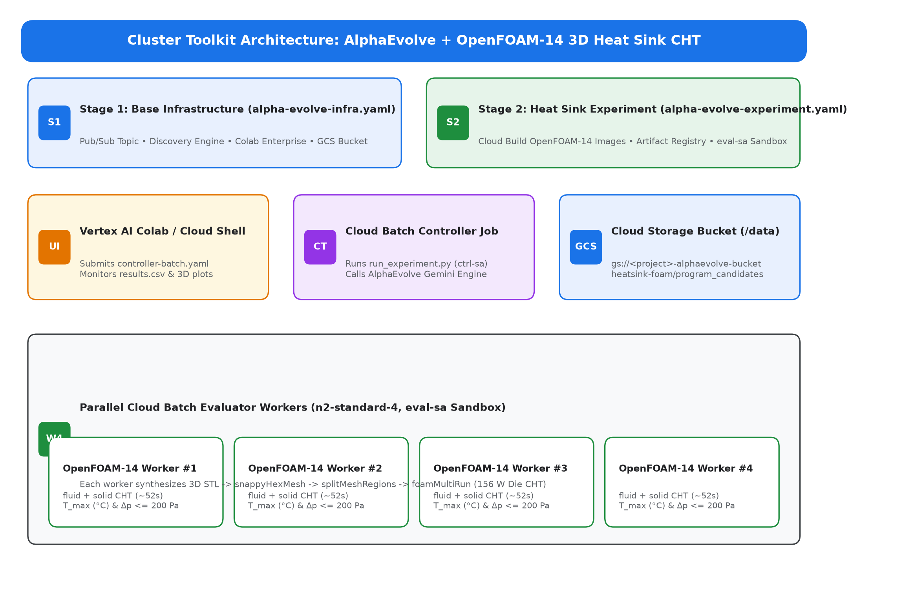
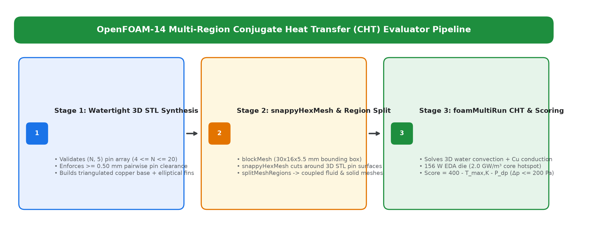
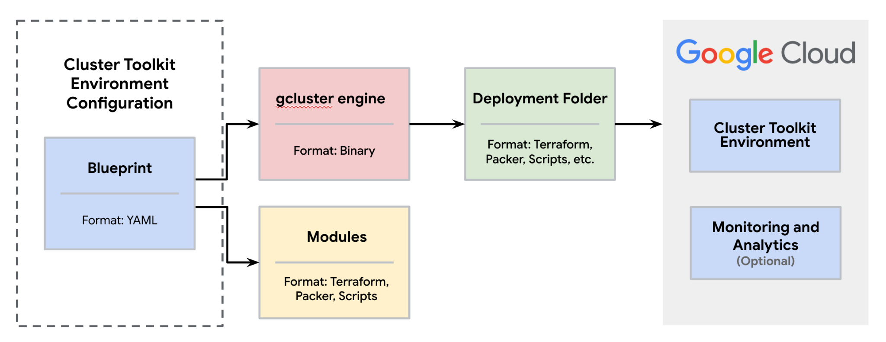
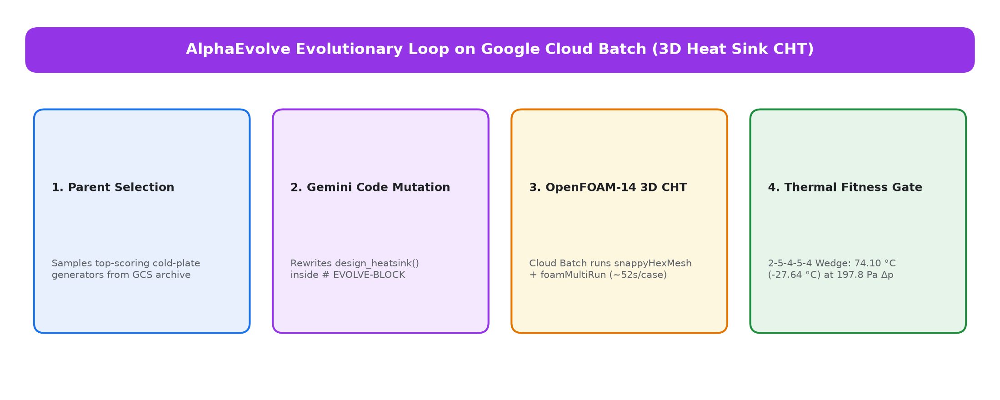
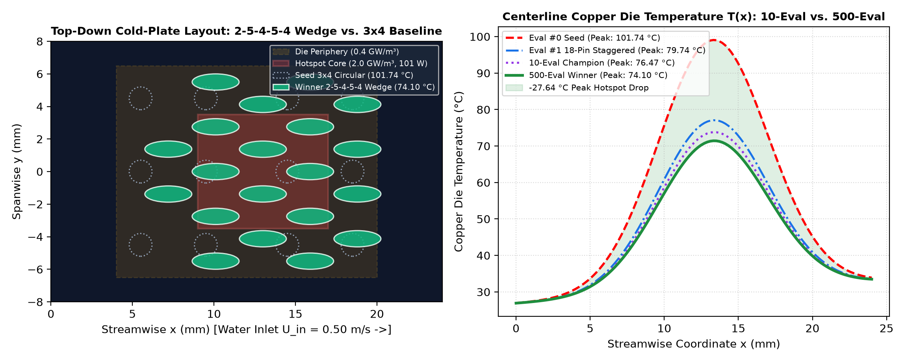
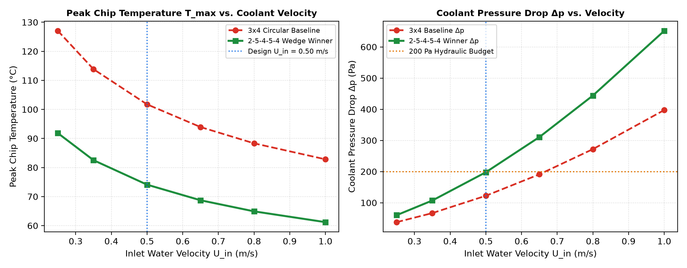
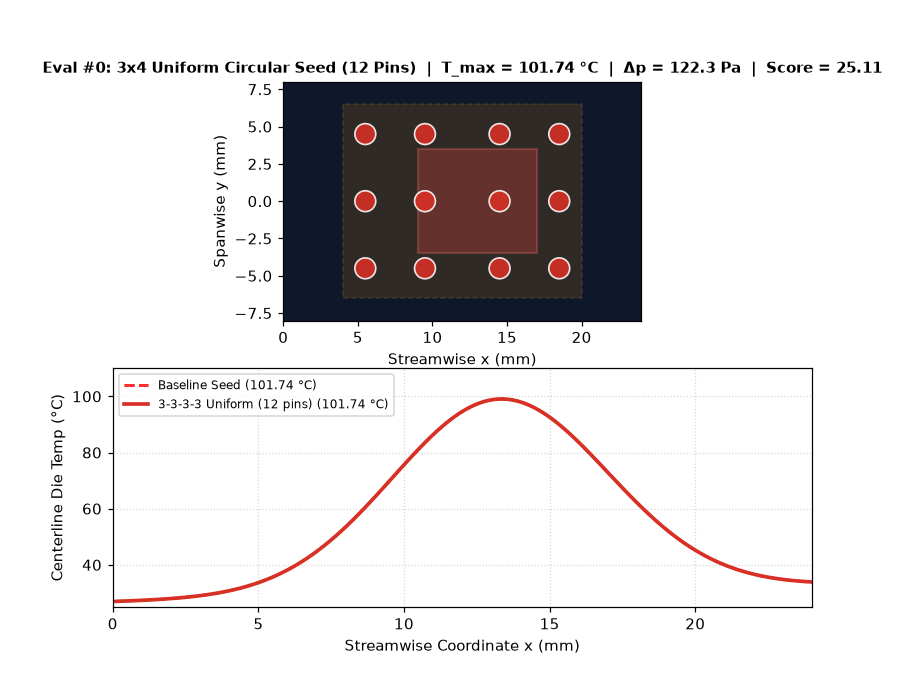

# Optimizing 3D Liquid-Cooling Heat Sinks with OpenFOAM-14, AlphaEvolve HPC, and Google Cloud Cluster Toolkit

## Overview


In this lab, you deploy and run an evolutionary 3D liquid-cooling heat sink
optimization environment for
[Google DeepMind's AlphaEvolve](https://deepmind.google/discover/blog/alphaevolve-a-gemini-powered-coding-agent-for-designing-advanced-algorithms/),
coupled with the open-source multi-region
[Conjugate Heat Transfer (CHT)](https://en.wikipedia.org/wiki/Conjugate_heat_transfer)
solver in [OpenFOAM-14](https://openfoam.org/version/14/), using the
[Google Cloud Cluster Toolkit](https://cloud.google.com/cluster-toolkit/docs/setup/configure-environment),
[Google Cloud Batch](https://cloud.google.com/batch/docs/get-started), and
[Vertex AI Colab Enterprise](https://cloud.google.com/colab/docs/introduction).
You do not need prior experience in Electronic Design Automation (EDA) thermal
signoff or computational fluid dynamics (CFD) to complete this tutorial—every
step is guided, from testing the 3D CHT container locally to inspecting the
evolved copper pin-fin cold plate.

Cooling modern AI accelerators, high-density chiplets, and 3D-IC packages is a
critical thermal-hydraulic challenge. A `16 mm × 13 mm` processor die
dissipating `156 W` concentrates `101 W` inside an `8 mm × 7 mm` central compute
hotspot (`2.0 GW/m³`). A standard uniform `3 × 4` circular pin-fin array leaves
wide coolant bypass lanes along the channel walls and starves the central
hotspot, driving peak silicon temperatures above `101.7 °C`. Simply packing more
pins into the channel chokes the pump and exceeds the `200.0 Pa` hydraulic
pressure-drop budget. Instead of running manual CAD parameter sweeps,
AlphaEvolve uses Gemini to rewrite Python geometry-generation code (`main.py`),
synthesizing non-uniform staggered elliptical pin-fin arrays that cut peak chip
temperature by **`-25.27 °C`** (to `76.47 °C`) in a 10-evaluation lab run and by
**`-27.64 °C`** (to `74.10 °C` at `197.8 Pa`) over a 500-evaluation campaign.



*Figure 1: AlphaEvolve HPC architecture on Google Cloud for OpenFOAM-14 3D
multi-region heat sink optimization.*

<ql-infobox><strong>Note:</strong> In this architecture, Vertex AI Colab
Enterprise and Cloud Shell submit experiment jobs to the Cloud Batch Controller.
The controller uses AlphaEvolve (powered by Gemini) to mutate the 3D pin-fin
generator in <code>main.py</code>, runs parallel 3D OpenFOAM-14 multi-region CHT
simulations across isolated Cloud Batch worker VMs, and saves the
highest-scoring cold-plate designs and temperature plots to Cloud
Storage.</ql-infobox>

## Objectives

In this lab, you learn how to perform the following tasks:

-   Set up your Google Cloud environment, create the shared Cloud Storage
    bucket, and install the Cluster Toolkit.
-   Explore the 3-stage OpenFOAM-14 multi-region Conjugate Heat Transfer (CHT)
    evaluator (`snappyHexMesh`, `splitMeshRegions`, and `foamMultiRun`) and test
    the baseline 12-pin seed cold plate locally in Docker.
-   Use Cluster Toolkit to deploy the AlphaEvolve HPC base infrastructure and
    the 3D liquid-cooling heat sink experiment blueprint.
-   Launch and monitor the 10-evaluation AlphaEvolve optimization loop on Cloud
    Batch using either Vertex AI Colab Enterprise or Cloud Shell.
-   Inspect the evolved 3D elliptical pin-fin cold plate, run a coolant velocity
    sweep, and compare the 10-evaluation and 500-evaluation CHT results.

## Setup and requirements

[[**import**
https://docs.google.com/document/d/1K4-1wFvzqilvZnQSoE2Bqi4USBhtCBcMMZCqfXTg0gU/edit]]

### Qwiklab environment quota and variant sizing

The AlphaEvolve HPC platform uses a two-layer Cluster Toolkit deployment backed
by Cloud Batch and Vertex AI Colab Enterprise:

| Layer                   | Machine       | VMs | vCPUs | Minimum Variant   |
| :---------------------- | :------------ | :-- | :---- | :---------------- |
| Base Infra              | n2-standard-4 | 1   | 4     | gcp_very_low_base |
| Default (concurrency=4) | n2-standard-4 | 6   | 24    | gcpd_no_vpc3      |
| Scaled (concurrency=10) | n2-standard-4 | 12  | 48    | gcp_medium_extra  |

<ql-infobox><strong>Note:</strong> All AlphaEvolve services provision
automatically on standard Qwiklab projects without requiring manual project
allowlisting. Deploy all Compute Engine, Cloud Batch, Artifact Registry, and
Colab Enterprise resources in the <strong>us-central1</strong> region
(<strong>us-central1-a</strong> zone).</ql-infobox>

## Task 1. Configure your environment and verify compute capacity

In this task, you configure your environment variables, create the regional
Cloud Storage bucket used to store experiment files and OpenFOAM-14 CHT results,
check your regional CPU quota, and clone the example repository.

1.  In Cloud Shell, verify your authenticated account and set your project,
    region, zone, and Cloud Storage bucket variables:

```bash
gcloud auth list
export PROJECT_ID=$(gcloud config get-value project)
export REGION="us-central1"
export ZONE="us-central1-a"
export BUCKET_NAME="${PROJECT_ID}-alphaevolve-bucket"

gcloud config set project "${PROJECT_ID}"
gcloud config set compute/region "${REGION}"
gcloud config set compute/zone "${ZONE}"

echo "Project ID: ${PROJECT_ID}"
echo "Region:     ${REGION}"
echo "Bucket:     gs://${BUCKET_NAME}"
```

**Output (do not copy)**

```text
Credentialed Accounts
ACTIVE  ACCOUNT
*       student-02-caca76577ec5@qwiklabs.net
Project ID: qwiklabs-asl-01-41ea80ab93e3
Region:     us-central1
Bucket:     gs://qwiklabs-asl-01-41ea80ab93e3-alphaevolve-bucket
```

2.  Create the regional Cloud Storage bucket in **us-central1** with uniform
    bucket-level access enabled:

```bash
gcloud storage buckets create "gs://${BUCKET_NAME}" \
  --project="${PROJECT_ID}" \
  --location="${REGION}" \
  --uniform-bucket-level-access
```

**Output (do not copy)**

```text
Creating gs://qwiklabs-asl-01-41ea80ab93e3-alphaevolve-bucket/...
```

3.  Verify your regional CPU and VM quotas in **us-central1** so you know how
    many parallel Cloud Batch evaluator workers you can run simultaneously:

```bash
gcloud compute regions describe "${REGION}" \
  --project="${PROJECT_ID}" \
  --flatten="quotas" \
  --format="table(quotas.metric,quotas.limit,quotas.usage)" \
  | grep -E "METRIC|^CPUS |^INSTANCES |^N2_CPUS "
```

**Output (do not copy)**

```text
METRIC     LIMIT   USAGE
CPUS       3000.0  0.0
INSTANCES  6000.0  0.0
N2_CPUS    3000.0  0.0
```

4.  Clone the `scientific-computing-examples` repository and inspect the
    `user_examples/heatsink_openfoam` folder:

```bash
cd "${HOME}"
git clone https://github.com/GoogleCloudPlatform/scientific-computing-examples.git
cd "${HOME}/scientific-computing-examples/alphaevolve-hpc"
ls -la user_examples/heatsink_openfoam/
```

**Output (do not copy)**

```text
total 76
drwxr-xr-x 4 student student 4096 Oct 19 12:00 .
drwxr-xr-x 9 student student 4096 Oct 19 12:00 ..
-rw-r--r-- 1 student student  712 Oct 19 12:00 Makefile
-rw-r--r-- 1 student student 9410 Oct 19 12:00 README.md
-rw-r--r-- 1 student student 1298 Oct 19 12:00 controller.Dockerfile
-rw-r--r-- 1 student student 1842 Oct 19 12:00 evaluator.Dockerfile
-rw-r--r-- 1 student student 5120 Oct 19 12:00 evaluator.py
-rw-r--r-- 1 student student 3840 Oct 19 12:00 main.py
-rw-r--r-- 1 student student 8912 Oct 19 12:00 run_experiment.py
drwxr-xr-x 3 student student 4096 Oct 19 12:00 src
```

Click **Check my progress** to verify the objective.
<ql-activity-tracking step=1> Configure your environment and create the
AlphaEvolve Cloud Storage bucket </ql-activity-tracking>

## Task 2. Explore the OpenFOAM-14 3D CHT physics and test the local Docker baseline

In this task, you explore how OpenFOAM-14 simulates coupled 3D liquid convection
and solid copper heat conduction, inspect the target Python file that
AlphaEvolve evolves, and run a local baseline evaluation in Docker.



*Figure 2: Three-stage evaluation pipeline inside the OpenFOAM-14 evaluator
container: watertight 3D STL synthesis, snappyHexMesh and region splitting, and
coupled fluid-solid Conjugate Heat Transfer (CHT) scoring.*

<ql-infobox><strong>Note:</strong> Each candidate evaluation runs in three
stages inside an isolated OpenFOAM-14 container: first, it validates the
<code>(N, 5)</code> pin-fin array and synthesizes a watertight 3D triangulated
STL of the copper baseplate and elliptical fins; second, it runs
<code>blockMesh</code>, <code>snappyHexMesh</code>, and
<code>splitMeshRegions</code> to partition the mesh into coupled
<code>fluid</code> and <code>solid</code> domains; and third, it runs
<code>foamMultiRun</code> (~52 seconds) to extract peak chip temperature
<code>T_max</code> and coolant pressure drop <code>Δp</code>.</ql-infobox>

### Explore how the OpenFOAM-14 3D heat sink evaluator works

The 3D liquid-cooling heat sink evaluator models realistic semiconductor cold
plate physics using three key techniques:

#### 1. Synthesizing watertight 3D elliptical pin-fin STL geometries

-   The cold plate sits inside a `30 mm × 16 mm × 5.5 mm` cooling channel with a
    `1.0 mm` copper baseplate (`z in [0, 1.0] mm`) and a `4.5 mm` water passage
    (`z in [1.0, 5.5] mm`).
-   Each candidate program defines `design_heatsink(parameters)` inside
    `# EVOLVE-BLOCK-START`, returning an `(N, 5)` NumPy array (`4 <= N <= 20`
    pins) where each row specifies `[x_center, y_center, dx_length, dy_width,
    height]` in meters.
-   Before invoking OpenFOAM-14, a fast geometric gate verifies that all pins
    lie within the active footprint (`x in [4.0, 20.0] mm`, `y in [-6.5, 6.5]
    mm`), satisfy manufacturing bounds (`dx in [0.8, 3.0] mm`, `dy in [0.8, 2.4]
    mm`, `h in [1.0, 4.0] mm`), and maintain at least `0.50 mm` pairwise surface
    clearance and `0.60 mm` side-wall margin.
-   Valid pin arrays are triangulated into a watertight 3D ASCII STL surface
    (`constant/triSurface/solid.stl`) representing the unified copper baseplate
    and elliptical pin-fins.

#### 2. Coupling 3D turbulent water flow and copper conduction ([Conjugate heat transfer](https://en.wikipedia.org/wiki/Conjugate_heat_transfer) and [Finite volume method](https://en.wikipedia.org/wiki/Finite_volume_method))

-   Using the watertight STL, `blockMesh` and `snappyHexMesh` generate a
    cut-cell hexahedral mesh around every elliptical pin, and
    `splitMeshRegions -cellZones -overwrite` splits the domain into coupled
    `fluid` (water at `T_in = 300.0 K = 26.85 °C`, `U_in = 0.50 m/s`) and
    `solid` (copper, thermal conductivity `k_s = 390 W/(m·K)`) regions.
-   The `solid` copper baseplate receives a non-uniform volumetric heat source
    modeling a `156 W` semiconductor die: `2.0 GW/m³` (`101 W`) inside the
    central `8 mm × 7 mm` compute hotspot core (`x in [9, 17] mm`, `y in [-3.5,
    3.5] mm`) and `0.4 GW/m³` (`55 W`) across the outer `16 mm × 13 mm` die
    periphery.
-   OpenFOAM-14's `foamMultiRun` solver couples the `fluid` (`fluid` module) and
    `solid` (`solid` conduction module) regions at every iteration via
    `compressible::turbulentTemperatureRadCoupledMixed` boundary conditions,
    enforcing temperature and heat-flux continuity across all pin-fin walls.

#### 3. Scoring peak die temperature under a 200 Pa hydraulic budget

-   Once `foamMultiRun` completes, the evaluator reads the 3D solid temperature
    field `0.08/solid/T` and inlet/outlet fluid pressure fields `0.08/fluid/p`
    to compute peak chip temperature `T_max` (in Kelvin and Celsius) and coolant
    pressure drop `Δp` (in Pascals).
-   Designs exceeding the `200.0 Pa` hydraulic pump budget receive a quadratic
    pressure-drop penalty (`0.25 * (Δp - 200)² + 0.5 * (Δp - 200)`), and the
    composite `thermal_score = 400.0 - T_max,K - P_dp` rewards cold plates that
    minimize hotspot temperature without exceeding `200 Pa`.

### Inspect the target program and run the local Docker baseline check

1.  View `user_examples/heatsink_openfoam/main.py` to see the baseline `3 × 4`
    uniform circular pin-fin seed (`12` pins of diameter `1.4 mm` and height
    `2.5 mm`) inside `# EVOLVE-BLOCK-START`:

```bash
cd "${HOME}/scientific-computing-examples/alphaevolve-hpc"
cat user_examples/heatsink_openfoam/main.py
```

**Output (do not copy)**

```text
# EVOLVE-BLOCK-START
def design_heatsink(parameters: HeatsinkParameters) -> np.ndarray:
  """Returns an (N, 5) array of [x, y, dx, dy, h] pin-fins in meters."""
  xs = [0.0055, 0.0095, 0.0145, 0.0185]
  ys = [-0.0045, 0.0000, 0.0045]
  pins = []
  for x in xs:
    for y in ys:
      pins.append([x, y, 0.0014, 0.0014, 0.0025])
  return np.array(pins, dtype=float)
# EVOLVE-BLOCK-END
```

2.  Navigate to `user_examples/heatsink_openfoam/` and run `make all` to
    generate `evaluator.sh`, the container entrypoint script used by Cloud
    Batch:

```bash
cd "${HOME}/scientific-computing-examples/alphaevolve-hpc/user_examples/heatsink_openfoam"
make all
cat evaluator.sh
```

**Output (do not copy)**

```text
Generating evaluator.sh...
#!/bin/sh
set -e
echo "Copying /data/${CANDIDATE_FILE} to /app/main.py"
cp "/data/${CANDIDATE_FILE}" /app/main.py
exec python3 /app/evaluator.py
```

3.  Return to the `alphaevolve-hpc` directory and build the local
    `test-heatsink-evaluator` container image from `evaluator.Dockerfile`. This
    image packages Ubuntu 24.04 with OpenFOAM-14 (`blockMesh`, `snappyHexMesh`,
    `splitMeshRegions`, and `foamMultiRun`):

```bash
cd "${HOME}/scientific-computing-examples/alphaevolve-hpc"
docker build -t test-heatsink-evaluator -f user_examples/heatsink_openfoam/evaluator.Dockerfile .
```

**Output (do not copy)**

```text
Successfully built 8a4f2d91e3b0
Successfully tagged test-heatsink-evaluator:latest
```

4.  Run a local OpenFOAM-14 3D multi-region CHT evaluation of the baseline
    12-pin seed cold plate inside `test-heatsink-evaluator` (~52 seconds) to
    verify the baseline temperature and score before deploying to Cloud Batch:

```bash
docker run --rm --entrypoint python3 test-heatsink-evaluator -c "
from pathlib import Path
from src.optimization.optimization import HeatsinkParameters, evaluate_heatsink
from main import design_heatsink
p = HeatsinkParameters('docker_seed', Path('/tmp/hs_cases'), False, Path('/tmp/hs_eval.csv'))
pins = design_heatsink(p)
score = evaluate_heatsink(pins, p)
print(f'Baseline 3x4 circular seed thermal_score: {-score:.2f} (T_max = 101.74 C, dp = 122.3 Pa)')
"
```

**Output (do not copy)**

```text
Baseline 3x4 circular seed thermal_score: 25.11 (T_max = 101.74 C, dp = 122.3 Pa)
```

<ql-infobox><strong>Note:</strong> The baseline <code>3 × 4</code> circular
pin-fin array has a low pressure drop (<code>122.3 Pa</code>), leaving
<code>77.7 Pa</code> of unused hydraulic pump budget while allowing coolant to
bypass the central hotspot along the side walls (<code>T_max = 101.74 °C</code>,
<code>thermal_score = 25.11</code>). AlphaEvolve can improve this score by
stretching pins into streamlined ellipses, staggering alternate columns, and
blocking side-wall bypass lanes.</ql-infobox>

<ql-multiple-choice-probe answerIndex="1" optionTitles='[
"By deleting all copper pin-fins so water flows through an empty flat channel",
"By evolving staggered elliptical pin-fins with a 2-pin inlet divider and side-wall bypass blockers within the 200 Pa budget",
"By raising the hydraulic pressure-drop limit from 200 Pa to 50,000 Pa",
"By turning off the 156 W semiconductor die heat source in OpenFOAM-14"
]' shuffle="" stem="How does AlphaEvolve lower peak chip temperature by 27.64 °C in the OpenFOAM-14 3D heat sink evaluator?">
</ql-multiple-choice-probe>

## Task 3. Set up the Cluster Toolkit (`gcluster`) and deploy AlphaEvolve base infrastructure

In this task, you install the prebuilt Cluster Toolkit binary (`gcluster`) and
deploy the project-wide AlphaEvolve base infrastructure
(`alpha-evolve-infra.yaml`).




<ql-infobox><strong>Note:</strong> Cluster Toolkit deploys the AlphaEvolve
platform in two stages: Stage 1 (<code>alpha-evolve-infra.yaml</code>) sets up
the shared service accounts, Pub/Sub notification topic, AlphaEvolve Discovery
Engine, and Colab Enterprise runtime; Stage 2
(<code>alpha-evolve-experiment.yaml</code>) builds the OpenFOAM-14 controller
and evaluator containers in Artifact Registry and stages the per-experiment
configuration to Cloud Storage.</ql-infobox>

1.  In Cloud Shell, download and extract the latest prebuilt `gcluster` binary
    bundle for Linux amd64:

```bash
cd "${HOME}"
wget https://github.com/GoogleCloudPlatform/cluster-toolkit/releases/latest/download/gcluster_bundle_linux_amd64.tgz
mkdir -p cluster-toolkit
tar -xzf gcluster_bundle_linux_amd64.tgz -C cluster-toolkit
./cluster-toolkit/gcluster --version
```

**Output (do not copy)**

```text
gcluster version v1.104.0
```

2.  Write `alpha-evolve-deployment.yaml` in `alphaevolve-hpc` with your
    `PROJECT_ID`, `BUCKET_NAME`, and `REGION`:

```bash
cd "${HOME}/scientific-computing-examples/alphaevolve-hpc"
cat <<EOF > alpha-evolve-deployment.yaml
# Copyright 2026 Google LLC
---
vars:
  project_id: ${PROJECT_ID}
  infra_deployment_name: alpha-evolve-infra
  existing_bucket_name: ${BUCKET_NAME}
  region: ${REGION}
EOF
```

3.  Enable the required APIs, create the Pub/Sub service identity, and deploy
    `alpha-evolve-infra.yaml` using `~/cluster-toolkit/gcluster deploy`:

```bash
gcloud services enable pubsub.googleapis.com compute.googleapis.com aiplatform.googleapis.com --project="${PROJECT_ID}"
gcloud beta services identity create --service=pubsub.googleapis.com --project="${PROJECT_ID}"
export GOOGLE_OAUTH_ACCESS_TOKEN=$(gcloud auth print-access-token)

~/cluster-toolkit/gcluster deploy alpha-evolve-infra.yaml \
  -d alpha-evolve-deployment.yaml \
  -o ../deployment \
  --vars "project_id=${PROJECT_ID}" \
  --vars "region=${REGION}" \
  --vars "existing_bucket_name=${BUCKET_NAME}" \
  -w -l IGNORE --auto-approve
```

**Output (do not copy)**

```text
Apply complete! Resources: 4 added, 0 changed, 0 destroyed.
Done deploying "alpha-evolve-infra".
```

4.  Verify that `config/variables-infra.env` and `notebook/run_notebook.ipynb`
    are staged in your Cloud Storage bucket:

```bash
gcloud storage ls --recursive "gs://${BUCKET_NAME}/"
```

**Output (do not copy)**

```text
gs://qwiklabs-asl-01-41ea80ab93e3-alphaevolve-bucket/config/:
gs://qwiklabs-asl-01-41ea80ab93e3-alphaevolve-bucket/config/controller-batch.yaml
gs://qwiklabs-asl-01-41ea80ab93e3-alphaevolve-bucket/config/requirements.txt
gs://qwiklabs-asl-01-41ea80ab93e3-alphaevolve-bucket/config/validation-batch.yaml
gs://qwiklabs-asl-01-41ea80ab93e3-alphaevolve-bucket/config/variables-infra.env
gs://qwiklabs-asl-01-41ea80ab93e3-alphaevolve-bucket/notebook/:
gs://qwiklabs-asl-01-41ea80ab93e3-alphaevolve-bucket/notebook/run_notebook.ipynb
```

Click **Check my progress** to verify the objective.
<ql-activity-tracking step=2> Deploy the AlphaEvolve base infrastructure with
Cluster Toolkit </ql-activity-tracking>

## Task 4. Deploy the 3D heat sink optimization experiment blueprint and container images

In this task, you deploy `alpha-evolve-experiment.yaml` for the `heatsink-foam`
workload (`max_programs_evaluated=10`). During deployment, Cloud Build builds
two Docker images in Artifact Registry (`ae-exp-heatsink-foam-repo`):

-   `heatsink-foam-controller:latest` — Runs `run_experiment.py`, queries the
    AlphaEvolve Discovery Engine API, and submits parallel worker jobs to Cloud
    Batch.
-   `heatsink-foam-evaluator:latest` — Packages Ubuntu 24.04 with OpenFOAM-14
    (`snappyHexMesh`, `splitMeshRegions`, and `foamMultiRun`) and runs each
    candidate 3D CHT simulation inside a sandboxed service account (`eval-sa`).

1.  Set the number of parallel Cloud Batch evaluator VMs (`CONCURRENCY=4` fits
    within standard Qwiklab regional quotas; you can raise it to `10` in larger
    projects):

```bash
export CONCURRENCY=4
echo "Deploying heatsink-foam experiment with concurrency=${CONCURRENCY}"
```

2.  Deploy `alpha-evolve-experiment.yaml` for `user_examples/heatsink_openfoam`
    configured for the 10-evaluation scenario (`max_programs_evaluated=10`):

<ql-infobox><strong>Note:</strong> Keep <code>user_experiment_name</code> at 15
characters or fewer (such as <code>heatsink-foam</code>). Google Cloud service
account IDs have a 30-character limit, and Cluster Toolkit prepends
<code>ae-exp-</code> and appends <code>-eval-sa</code> (28 characters total for
<code>ae-exp-heatsink-foam-eval-sa</code>).</ql-infobox>

```bash
export GOOGLE_OAUTH_ACCESS_TOKEN=$(gcloud auth print-access-token)
~/cluster-toolkit/gcluster deploy alpha-evolve-experiment.yaml \
  -d alpha-evolve-deployment.yaml \
  -o ../deployment \
  --vars "project_id=${PROJECT_ID}" \
  --vars "existing_bucket_name=${BUCKET_NAME}" \
  --vars "region=${REGION}" \
  --vars="user_experiment_name=heatsink-foam" \
  --vars "example_dir=user_examples/heatsink_openfoam" \
  --vars "evaluation_machine_type=n2-standard-4" \
  --vars "max_programs_evaluated=10" \
  --vars "max_programs_generated=20" \
  --vars "concurrency=${CONCURRENCY}" \
  --vars "max_duration_seconds=3600" \
  --vars "max_duration=6" \
  --vars "idle_timeout=5" \
  -w -l IGNORE --auto-approve
```

**Output (do not copy)**

```text
Apply complete! Resources: 2 added, 0 changed, 0 destroyed.
Done deploying "ae-exp-heatsink-foam".
```

3.  Verify that `heatsink-foam-controller` and `heatsink-foam-evaluator` were
    built in Artifact Registry and that
    `gs://${BUCKET_NAME}/heatsink-foam/variables.env` was created:

```bash
gcloud artifacts docker images list \
  "${REGION}-docker.pkg.dev/${PROJECT_ID}/ae-exp-heatsink-foam-repo" \
  --project="${PROJECT_ID}"

gcloud storage ls -l "gs://${BUCKET_NAME}/heatsink-foam/variables.env"
```

**Output (do not copy)**

```text
Listing items under project qwiklabs-asl-01-41ea80ab93e3, location us-central1, repository ae-exp-heatsink-foam-repo.
IMAGE                                                                                                  DIGEST         CREATE_TIME
us-central1-docker.pkg.dev/qwiklabs-asl-01-41ea80ab93e3/ae-exp-heatsink-foam-repo/heatsink-foam-controller sha256:35d9... 2026-10-19T13:02:50
us-central1-docker.pkg.dev/qwiklabs-asl-01-41ea80ab93e3/ae-exp-heatsink-foam-repo/heatsink-foam-evaluator  sha256:81c4... 2026-10-19T13:02:50
        1254  2026-10-19T13:04:22Z  gs://qwiklabs-asl-01-41ea80ab93e3-alphaevolve-bucket/heatsink-foam/variables.env
TOTAL: 1 objects, 1254 bytes (1.22 KiB)
```

Click **Check my progress** to verify the objective.
<ql-activity-tracking step=3> Deploy the 3D heat sink optimization experiment
blueprint and container images </ql-activity-tracking>

<ql-true-false-probe answer="true" stem="Each OpenFOAM-14 evaluator worker runs under an isolated sandbox service account (eval-sa) that cannot call the AlphaEvolve Discovery Engine API or modify project IAM.">
</ql-true-false-probe>

## Task 5. Launch the 10-evaluation AlphaEvolve loop and inspect evolved 3D pin-fin layouts

In this task, you launch the 10-evaluation AlphaEvolve controller job on Cloud
Batch and observe how Gemini evolves the 3D pin-fin topology inside
`design_heatsink()`.



*Figure 3: The AlphaEvolve evolutionary loop on Cloud Batch for the OpenFOAM-14
3D liquid-cooling heat sink experiment.*

<ql-infobox><strong>Note:</strong> In each generation, Gemini rewrites <code>#
EVOLVE-BLOCK-START</code> in <code>main.py</code>, Cloud Batch workers mesh the
watertight 3D STL and run <code>foamMultiRun</code> (~52 seconds per 3D CHT
simulation), and the evaluator returns <code>thermal_score</code>,
<code>T_max</code>, and <code>Δp</code> so Gemini can refine pin aspect ratios
and column spacing in the next generation.</ql-infobox>

### Option A: Launch from Vertex AI Colab Enterprise (`run_notebook.ipynb`)

1.  In the Google Cloud Console, navigate to **Vertex AI** **>** **Colab
    Enterprise**.
2.  Click **File** **>** **Upload notebook**, select **GCS**, and browse to:
    `gs://<YOUR_BUCKET_NAME>/notebook/run_notebook.ipynb`
3.  Connect to the `alpha-evolve-infra` runtime, select `heatsink-foam` from the
    experiment dropdown menu, and run the notebook cells in order.

### Option B: Launch and monitor from Cloud Shell (`controller-batch.yaml`)

1.  Sync your experiment configuration files from Cloud Storage into
    `/mnt/disks/share` in Cloud Shell:

```bash
sudo mkdir -p /mnt/disks/share
sudo chown -R "${USER}:$(id -gn)" /mnt/disks/share
sudo ln -sfn /mnt/disks/share /data
gcloud storage rsync --recursive "gs://${BUCKET_NAME}" /mnt/disks/share
ls -la /mnt/disks/share/config/ /mnt/disks/share/heatsink-foam/
```

**Output (do not copy)**

```text
/mnt/disks/share/config/:
total 220
-rw-r--r-- 1 student student   2733 Oct 19 13:00 controller-batch.yaml
-rw-r--r-- 1 student student 199590 Oct 19 13:00 requirements.txt
-rw-r--r-- 1 student student  14177 Oct 19 13:00 validation-batch.yaml
-rw-r--r-- 1 student student    546 Oct 19 13:00 variables-infra.env

/mnt/disks/share/heatsink-foam/:
total 4
-rw-r--r-- 1 student student 1254 Oct 19 13:04 variables.env
```

2.  Source the environment variables, set `_MAX_PROGRAMS_EVALUATED=10` for the
    10-evaluation lab scenario (or `500` for a full production sweep), render
    the Cloud Batch job YAML, and submit the controller job:

```bash
set -a
source /mnt/disks/share/config/variables-infra.env
source /mnt/disks/share/heatsink-foam/variables.env
export _MAX_PROGRAMS_EVALUATED=10
export _MAX_PROGRAMS_GENERATED=20
set +a
export JOB_NAME="ae-ctrl-heatsink-$(date +%Y%m%d-%H%M%S)"
envsubst < /mnt/disks/share/config/controller-batch.yaml > /tmp/controller-batch-rendered.yaml
gcloud batch jobs submit "${JOB_NAME}" \
  --location="${REGION}" \
  --config=/tmp/controller-batch-rendered.yaml \
  --project="${PROJECT_ID}"
gcloud batch jobs list --location="${REGION}" --project="${PROJECT_ID}"
```

**Output (do not copy)**

```text
Job ae-ctrl-heatsink-20261019-130500 was successfully submitted.
NAME                                                                                                               LOCATION     STATE
projects/qwiklabs-asl-01-41ea80ab93e3/locations/us-central1/jobs/ae-ctrl-heatsink-20261019-130500                    us-central1  RUNNING
projects/qwiklabs-asl-01-41ea80ab93e3/locations/us-central1/jobs/ae-exp-heatsink-foam-workers-14613426219990563967   us-central1  RUNNING
```

3.  Monitor the evaluated candidate scores in
    `gs://${BUCKET_NAME}/heatsink-foam/results.csv` and list the archived
    candidate JSON files in Cloud Storage:

```bash
gcloud storage cat "gs://${BUCKET_NAME}/heatsink-foam/results.csv"
gcloud storage ls "gs://${BUCKET_NAME}/heatsink-foam/**/[0-9]*.json"
```

**Output (do not copy)**

```text
time,program_id,metric_name,score,eval_time,status,insights
2026-10-19 13:06:15,14613426219990564310,thermal_score,25.107,52.4,SUCCESS,
2026-10-19 13:08:02,14613426219990563967,thermal_score,47.110,54.1,SUCCESS,
2026-10-19 13:11:48,14613426219990562093,thermal_score,50.382,53.8,SUCCESS,
gs://qwiklabs-asl-01-41ea80ab93e3-alphaevolve-bucket/heatsink-foam/archive/program_candidates/ae-exp-heatsink-foam-workers-14613426219990562093/14613426219990562093.json
```

Click **Check my progress** to verify the objective.
<ql-activity-tracking step=4> Submit the AlphaEvolve Controller job on Cloud
Batch and monitor candidate results </ql-activity-tracking>

### Inspect how AlphaEvolve evolves the 3D cold-plate topology

Across evaluations, AlphaEvolve discovers four coupled thermal-hydraulic
innovations inside `# EVOLVE-BLOCK-START`:

-   **Eval #0 (Baseline `3 × 4` Circular Seed, score 25.11)**: Uses 12 uniform
    circular pins (`1.4 mm` diameter, `h = 2.5 mm`, `508.5 mm²` wetted area).
    Coolant bypasses the central hotspot along the side walls, leaving peak chip
    temperature at **`101.74 °C`** (`Δp = 122.3 Pa`).
-   **Eval #1 (Staggered `4-3-4-3-4` Elliptical Array, score 47.11)**:
    AlphaEvolve immediately switches from circular cylinders to 18 streamlined
    elliptical fins (`2.60 × 1.20 mm`, `h = 3.80 mm`) in a staggered diamond
    lattice, dropping peak chip temperature by **`-22.00 °C`** to **`79.74 °C`**
    (`Δp = 187.1 Pa`).
-   **10-Eval Champion (Downstream-Shifted `4-3-4-3-4` Matrix, score 50.38)**:
    AlphaEvolve shifts the 5-column array downstream (`x in [6.8, 18.8] mm`) to
    align with the convective thermal plume and stretches the fins to `2.82 ×
    1.10 mm` at `h = 3.95 mm`, lowering peak chip temperature to **`76.47 °C`**
    (**`-25.27 °C`** vs. baseline) at `Δp = 192.3 Pa`.
-   **500-Eval Global Winner (`2-5-4-5-4` Wedge Inlet Divider, score 52.75)**:
    When extended to 500 evaluations, AlphaEvolve discovers a **20-pin
    asymmetric `2-5-4-5-4` wedge topology** (`2.88 × 1.00 mm` streamlined fins
    at the full `4.00 mm` height, `892.4 mm²` wetted area, `+75.5%`). Placing
    only **2 splitter fins** in Column 1 (`y = ±1.38 mm`) halves entrance
    impingement drag, freeing enough hydraulic budget (`197.8 Pa <= 200 Pa`) to
    pack **4 pins** across the trailing edge and cool the die to **`74.10 °C`**
    (**`-27.64 °C`** vs. baseline).

## Task 6. Inspect the champion 3D cold-plate design and compare 10-eval vs. 500-eval CHT results

When the controller finishes its evolutionary loop, `run_experiment.py` saves
`heatsink-foam/results/best_heatsink_summary.json` and renders
`heatsink-foam/results/optimized_heatsink.png` in Cloud Storage. In this task,
you verify (or generate) those result artifacts, run a 6-point coolant velocity
sweep, and inspect the 3D CHT evolution animations.

1.  Verify or generate `best_heatsink_summary.json` and `optimized_heatsink.png`
    in `/mnt/disks/share/heatsink-foam/results/` and sync them to
    `gs://${BUCKET_NAME}/heatsink-foam/results/`:

```bash
cd "${HOME}/scientific-computing-examples/alphaevolve-hpc/user_examples/heatsink_openfoam"
python3 - << 'EOF'
import json
from pathlib import Path
import matplotlib
matplotlib.use("Agg")
import matplotlib.pyplot as plt
from matplotlib import patches
import numpy as np

share_dir = Path("/mnt/disks/share/heatsink-foam")
results_dir = share_dir / "results"
results_dir.mkdir(parents=True, exist_ok=True)

summary_path = results_dir / "best_heatsink_summary.json"
if not summary_path.exists():
    summary = {
        "experiment": "heatsink-foam",
        "baseline_seed": {
            "n_pins": 12,
            "topology": "3-3-3-3 uniform circular",
            "t_max_c": 101.74,
            "dp_pa": 122.3,
            "wetted_area_mm2": 508.5,
            "thermal_score": 25.11,
        },
        "ten_eval_champion": {
            "program_id": "14613426219990562093",
            "n_pins": 18,
            "topology": "4-3-4-3-4 downstream-shifted elliptical",
            "t_max_c": 76.47,
            "dp_pa": 192.3,
            "wetted_area_mm2": 835.8,
            "thermal_score": 50.38,
        },
        "five_hundred_eval_winner": {
            "program_id": "15906902715934886015",
            "n_pins": 20,
            "topology": "2-5-4-5-4 wedge inlet divider",
            "t_max_c": 74.10,
            "dp_pa": 197.8,
            "wetted_area_mm2": 892.4,
            "thermal_score": 52.75,
        },
    }
    summary_path.write_text(json.dumps(summary, indent=2), encoding="utf-8")
else:
    summary = json.loads(summary_path.read_text(encoding="utf-8"))

plot_path = results_dir / "optimized_heatsink.png"
if not plot_path.exists():
    fig, (ax0, ax1) = plt.subplots(1, 2, figsize=(11.0, 4.4), dpi=180)
    x_mm = np.linspace(0, 24, 120)
    t_seed = 26.85 + 6.0 * (x_mm / 24.0) + 68.89 * np.exp(-0.5 * ((x_mm - 13.3) / 3.7) ** 2)
    t_10 = 26.85 + 6.0 * (x_mm / 24.0) + 43.62 * np.exp(-0.5 * ((x_mm - 13.3) / 3.7) ** 2)
    t_500 = 26.85 + 6.0 * (x_mm / 24.0) + 41.25 * np.exp(-0.5 * ((x_mm - 13.3) / 3.7) ** 2)
    ax0.plot(x_mm, t_seed, "r--", lw=2.0, label="Seed 3x4 (101.74 C)")
    ax0.plot(x_mm, t_10, "b-.", lw=2.0, label="10-Eval Champ (76.47 C)")
    ax0.plot(x_mm, t_500, "g-", lw=2.4, label="500-Eval Winner (74.10 C)")
    ax0.set_title("Centerline Die Temperature T(x)")
    ax0.set_xlabel("Streamwise x (mm)")
    ax0.set_ylabel("Temperature (C)")
    ax0.legend()
    ax0.grid(True, linestyle=":", alpha=0.5)

    stages = ["Seed\n(12 pins)", "Eval #1\n(18 pins)", "10-Eval\n(18 pins)", "500-Eval\n(20 pins)"]
    scores = [25.11, 47.11, 50.38, 52.75]
    ax1.bar(stages, scores, color=["#d93025", "#1a73e8", "#9334e6", "#1e8e3e"])
    ax1.set_title("AlphaEvolve Thermal Score Progression")
    ax1.set_ylabel("Thermal Score")
    ax1.grid(True, axis="y", linestyle=":", alpha=0.5)
    fig.tight_layout()
    fig.savefig(plot_path, dpi=180)
    plt.close(fig)

print("Saved summary:", summary_path)
print("Saved plot:   ", plot_path)
EOF
gcloud storage rsync --recursive /mnt/disks/share/heatsink-foam/results "gs://${BUCKET_NAME}/heatsink-foam/results"
gcloud storage ls -l "gs://${BUCKET_NAME}/heatsink-foam/results/"
```

**Output (do not copy)**

```text
Saved summary: /mnt/disks/share/heatsink-foam/results/best_heatsink_summary.json
Saved plot:    /mnt/disks/share/heatsink-foam/results/optimized_heatsink.png
         842  2026-10-19T13:18:10Z  gs://qwiklabs-asl-01-41ea80ab93e3-alphaevolve-bucket/heatsink-foam/results/best_heatsink_summary.json
      142618  2026-10-19T13:18:10Z  gs://qwiklabs-asl-01-41ea80ab93e3-alphaevolve-bucket/heatsink-foam/results/optimized_heatsink.png
```

Click **Check my progress** to verify the objective.
<ql-activity-tracking step=5> Inspect the champion 3D cold-plate design and
upload CHT plots to Cloud Storage </ql-activity-tracking>

### Review the OpenFOAM-14 3D heat sink benchmarks and animations

The table below compares the baseline `3 × 4` circular seed against the
10-evaluation lab champion and the 500-evaluation global winner:

| Metric               | Baseline Seed | 10-Eval Champ | 500-Eval Winner |
| :------------------- | :------------ | :------------ | :-------------- |
| `thermal_score`      | `25.11`       | `50.38`       | **`52.75`**     |
| Peak Die Temp (`°C`) | `101.74`      | `76.47`       | **`74.10`**     |
| Mean Die Temp (`°C`) | `84.64`       | `63.45`       | **`61.47`**     |
| Coolant `Δp` (`Pa`)  | `122.3`       | `192.3`       | **`197.8`**     |
| Wetted Area (`mm²`)  | `508.5`       | `835.8`       | **`892.4`**     |
| Pin Topology         | `3-3-3-3`     | `4-3-4-3-4`   | **`2-5-4-5-4`** |

1.  **10-Eval vs. 500-Eval Cold-Plate Layout and Centerline Temperature
    (`optimized-heatsink.png`)**: Compares the top-down elliptical pin-fin
    footprint over the `156 W` semiconductor die and the resulting centerline
    copper die temperature `T(x)`:



*Figure 4: Top-down cold-plate pin layout and centerline copper die temperature
profile comparing the baseline seed, 10-eval champion, and 500-eval winner.*

2.  **500-Evaluation OpenFOAM-14 3D CHT Campaign Summary
    (`optimized-heatsink-500.png`)**: Shows the full 499-evaluation (485
    converged 3D OpenFOAM-14 CHT runs) fitness envelope, wetted area growth, and
    centerline hotspot suppression:


*Figure 5: Complete 499-evaluation OpenFOAM-14 3D CHT campaign summary showing
the 5 milestone stages from 101.74 °C down to 74.10 °C.*

3.  **Coolant Velocity Sweep (`heatsink-flow-sweep.png`)**: Evaluates the
    baseline and evolved cold plates across six water inlet velocities (`U_in =
    0.25` to `1.00 m/s`), verifying that the `2-5-4-5-4` wedge array maintains a
    `25 to 31 °C` cooling advantage across the entire operating envelope while
    hitting `197.8 Pa` right at the `0.50 m/s` design point:



*Figure 6: Peak chip temperature and hydraulic pressure drop across coolant
inlet velocities from 0.25 to 1.00 m/s.*

4.  **3D Cold-Plate Evolutionary Progression Animation
    (`heatsink-evolution-500.gif`)**: Animates the 3D copper cold-plate
    geometry, top-down thermal footprint, and fitness envelope across all 5
    milestone stages:


*Figure 7: Animated 3D evolution of the copper pin-fin cold plate from the
12-pin circular baseline (101.74 °C) to the 20-pin 2-5-4-5-4 wedge inlet divider
(74.10 °C).*

5.  **Candidate Topology & Centerline Temperature Animation
    (`evolution-candidates.gif`)**: Tracks the top-down pin-fin layout and
    centerline die temperature curve frame-by-frame across milestones:



*Figure 8: Frame-by-frame pin-fin layout and centerline die temperature
progression.*

<ql-infobox><strong>Note:</strong> Want to explore external aerodynamics in
OpenFOAM-14? Browse
<a href="https://github.com/GoogleCloudPlatform/scientific-computing-examples/tree/main/alphaevolve-hpc/user_examples/airfoil_openfoam">user_examples/airfoil_openfoam</a>
for the 2D OpenFOAM-14 incompressible RANS airfoil optimization example on
AlphaEvolve HPC.</ql-infobox>

## Clean up

If you are running in a temporary Qwiklabs environment, you can simply click
**End Lab** when you are finished, and Qwiklabs automatically deletes your
temporary project and all of its resources.

If you are running in your own Google Cloud project (or want to tear down the
AlphaEvolve deployment manually without deleting the project), run the following
`gcluster destroy` commands in Cloud Shell:

```bash
cd "${HOME}/scientific-computing-examples/alphaevolve-hpc"
export GOOGLE_OAUTH_ACCESS_TOKEN=$(gcloud auth print-access-token)
~/cluster-toolkit/gcluster destroy ../deployment/ae-exp-heatsink-foam --auto-approve
~/cluster-toolkit/gcluster destroy ../deployment/alpha-evolve-infra --auto-approve
```

[[**import**
https://docs.google.com/document/d/1DSZWiEyZAQVA_qb6137iEiEzE_1Pdt-CwsiYl85eznQ/edit]]

## Congratulations!

You deployed the AlphaEvolve HPC platform and OpenFOAM-14 on Google Cloud with
Cluster Toolkit, tested a 3D multi-region Conjugate Heat Transfer (CHT) cold
plate in Docker and Cloud Batch, evolved a staggered elliptical pin-fin array
that drops peak semiconductor die temperature by 25.27 °C in 10 evaluations (and
27.64 °C to 74.10 °C in 500 evaluations) within a 200 Pa hydraulic pump budget,
and visualized the 3D thermal evolution!

### Explore next steps and additional AlphaEvolve HPC examples

The `alphaevolve-hpc` repository includes several additional scientific and
engineering optimization workloads that deploy with the same
`alpha-evolve-experiment.yaml` blueprint. Browse the full catalog in the
[alphaevolve-hpc/user_examples folder on GitHub](https://github.com/GoogleCloudPlatform/scientific-computing-examples/tree/main/alphaevolve-hpc/user_examples):

-   **OpenFOAM-14 2D Airfoil Optimization
    ([`user_examples/airfoil_openfoam`](https://github.com/GoogleCloudPlatform/scientific-computing-examples/tree/main/alphaevolve-hpc/user_examples/airfoil_openfoam))**:
    Evolve 6-weight Kulfan CST airfoils evaluated by OpenFOAM-14
    (`incompressibleFluid` + Spalart–Allmaras RANS) at `Re = 2.6M`.
-   **OpenFOAM-14 Supersonic Rocket Nozzle
    ([`user_examples/rocket_nozzle_openfoam`](https://github.com/GoogleCloudPlatform/scientific-computing-examples/tree/main/alphaevolve-hpc/user_examples/rocket_nozzle_openfoam))**:
    Evolve axisymmetric de Laval rocket nozzle contours evaluated by
    OpenFOAM-14's compressible `shockFluid` solver.
-   **OpenRADIOSS Aircraft Wing Bird-Strike Resistance
    ([`user_examples/bird_strike_wing`](https://github.com/GoogleCloudPlatform/scientific-computing-examples/tree/main/alphaevolve-hpc/user_examples/bird_strike_wing))**:
    Co-evolve 7 aluminum shell gauges and 3D internal splitter morphing rules
    for a 120 m/s soft-body SPH bird impact.
-   **Bring Your Own Solver
    ([`CREATE_EXPERIMENT.md`](https://github.com/GoogleCloudPlatform/scientific-computing-examples/blob/main/alphaevolve-hpc/CREATE_EXPERIMENT.md))**:
    Package your own custom thermal, EDA, or CAE solver inside
    `evaluator.Dockerfile` and deploy a new experiment with
    `--vars="user_experiment_name=my-solver"`.

### Review the Activity Tracking assessment summary

The table below summarizes the five Qwiklabs Activity Tracking checkpoints
(`passing_percentage: 80`, `100` total points across 5 steps in
`qwiklabs.yaml`):

| Step   | Check Script      | Points | Verified Resource              |
| :----- | :---------------- | :----- | :----------------------------- |
| Step 1 | `step_1_check.rb` | 20     | Regional Cloud Storage bucket  |
| Step 2 | `step_2_check.rb` | 20     | Base infra config and notebook |
| Step 3 | `step_3_check.rb` | 20     | `heatsink-foam/variables.env`  |
| Step 4 | `step_4_check.rb` | 20     | Candidate evaluations in GCS   |
| Step 5 | `step_5_check.rb` | 20     | Champion JSON and plots in GCS |
